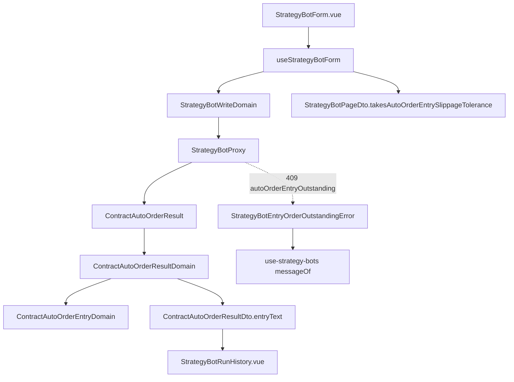

# 自動下單限價進場（網頁）— Architecture Design

**Status:** Confirmed
**Source PRD:** `.sdd/2026-10-12-auto-order-limit-entry/PRD.md`
**Tech context:** Nuxt 4 · Vue 3 `<script setup>` · Clean/Onion（`.vue` → Application → Domain ← Proxy）· decimal.js · Vitest

---

## 1. Design Goal & Guiding Principle

- **In one sentence:** 讓開倉容許滑價從交易服務一路讀進表單、寫回去（只有合約機器人），讓下單結果多說出進場單的收尾，並把「還有進場單掛著」這一種刪除拒絕認成具名錯誤。
- **Guiding principle:** 「哪一種機器人有這一格」只問 `StrategyBotPageDto`（行情種類那張表），「進場行怎麼說」只住在一個新的 Domain Model——下一種會下單的機器人（現貨）只要翻一個旗標，進場資訊多一段只改一個類別。

---

## 2. Change Scope

| Area | Action | What / Why |
| :--- | :--- | :--- |
| `StrategyBotProxy` | **Modify** | 讀 `autoOrderEntrySlippageTolerancePercentage`（缺讀作 0.1）；寫入時只有 write DTO 帶值才放這個鍵；讀下單結果的六個新欄位；409 `autoOrderEntryOutstanding` → `StrategyBotEntryOrderOutstandingError` |
| `StrategyBot` / `StrategyBotDto` / `StrategyBotDomain` | **Modify** | 多帶開倉容許滑價（Decimal），原樣交給表單 |
| `StrategyBotWriteDto` / `StrategyBotWriteDomain` | **Modify** | 多一格 `Decimal \| null`（null＝不送）；`rejection` 檢查 NaN 與 0～5 |
| `STRATEGY_BOT_LIMITS` | **Modify** | 補上下限與預設值，畫面與驗證共用一份 |
| `MarketDataKindDomain` / `StrategyBotPageDto` | **Modify** | `takesAutoOrderEntrySlippageTolerance` 旗標；合約 `runHistoryNote` 補滑價正負一句 |
| `useStrategyBotForm` / `StrategyBotForm.vue` | **Modify** | 新文字欄與一塊「自動下單開倉」；清空讀作 NaN 而非 0 |
| `ContractAutoOrderResult`（entity） | **Modify** | 六個新欄位（金額／數量皆 Decimal） |
| `ContractAutoOrderResultDomain` / `Dto` | **Modify** | 新狀態 `unfilled`、`pending`+`working` 說「等待成交」；DTO 多 `entryText` |
| `ContractAutoOrderEntryDomain` | **Add** | 進場行怎麼說 |
| `StrategyBotEntryOrderOutstandingError` | **Add** | 刪除被進場單擋下的哨兵錯誤（雙語訊息） |
| `StrategyBotRunHistory.vue` | **Modify** | 多畫一行 `entryText` |
| 設定頁 locale | **Modify** | 金鑰說明不再說「將來」 |
| `use-strategy-bots` / 清單元件 | **Not touched** | 既有 `messageOf(LocalizedError)` 已會顯示新錯誤的雙語訊息 |
| 自動下單開關、機器人持倉 | **Not touched** | 行為不變 |

---

## 3. New Classes / Modules

| Name | Kind | Responsibility (purpose) | Collaborators | Satisfies |
| :--- | :--- | :--- | :--- | :--- |
| `ContractAutoOrderEntryDomain` | Domain Model | 把一張進場單的狀態、參考價、限價、成交／要求、滑價串成一行雙語文字；什麼都沒有時回 `null`；認不得的狀態略過 | `ContractAutoOrderResult`, `LocalizedTextVo` | US-02 例 10–17 |
| `StrategyBotEntryOrderOutstandingError` | 哨兵錯誤 | 帶畫面要說的那一句（中英） | `LocalizedError` | US-03 例 18 |

---

## 4. Modified Components

| Component | Current role | Change needed |
| :--- | :--- | :--- |
| `StrategyBotProxy.toBody` | 組送出的 body | `writeDto.autoOrderEntrySlippageTolerancePercentage !== null` 時放字串值 |
| `StrategyBotProxy.strategyBotFailureOf` | 翻譯拒絕 | 409 且 `reason === 'autoOrderEntryOutstanding'` → 新錯誤（在一般 409 之前） |
| `StrategyBotWriteDomain.rejection` | 表單第一個擋住的理由 | 必填四格之後、部位規劃之前檢查開倉容許滑價 |
| `useStrategyBotForm` | 表單狀態 | `entrySlippageToleranceText`；`buildWriteDto` 只在 `page.takesAutoOrderEntrySlippageTolerance` 時帶值；`reset` 用現值或預設 0.1 |
| `ContractAutoOrderResultDomain.toDto` | 一句下單結果 | 狀態表加 `unfilled`；等待中且 `entryStatus === 'working'` 用「等待成交」；呼叫 `ContractAutoOrderEntryDomain` 填 `entryText` |

---

## 5. Component Relationships

---

## 6. Extensibility — the axis of change

- **最可能的下一個需求：** 現貨機器人也開始自動下單 → 現貨那一列 `takesAutoOrderEntrySlippageTolerance: true`，表單、送出、驗證全部自動跟上。
- **第二可能：** 進場行多一段（例如手續費、撤單時間）→ 只改 `ContractAutoOrderEntryDomain`。
- **範圍上限改變：** 只改 `STRATEGY_BOT_LIMITS`（驗證訊息由它組字）。

---

## 7. Traceability

| PRD scenario | Component(s) | Test |
| :--- | :--- | :--- |
| 例 1、2 | `useStrategyBotForm.reset`, `StrategyBotForm.vue` | `StrategyBotForm.spec.ts` |
| 例 3、4 | `StrategyBotWriteDomain`, `StrategyBotProxy.toBody` | write domain spec, proxy spec |
| 例 5、6、7 | `StrategyBotWriteDomain.rejection`, 表單清空→NaN | write domain spec, form spec |
| 例 8 | `StrategyBotPageDto` 旗標, `toBody` | form spec, proxy spec |
| 例 9 | 既有 workbench failureMessage | 既有行為，proxy 400 不變 |
| 例 10–17、註腳 | `ContractAutoOrderEntryDomain`, `ContractAutoOrderResultDomain`, proxy 讀欄位 | result domain spec, proxy spec |
| 例 18、19 | `StrategyBotProxy.strategyBotFailureOf`, 新錯誤 | proxy spec, `use-strategy-bots.spec.ts` |
| US-04 | settings locale | — （文案） |

---

## 8. Risks & Open Questions

- 交易服務的 400 訊息帶英文前綴（既有所有驗證訊息皆然），照原樣顯示，不在這一刀處理。
- 實作時 entity／DTO 的新建構參數放在尾端並給預設值，避免改動既有呼叫端。
