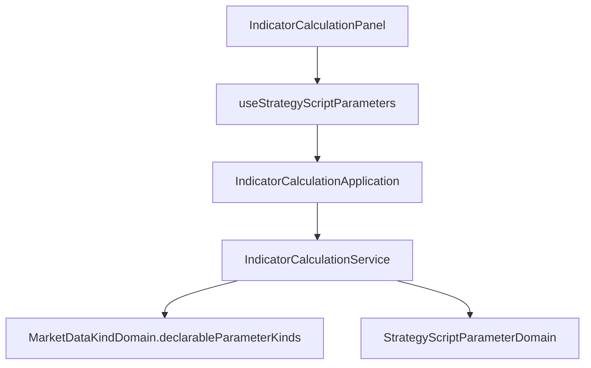

# 合約訂單流（足跡）畫面 — Architecture Design

**Status:** Confirmed（autonomous run）
**Source PRD:** `.sdd/2026-10-14-contract-order-flow-footprint/PRD.md`
**Tech context:** Nuxt 4 · Vue 3 · TypeScript · Clean/Onion（`app/{components,composables,application,domain,infrastructure}`）· Vitest

---

## 1. Design Goal & Guiding Principle

- **In one sentence:** 多一種參數種類 `orderFlowPriceStep`，由行情種類決定它出不出現在選單上；規則掛在既有的參數 Domain Model；說明與停擺原因各加一列。
- **Guiding principle — 「哪些種類可以宣告」屬於行情種類。** 把它放進 `MarketDataKindDomain` 的那張描述表（多一種行情 = 加一列，不是加一個 if），service 只負責貼上標籤。

---

## 2. Change Scope

| Area | Action | What / Why |
| :--- | :--- | :--- |
| `dto/strategy-script-parameter-dto.ts` | **Modify** | 種類聯合與 `STRATEGY_PARAMETER_KINDS` 加 `orderFlowPriceStep`——兩支 proxy 讀回來就靠這份清單，漏了會退回 `number`（US-02） |
| `domains/strategy-script-parameter-domain.ts` | **Modify** | 值必須大於零；輸入框可小數、步進 1；不算回看根數 |
| `domains/strategy-script-parameters-domain.ts` | **Modify** | 整份規則加「至多一個」，排在名稱重複之後 |
| `domains/market-data-kind-domain.ts` | **Modify** | 描述表多一欄 `parameterKinds`；新方法 `declarableParameterKinds()` |
| `service/indicator-calculation-service.ts` | **Modify** | `listStrategyScriptParameterKindOptions(marketDataKind)`：照行情種類的可宣告清單貼標籤 |
| `application/indicator-calculation-application.ts`、`composables/use-strategy-script-parameters.ts`、`IndicatorCalculationPanel.vue` | **Modify** | 把畫面的行情種類傳下去 |
| `vo/k-candle-field-vo.ts` | **Modify** | 合約欄位清單加 `Footprint`（`indicator.Footprint`），說明子欄位與 `indicator.PriceLevel` |
| `domains/market-data-kind-domain.ts`（合約那一列） | **Modify** | 型別說明句提到 Footprint；多一則說明：宣告了才有、怎麼取價位、上限、不落地 |
| `vo/strategy-bot-halt-reason-vo.ts` | **Modify** | 加 `orderFlowRefused` 與它的一句話 |
| 元件 | **Not touched** | 參數列與說明區都是資料驅動，不必改版面 |

---

## 3. New Classes / Modules

無新類別。

---

## 4. Modified Components

| Component | Change |
| :--- | :--- |
| `MarketDataKindDomain.declarableParameterKinds()` | 回傳那一種行情可以宣告的種類，K 線三種、合約四種 |
| `StrategyScriptParameterDomain.validationMessage()` | `orderFlowPriceStep` 不大於零 →「訂單流價位寬度必須大於零」 |
| `StrategyScriptParameterDomain.step()` | `orderFlowPriceStep` → 1 |
| `StrategyScriptParametersDomain.validationMessage()` | 第二個 `orderFlowPriceStep` →「訂單流價位寬度至多宣告一個」 |

---

## 5. Component Relationships

---

## 6. Extensibility & Handoff Notes

- **Most likely next requirement:** 現貨也有訂單流，或再多一種只屬於某種行情的參數。
- **Where it lands:** `MARKET_DATA_KIND_DESCRIPTIONS` 那一列的 `parameterKinds`；加進去就出現在選單上。
- **Do not hardcode:** 畫面不得比對 `'orderFlowPriceStep'` 或 `'contractKCandle'`。

---

## 7. Traceability

| PRD Scenario | Fulfilled by |
| :--- | :--- |
| US-01 種類選單（合約／K 線） | `MarketDataKindDomain.declarableParameterKinds` + service |
| US-01 驗證、輸入框、不多拿 K 線 | `StrategyScriptParameterDomain`、`StrategyScriptParametersDomain` |
| US-02 讀回來 | `STRATEGY_PARAMETER_KINDS`（兩支 proxy 共用） |
| US-03 說明 | `CONTRACT_K_CANDLE_FIELDS` + 合約那一列的說明 |
| US-04 停擺原因 | `STRATEGY_BOT_HALT_REASONS` + 標籤 |

---

## 8. Risks & Open Decisions

- 無。
