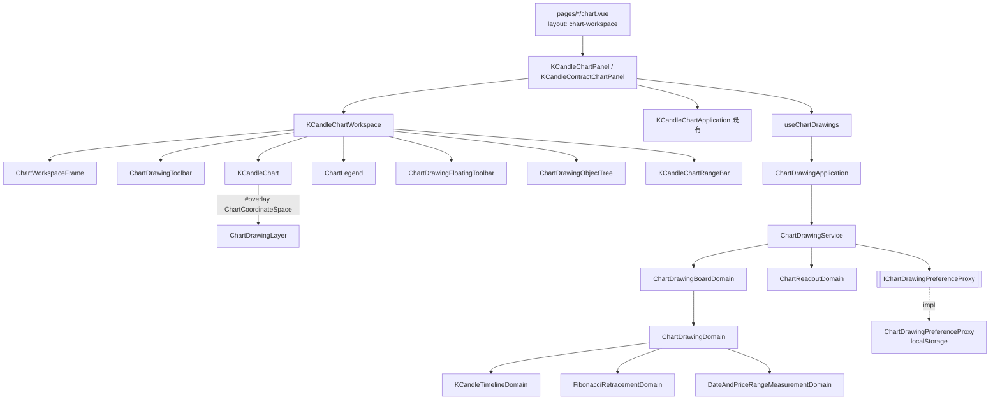

# 看盤工作區（照 TradingView Supercharts）— Architecture Design

**Status:** Confirmed
**Source PRD:** `.sdd/2026-10-16-supercharts-chart-workspace/PRD.md`
**Tech context:** Nuxt · Vue 3 `<script setup>` · Clean/Onion（`.vue` → Application → Domain ← Proxy）· lightweight-charts 5 · decimal.js · SCSS token · Vitest

---

## 1. Design Goal & Guiding Principle

- **In one sentence:** 把現貨與合約兩個行情圖表畫面換成一個共用的「看盤工作區」有機體（四條細邊＋整片圖），並加上一套可留存、可復原的繪圖——兩個面板原本的取資料、跟盤、指標、補齊邏輯一行都不改，只換它們的 template。
- **Guiding principle:**
  1. **一個工作區、兩個面板。** 版面、繪圖工具、浮動工具列、物件樹、跳到最新、快捷鍵全部住在 `KCandleChartWorkspace` 這一個有機體裡；現貨與合約面板只透過 slot 把「各自不同的那幾塊」（交易標的、圖例第二行、指標、補齊）塞進去。下一個要這個版面的圖（例如回測圖）只要寫一個面板。
  2. **繪圖的規則在 domain，畫在畫面。** 「落點對齊到哪一根」「磁鐵吸到哪個價」「斐波那契各條在哪」「量出來是多少」「上一步回到哪」全部是 Domain Model 的行為，經 `ChartDrawingApplication` 交出 DTO；`ChartDrawingLayer` 只把 DTO 換成像素、把指標事件換成「第幾根＋多少價」問回去。**新增一種繪圖＝在 `CHART_DRAWING_KINDS` 加一列＋在畫布畫法表加一個函式。**
  3. **繪圖紀錄是一份不可變的板子。** `ChartDrawingBoardDto` 帶著目前的繪圖與上一步／下一步的快照；Application 每個動作收一份板子、回一份新板子並留存——沒有任何一層要記「目前的狀態」，畫面狀態只有 composable 裡那一個 ref。

---

## 2. Change Scope

| Area | Action | What / Why |
| :--- | :--- | :--- |
| `app/layouts/chart-workspace.vue` | **Add** | 行情圖表畫面專用的版型：全視窗、沒有頁首與側欄；只負責主選單抽屜與助手抽屜的接線 |
| `app/layouts/console.vue` | **Modify** | 共用的那一圈接線（時區、語言、外觀、連線燈、帳號、現貨／合約開關）抽成 `useConsoleShell`，兩個版型共用 |
| `ConsoleLayout.vue` | **Modify** | 去處清單抽成 `useConsoleDestinations`，主選單用同一份 |
| `pages/k-candles/chart.vue`、`pages/contract-k-candles/chart.vue` | **Modify** | `layout: 'chart-workspace'`；多注入 `$chartDrawingApplication` |
| `KCandleChartPanel.vue`、`KCandleContractChartPanel.vue` | **Modify** | **script 不動規則**，只多：圖例要的十字線位置、跳到最新、價格軸設定、繪圖 composable；template 換成 `KCandleChartWorkspace` 加 slot |
| `KCandleChart.vue` | **Modify** | 四種畫法、價格軸刻度與自動縮放、十字線所在那一根與「看不看得到最新那一根」的事件、最新價收盤倒數、`#overlay` slot 交出 `ChartCoordinateSpace` |
| `KCandleChartToolbar.vue` | **Modify** | 變成上方細邊中段：彙總刻度五顆按鈕＋畫法選單（快捷區間搬到下方細邊） |
| `SymbolField.vue`、`ContractSymbolField.vue` | **Modify** | 多一個 `presentation: 'select' \| 'search'` variant；`search` 是按鈕＋商品搜尋對話框（同一個 UI 概念，不另開元件） |
| `ChartIndicatorPanel.vue` | **Not touched** | 原封放進「指標與策略腳本」對話框（`AppModal`） |
| `KCandleQuote.vue` | **Not touched** | 其他地方不用它就留著；行情圖表畫面改由圖例取代 |
| 取資料／跟盤／指標的 domain 與 application | **Not touched** | PRD 明定這些規則一條都不改 |
| 其他畫面 | **Not touched** | 仍用 `console` 版型 |
| 後端 | **Not touched** | 繪圖只記在瀏覽器 |

---

## 3. New Classes / Modules

### Domain

| Name | Kind | Responsibility (purpose) | Collaborators | Satisfies |
| :--- | :--- | :--- | :--- | :--- |
| `ChartDrawing` | Entity | 一個繪圖的本體：識別碼、種類、錨點、線色、線寬、線型、鎖定、顯示 | `ChartDrawingAnchorVo` | US-06、US-09 |
| `ChartDrawingAnchorVo` | VO | 繪圖的一個點：起始時間＋價格（Decimal） | — | US-09「換刻度不跑掉」 |
| `ChartDrawingKindVo` + `CHART_DRAWING_KINDS` | VO 清單 | 八種繪圖的目錄：值、幾個點、預設樣式、改不改得了樣式、所屬工具格、快捷鍵、名稱 | `LocalizedTextVo` | US-06、US-10 |
| `ChartDrawingDomain` | Domain Model | 一個繪圖的行為：移動整個（錨點時間平移 N 根、價格平移）、換錨點、循環線寬（1→4→1）、循環線型、換色、鎖定與顯示切換；拒絕改樣式於固定配色的種類；**把自己放到圖上**（算出錨點的序位、斐波那契各條、日期與價格範圍的測量） | `KCandleTimelineDomain`, `ChartDrawingKindVo` | US-06、US-07 |
| `ChartDrawingBoardDomain` | Domain Model | 一檔的繪圖板：新增、修改、刪除、移除所有、上一步、下一步（上限 100 步、新的一步清空下一步）；交出 `ChartDrawingBoardDto` | `ChartDrawingDomain` | US-07、US-08 |
| `KCandleTimelineDomain` | Domain Model | 「第幾根」與「起始時間」互換：資料內用那一根的起始時間；最新那一根之後以彙總刻度往後推；最早那一根之前往前推；介於兩根之間的時間（停盤）對到之後那一根；**磁鐵**：在某一根上時吸到開高低收裡最近的價格 | `KCandleChartDto` | US-06 磁鐵、US-09 |
| `DateAndPriceRangeMeasurementDomain` | Domain Model | 價差、百分比（兩位）、根數、經過多久（天／小時／分）、成交量合計、語氣（不小於零為上漲） | `KCandleDto[]` | US-06 範圍三例 |
| `FibonacciRetracementDomain` | Domain Model | 七條比例的價格：第二點＋（第一點－第二點）×比例 | — | US-06 斐波那契兩例 |
| `ChartReadoutDomain` | Domain Model | 圖例那一行：十字線那一根（不在 K 線上時最新那一根）的開高低收、相對前一根收盤的漲跌與百分比、語氣；最新那一根的收盤倒數（「mm:ss」或「hh:mm:ss」，已收完回 null） | `KCandleChartDto` | US-03、US-04 倒數 |
| `ChartDrawingBoardDto` | DTO | 交易標的、市場、目前的繪圖、上一步快照、下一步快照、`canUndo` / `canRedo` | `ChartDrawingDto` | US-08 |
| `ChartDrawingDto` | DTO | 一個繪圖的對外形狀＋`styleEditable` | — | 全部 |
| `PlacedChartDrawingDto` | DTO | 放到某一張圖上的繪圖：錨點的序位與價格（number，只供畫）、斐波那契各條、測量 | — | US-06 |
| `ChartDrawingAnchorDto` | DTO | 對齊之後的錨點：起始時間、價格、序位 | — | US-06 |
| `ChartDrawingCommandDto` | DTO | 對一個繪圖要做的事（`move`／`moveAnchor`／`cycleLineWidth`／`cycleLineStyle`／`changeColor`／`toggleLocked`／`toggleVisible`）＋參數 | — | US-07 |
| `ChartDrawingToolGroupDto` | DTO | 左邊細邊一格：游標／線／斐波那契／形狀／測量與裡面的工具 | — | US-06「同類收一格」 |
| `ChartReadoutDto` | DTO | 圖例與倒數要說的那幾個值 | — | US-03 |
| `IChartDrawingPreferenceProxy` | 介面 | 讀寫某一邊某一檔的繪圖；讀不出來回空、寫不進去不出聲 | — | US-09 |
| `ChartDrawingService` | Domain Service | 讀留存 → 建板子；每個動作做完寫回留存；把板子放到圖上 | proxy、上面各 Domain Model | US-06～09 |

### Application / Infrastructure / Composables

| Name | Kind | Responsibility | Collaborators | Satisfies |
| :--- | :--- | :--- | :--- | :--- |
| `ChartDrawingApplication` | Application | `loadBoard`、`addDrawing`、`changeDrawing`、`removeDrawing`、`removeAllDrawings`、`undo`、`redo`、`alignAnchor`、`placeDrawings`、`listToolGroups`、`toolForShortcut`、`describeReadout` | `ChartDrawingService` | 全部繪圖 |
| `ChartDrawingPreferenceProxy` | Proxy | 瀏覽器儲存；一個鍵一份「市場:交易標的 → 繪圖陣列」；wire 逐欄 `unknown` 驗過才收、壞掉的那一筆跳過 | `localStorage` | US-09 |
| `useChartDrawings` | Composable | 畫面狀態：板子、選取、目前工具、游標樣式、磁鐵、連續繪圖、鎖定所有、隱藏所有、每格記得的工具；動作只呼叫 Application | `ChartDrawingApplication` | US-06～10 |
| `useConsoleShell` | Composable | 兩個版型共用的那一圈接線 | 既有 composables | US-01 主選單 |
| `useConsoleDestinations` | Composable | 去處清單（側欄與主選單共用） | i18n | US-01 |
| `useChartWorkspaceMenu` | Composable | 主選單開關（`useState`），面板的按鈕與版型的抽屜共用 | — | US-01 |
| `ChartCoordinateSpace` | `app/utilities/` | lightweight-charts 的黏合：序位↔x、價格↔y、圖區寬高、目前看得到的序位範圍、訂閱「畫面動了」 | lightweight-charts | 繪圖畫在對的位置 |

### Components

| Name | Layer | Responsibility | Satisfies |
| :--- | :--- | :--- | :--- |
| `ChartWorkspaceFrame.vue` | template | 四條細邊＋圖＋可開的右欄的格線骨架（只有 slot） | US-01、US-11 |
| `KCandleChartWorkspace.vue` | organism | 看盤工作區本身：框架、上方細邊固定的那幾顆、左邊繪圖工具、圖與繪圖層、圖例、浮動提示區、浮動工具列、物件樹、下方細邊、跳到最新、快捷鍵；面板以 slot 補上不同的那幾塊 | US-01～US-11 |
| `ChartDrawingToolbar.vue` | molecule | 左邊細邊：工具格與展開清單、四個開關、移除所有 | US-06 |
| `ChartDrawingLayer.vue` | molecule | 疊在圖上的畫布：畫繪圖、把手、軸上的標籤與色帶、最新價收盤倒數；在捕獲階段接指標事件：畫、選、拖；點在空白處放行給圖拖動 | US-06、US-07 |
| `ChartDrawingFloatingToolbar.vue` | molecule | 選取時的浮動工具列（可拖） | US-07 |
| `ChartDrawingObjectTree.vue` | molecule | 物件樹清單 | US-07 |
| `ChartLegend.vue` | molecule | 圖例：第一行、`#extra` slot（合約三條價格）、已套用指標各一行 | US-03 |
| `KCandleChartRangeBar.vue` | molecule | 下方細邊：快捷區間、時鐘與時區位移、已取回區間註腳、%／對數／自動 | US-04 |
| `SymbolSearchDialog.vue` | molecule | 商品搜尋對話框（篩選、上下鍵、Enter），由兩個 SymbolField 的 `search` variant 使用 | US-02 |
| `ChartWorkspaceMenu.vue` | organism | 主選單抽屜：去處＋共用設定 slot | US-01 |
| `AppIcon` | atom | **Modify**：補繪圖工具與細邊要的圖示 | — |

---

## 4. Modified Components

| Component | Current role | Change needed |
| :--- | :--- | :--- |
| `KCandleChart.vue` | 畫 K 線、指標、回報拖動的區間 | `drawing` 擴成 `candlestick｜bar｜line｜area`；新 props `priceScaleMode`、`autoScale`；新 emits `crosshairMove(index｜null)`、`latestVisibilityChange(boolean)`、`autoScaleChange(boolean)`（使用者拖價格軸時）；`#overlay` scoped slot 交出 `ChartCoordinateSpace` 與 `viewRevision`；拖價格軸與雙擊恢復交給函式庫原生行為 |
| `KCandleChartToolbar.vue` | 快捷區間＋彙總刻度下拉＋兩種畫法 | 彙總刻度改五顆按鈕（`aggregation-interval-choice-button`）、畫法改一顆按鈕展開四種（`drawing-button`）；快捷區間移到 `KCandleChartRangeBar` |
| `KCandleChartPanel.vue` | 現貨圖表的狀態與接線 | template 換成工作區；新增 `hoveredIndex`、`latestVisible`、價格軸設定 refs、`jumpToLatest()`（以目前要求的長度、結束在現在重新 `showViewport`）、`useChartDrawings('spot', symbol)`；「看什麼」收起的那一套拿掉 |
| `KCandleContractChartPanel.vue` | 合約圖表的狀態與接線 | 同上（`'contract'`）；三條價格搬進圖例 `#extra`；「沒有指標」那一句搬進指標對話框 |
| `SymbolField.vue` / `ContractSymbolField.vue` | 下拉挑一檔 | `presentation` variant；取清單、`selected` 事件的規則不變 |
| `ConsoleLayout.vue` / `layouts/console.vue` | 操作台骨架與接線 | 抽出 `useConsoleDestinations` / `useConsoleShell`，行為不變 |
| `plugins/dependencies.ts` | 組裝根 | 組 `ChartDrawingPreferenceProxy → ChartDrawingService → ChartDrawingApplication` 並 provide |
| locales | 中英字串 | 新增 `marketData.chartWorkspace.*` 與 `marketData.chartDrawing.*` |
| `_tokens.scss` | token | 補 TradingView 配色：圖表面板、細縫、十字線標籤、繪圖預設色與調色盤 |

---

## 5. Component Relationships

---

## 6. Extensibility & Handoff Notes

- **Most likely next requirement:** 再加一種繪圖（文字標註、平行通道、多頭／空頭部位）；其次是繪圖跨裝置同步。
- **Where it lands:**
  - 新繪圖：`CHART_DRAWING_KINDS` 加一列（幾個點、預設樣式、所屬工具格、快捷鍵）＋`ChartDrawingDomain.place()` 若有衍生值（像斐波那契）加一個 Domain Model＋`ChartDrawingLayer` 的畫法表（`painters`）加一個函式、命中表（`hitTesters`）加一個函式。其他層不動。
  - 同步：換一個 `IChartDrawingPreferenceProxy` 的實作（打後端），介面不改名。
- **How to add it:** add-only——工具格清單由 `listToolGroups()` 從目錄產生，工具列不必改。
- **Patterns applied & why:** 目錄（VO 清單）＋表驅動的畫法／命中，對應「種類會一直加」這條變動軸；不可變板子＋快照，讓上一步不必知道每一種動作怎麼反做。
- **Do not hardcode:** 繪圖種類與快捷鍵（目錄）、步數上限、點一下的分界、預設色（token）。
- **Known debt / deferred:**
  - 右邊細邊只有物件樹，自選清單等到有多檔最新價的來源。
  - 板子快照存整份陣列，100 步×100 個繪圖仍很小；若繪圖數量級變大再改成差異紀錄。
  - **兩個面板的 `jumpToLatest` 各一份**（「以要求的長度、結束在現在」）。沒有收進 domain：兩個面板本來就各自持有整條取資料／跟盤的流程（既有的重複），只抽這一小段會讓規則一半在面板、一半在領域；等哪天把兩個面板的取資料流程合成一個 composable 時一起搬。
  - **`ChartDrawingLayer` 約 600 行**。沒有拆：畫法與命中已經是依種類分的兩張表（新增繪圖的那道縫），剩下的是指標事件與座標換算；拆成「幾何工具」模組會變成 rules 禁止的 utils 雜物模組，拆成子元件又沒有可以獨立存在的畫面。等到要加第一種需要文字輸入的繪圖（文字標註）時，那一種的編輯框應該是一個子元件。
  - 圖例每秒重算一次（為了收盤倒數）。量很小，不值得為它拆出一條只算倒數的路。

---

## 6a. Implementation Notes（與原設計的差異）

- **沒有 `ChartWorkspaceFrame` 樣板**：lint 規則不允許有機體 import 樣板，格線骨架直接寫在 `KCandleChartWorkspace` 的樣式裡。
- **圖例的值由 `KCandleChartApplication.describeReadout` 給**，而不是 `ChartDrawingApplication`：圖例說的是 K 線，不是繪圖。
- **主選單的開關不由工作區直接碰**：工作區發 `openMenu`，面板轉給頁面，頁面呼叫 `useChartWorkspaceMenu`。有機體因此不依賴 Nuxt 的共用狀態，在測試裡照樣掛得起來。
- **`/improve-codebase` 之後**：商品搜尋的按鈕與對話框合成 `SymbolSearch`；兩個面板共用的狀態說明抽成 `KCandleChartNotices`；`KCandleQuote`、`LayoutDensityDto.startsChartControlsCollapsed` 與六句不再用到的說法刪除。

## 7. Traceability

| PRD Scenario | Fulfilled by |
| :--- | :--- |
| US-01 全部 | `chart-workspace` 版型、`ChartWorkspaceFrame`、`KCandleChartWorkspace`、`ChartWorkspaceMenu`、`useConsoleDestinations`、`useConsoleShell` |
| US-02 商品搜尋三例、直接打字 | `SymbolField(search)`、`SymbolSearchDialog`、`KCandleChartWorkspace` 鍵盤 |
| US-02 現貨／合約、彙總刻度、畫法 | `MarketSwitch`（既有）、`KCandleChartToolbar`、`KCandleChart` |
| US-02 指標對話框兩例 | 兩個面板的 `#indicators` slot＋`AppModal`＋`ChartIndicatorPanel` |
| US-02 立刻補齊兩例 | 現貨面板 `#topBarEnd` slot（`canCatchUp` 既有規則） |
| US-03 全部 | `ChartReadoutDomain`、`ChartLegend`、`KCandleChart.crosshairMove` |
| US-04 最新價與倒數 | `ChartReadoutDomain.countdown`、`ChartDrawingLayer` 軸標籤 |
| US-04 快捷區間、%、對數、自動 | `KCandleChartRangeBar`、`KCandleChart` props |
| US-04 跳到最新三例 | `KCandleChart.latestVisibilityChange`、面板 `jumpToLatest`（經既有顯示區間規則） |
| US-05 全部 | `KCandleChartWorkspace` 浮動提示區（既有 `AppAlert`）＋空狀態 slot |
| US-06 兩種畫法、拖得太短、Esc、一點工具、連續繪圖、同類一格 | `ChartDrawingLayer`、`useChartDrawings`、`ChartDrawingToolbar`、`CHART_DRAWING_KINDS` |
| US-06 磁鐵三例 | `KCandleTimelineDomain.alignAnchor` |
| US-06 範圍三例 | `DateAndPriceRangeMeasurementDomain` |
| US-06 斐波那契兩例 | `FibonacciRetracementDomain` |
| US-06 手機手指 | `ChartDrawingLayer`（pointer 事件涵蓋觸控） |
| US-07 選取、取消、色帶、浮動工具列 | `ChartDrawingLayer`、`ChartDrawingFloatingToolbar`、`useChartDrawings` |
| US-07 中點把手、整個移動、改樣式 | `ChartDrawingDomain`（`moveAnchor`／`move`／循環） |
| US-07 鎖定、鎖定所有、隱藏所有 | `ChartDrawingDomain`、`useChartDrawings` |
| US-07 刪除、物件樹兩例 | `ChartDrawingBoardDomain.remove`、`ChartDrawingObjectTree` |
| US-08 全部 | `ChartDrawingBoardDomain`（快照、上限、清空下一步）、`useChartDrawings`（換檔重新 `loadBoard`） |
| US-09 全部 | `ChartDrawingAnchorVo`（時間錨）、`KCandleTimelineDomain`、`ChartDrawingPreferenceProxy`（市場:標的為鍵、讀寫失敗不出聲） |
| US-10 全部 | `ChartDrawingKindVo.shortcut`、`KCandleChartWorkspace` 鍵盤（輸入框／對話框開著時不作用） |
| US-11 全部 | `ChartWorkspaceFrame` 斷點樣式、`KCandleChartWorkspace` 鉛筆按鈕 |

---

## 8. Risks & Open Decisions

- **Risks / trade-offs:**
  - 繪圖層在**捕獲階段**攔指標事件：點中繪圖或正在畫時 `stopPropagation` 並暫停圖的拖動／縮放，放手後恢復；其他情況放行。這是與函式庫拖動分清楚的唯一一處。
  - 既有面板測試（約 5600 行）以 data-testid 驅動；保留所有 testid，交互方式改變的（挑標的、刻度、畫法、指標面板在對話框裡、看什麼的收合）改寫測試的操作步驟，不改它們驗的規則。
  - 價格軸百分比與對數交給 lightweight-charts 原生的刻度模式；百分比的基準是畫面最左邊那一根（函式庫的定義），與 PRD 一致。
- **Open decisions (for implementation):**
  - 浮動工具列的初始位置是圖上緣中間；拖過之後在同一次看盤中記住位置，不留存。
  - 主選單在手機上照樣是抽屜；版型的底部導覽在行情圖表畫面不出現。
