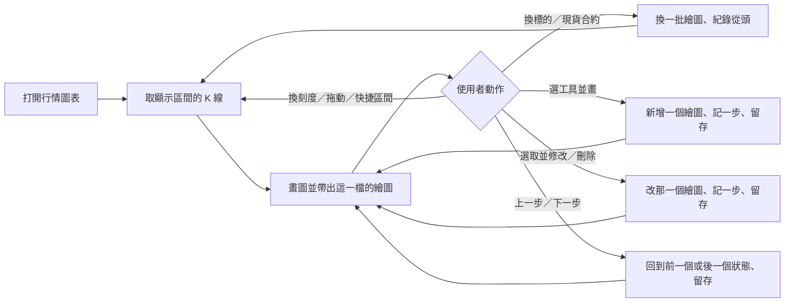

# Product Requirements Document (PRD)

**Status:** Finalized
**Version:** v1.0
**Owner:** James Hsueh
**Stakeholders:** 使用者本人（看盤、研究策略腳本）

---

## 1. Background & Goal (Why & Goal)

- **Problem Statement:** 行情圖表畫面（現貨與合約）把一半以上的面積給了圖以外的東西：
  操作台的頁首與側欄、行情摘要大數字、圖的標題列、圖上方的工具列、右邊一整欄「看什麼」。
  真正要看的那張圖被擠在中間一塊框裡。而 TradingView 看盤畫面最常被用到的那件事——
  **在圖上畫線、框住一段行情、量一段漲跌**——這裡完全沒有。
- **Expected Outcome:**
  1. 行情圖表畫面照 TradingView Supercharts 的版面：圖以外只剩上、左、下、右四條細邊，
     寬螢幕上圖的面積從現在約一半變成扣掉四條細邊之後的全部。
  2. 使用者能在圖上畫八種繪圖（趨勢線、射線、水平線、水平射線、垂直線、斐波那契回撤、矩形、
     日期與價格範圍），選取、修改、鎖定、隱藏、刪除、上一步／下一步，
     且繪圖跟著「現貨或合約的那一檔」留存在這個瀏覽器裡。
  3. 現有的每一條圖表規則（取哪一段、要不要重新取、右側留白、即時更新與它的說明、
     指標的重算與留存、顯示時區、外觀）**一條都不改**。
- **Out of Scope:**
  - 文字標註、多頭／空頭部位、平行通道、江恩、形態、圖示等其他繪圖工具。
  - 自選清單（多檔即時價與漲跌）。
  - 繪圖跨裝置、跨瀏覽器同步。
  - 多圖版面、警示、行情重播、截圖分享。
  - 新增彙總刻度種類、快捷區間、指標種類。
  - 其他畫面的版面。

---

## 2. User Personas

- **Primary Role(s):** 看盤的人——專案作者本人，同時是策略腳本研究者。單人使用。
- **Usage Context:** 主要在桌機寬螢幕上長時間看盤、畫線找支撐壓力、對照指標；
  偶爾在手機（直立寬 390）上快速看一眼、畫一條線。亮色與暗色外觀都會用。

---

## 3. User Stories & Acceptance Criteria

### US-01 — 圖佔滿畫面 [priority: P0]
**As a** 看盤的人, **I want** 行情圖表畫面只留四條細邊、其餘全給圖, **so that** 我看得到更多根 K 線、看得更清楚。

```gherkin
Scenario: 寬螢幕上的行情圖表只剩四條細邊與圖
  Given 寬螢幕
  When 打開現貨行情圖表
  Then 畫面上只有上、左、下、右四條細邊與中間的圖
  And 看不到操作台的頁首標題、側欄、行情摘要大數字與右邊的「看什麼」欄

Scenario: 合約行情圖表也是同一個版面
  Given 寬螢幕
  When 打開合約行情圖表
  Then 畫面上只有上、左、下、右四條細邊與中間的圖

Scenario: 從主選單去其他畫面
  Given 在行情圖表畫面
  When 按主選單、點「策略腳本」
  Then 主選單收起
  And 換到策略腳本畫面

Scenario: 其他畫面的版面不變
  Given 在策略腳本畫面
  When 看版面
  Then 操作台的頁首與側欄照樣在

Scenario: 點主選單外面就收起
  Given 主選單打開著
  When 點主選單外面
  Then 主選單收起
  And 畫面沒有換

Scenario: 主選單裡找得到共用設定
  Given 在行情圖表畫面
  When 打開主選單
  Then 看得到每一個去處、顯示語言、顯示時區、外觀、助手、後端連線狀態與帳號
```

### US-02 — 上方細邊：換標的、刻度、畫法、指標 [priority: P0]
**As a** 看盤的人, **I want** 在上方一條細邊換交易標的、彙總刻度、畫法與指標, **so that** 我不必離開圖就能換看的東西。

```gherkin
Scenario: 按交易標的打開商品搜尋並選一檔
  Given 現貨行情圖表看的是 BTCUSDT
  When 按上方的交易標的、在搜尋框打「ETH」、按 Enter
  Then 商品搜尋收起
  And 圖換成 ETHUSDT，看的那一段不變

Scenario: 在圖上直接打字打開商品搜尋
  Given 圖上沒有對話框開著
  When 按 E
  Then 打開商品搜尋，搜尋框裡是「E」

Scenario: 商品搜尋找不到
  Given 商品搜尋開著
  When 打「ZZZ」
  Then 清單位置寫「找不到這個代號」

Scenario: 現貨／合約切換
  Given 在現貨行情圖表
  When 按上方的「合約」
  Then 換到合約行情圖表

Scenario: 彙總刻度直接挑
  Given 彙總刻度是「自動」
  When 按上方的「15 分鐘」
  Then 圖換成每根 15 分鐘，「15 分鐘」亮起來，看的那一段不變

Scenario: 換畫法
  Given 畫法是蠟燭
  When 按畫法按鈕、選「面積」
  Then 圖改畫成面積，K 線一根都沒有重新取

Scenario: 現貨打開指標對話框
  Given 現貨行情圖表
  When 按上方的「指標」
  Then 打開「指標與策略腳本」對話框，列出畫得出來的策略腳本與已套用的指標

Scenario: 合約打開指標對話框
  Given 合約行情圖表
  When 按上方的「指標」
  Then 對話框寫「合約圖表目前沒有指標可套用」

Scenario: 會收盤的市場才有立刻補齊
  Given 現貨行情圖表看的是一檔會收盤的股票
  When 看上方細邊
  Then 有「立刻補齊」按鈕

Scenario: 不會收盤的市場沒有立刻補齊
  Given 現貨行情圖表看的是 BTCUSDT
  When 看上方細邊
  Then 沒有「立刻補齊」按鈕
```

### US-03 — 圖例說明這張圖 [priority: P0]
**As a** 看盤的人, **I want** 圖的左上角寫出這是哪一檔、多粗、十字線那一根的開高低收, **so that** 我不用另外看一塊行情摘要。

```gherkin
Scenario: 十字線停在一根跌的 K 線上
  Given 十字線停在某一根跌的 K 線上
  When 看圖例
  Then 開高低收是那一根的，用跌的顏色
  And 漲跌是它相對前一根收盤的差

Scenario: 十字線移出圖
  Given 十字線不在圖上
  When 看圖例
  Then 說的是最新那一根

Scenario: 十字線停在右側留白
  Given 十字線停在最新那一根右邊的空白
  When 看圖例
  Then 說的是最新那一根

Scenario: 合約圖例的第二行
  Given 合約行情圖表、最新一筆記錄有標記價格、沒有溢價指數
  When 看圖例第二行
  Then 標記價格寫數字、溢價指數寫「—」
  And 旁邊寫這三條是幾點的記錄

Scenario: 在圖例上收起一個指標
  Given 現貨圖上套用了一個指標
  When 在圖例上那一行按「在圖上收起來」
  Then 那一條線從圖上消失，圖例那一行變淡，仍留在已套用清單上
```

### US-04 — 價格軸、時間軸與下方細邊 [priority: P0]
**As a** 看盤的人, **I want** 價格軸寫著最新價與收盤倒數、下方細邊有快捷區間與價格軸設定, **so that** 我一眼看到現在多少錢、也能快速換看的長度。

```gherkin
Scenario: 價格軸上的最新價
  Given 最新那一根是漲的
  When 看價格軸
  Then 最新價寫在漲的顏色的標籤上
  And 標籤下面是這一根還有多久收完的倒數

Scenario: 按快捷區間
  Given 沒有任何快捷區間亮著
  When 按下方細邊的某個快捷區間
  Then 圖換成那一段，那個按鈕亮起來

Scenario: 自己拖動之後快捷區間不亮
  Given 某個快捷區間亮著
  When 使用者自己拖動圖
  Then 沒有任何一個快捷區間亮著

Scenario: 對數刻度
  Given 價格軸是一般刻度
  When 按下方細邊的「對數」
  Then 價格軸改成對數刻度，「對數」亮起來

Scenario: 百分比刻度
  Given 價格軸是一般刻度
  When 按下方細邊的「%」
  Then 價格軸改寫成相對畫面最左邊那一根的百分比

Scenario: 雙擊價格軸恢復自動縮放
  Given 使用者拖曳價格軸放大過，「自動」沒亮
  When 雙擊價格軸
  Then 價格軸回到自動縮放，「自動」亮起來

Scenario: 看得到最新那一根時沒有跳到最新
  Given 看得到最新那一根
  When 看圖的右下角
  Then 沒有「跳到最新」按鈕

Scenario: 往回拖之後出現跳到最新
  Given 往回拖到最新那一根離開畫面
  When 看圖的右下角
  Then 出現「跳到最新」按鈕

Scenario: 按跳到最新
  Given 「跳到最新」按鈕出現著
  When 按下去
  Then 回到看得到最新那一根的位置，右側照樣留白
```

### US-05 — 圖的狀態說明浮在圖上 [priority: P0]
**As a** 看盤的人, **I want** 連不上、被拒絕、載入中、即時更新停了這些說明浮在圖上而不推動圖, **so that** 說明出現與消失時我看的位置不會跳。

```gherkin
Scenario: 即時更新停了
  Given 圖已經畫著
  When 即時更新停了
  Then 圖的上緣中間浮出「即時更新停了」那一句說明
  And 圖的大小與位置不變

Scenario: 一次都還沒取到就連不上後端
  Given 後端連不上、一次都還沒取到圖
  When 打開畫面
  Then 圖的位置寫「這裡本來會有一張圖」的說明
  And 浮動說明寫連不上的原因並給「重試」

Scenario: 這一段查無 K 線
  Given 這一段時間沒有任何 K 線
  When 取回來
  Then 圖的位置寫「查無 K 線」
```

### US-06 — 在圖上畫東西 [priority: P0]
**As a** 看盤的人, **I want** 從左邊的繪圖工具挑一個在圖上畫, **so that** 我能標出趨勢、支撐壓力、盤整區與一段行情的幅度。

```gherkin
Scenario: 按住拖曳畫一條趨勢線
  Given 選了趨勢線
  When 在 A 按下、拖到 B 放開
  Then 圖上出現 A 到 B 的一條線
  And 它被選取
  And 工具回到游標

Scenario: 點兩下畫一條趨勢線
  Given 選了趨勢線
  When 在 A 點一下、移到 B 再點一下
  Then 圖上出現 A 到 B 的一條線

Scenario: 拖得太短視為點一下
  Given 選了趨勢線
  When 在 A 按下、只拖動一點點就放開
  Then 圖上還沒有完成的線，等著第二下

Scenario: 畫到一半按 Esc
  Given 選了趨勢線、已點下第一點
  When 按 Esc
  Then 圖上什麼都沒留下
  And 工具回到游標

Scenario: 點一下畫好水平線
  Given 選了水平線
  When 在 60000 點一下
  Then 圖上出現 60000 的水平線
  And 價格軸上常駐 60000 的標籤

Scenario: 連續繪圖
  Given 開著連續繪圖、選了矩形
  When 畫好一個矩形
  Then 工具仍是矩形

Scenario: 同類工具收在一格、記得上次用的
  Given 「線」那一格現在是趨勢線
  When 展開那一格、選垂直線
  Then 那一格換成垂直線並被選用

Scenario: 磁鐵模式吸到最近的價格
  Given 開著磁鐵模式，某根 K 線最高價 105、收盤價 103
  When 在那一根上靠近 104.8 的位置落點
  Then 落點是 105

Scenario: 磁鐵模式在空白處不吸
  Given 開著磁鐵模式
  When 在最新那一根右邊的空白落點
  Then 落點就是指到的價格

Scenario: 沒開磁鐵模式
  Given 沒開磁鐵模式
  When 在 104.8 落點
  Then 落點是 104.8

Scenario: 日期與價格範圍往上量
  Given 選了日期與價格範圍
  When 從 100 量到 110，跨 24 根一小時 K 線
  Then 框是藍色
  And 框外寫「10（10.00%）」、「24 根，1 天」與那 24 根的成交量合計

Scenario: 日期與價格範圍往下量
  Given 選了日期與價格範圍
  When 從 110 量到 99
  Then 框是紅色
  And 框外寫負的價差與負的百分比

Scenario: 日期與價格範圍兩點同一根
  Given 選了日期與價格範圍
  When 兩點落在同一根上
  Then 框外寫 0 根、經過 0 分

Scenario: 斐波那契回撤的各條
  Given 選了斐波那契回撤
  When 從 100 拉到 200
  Then 0 在 200、1 在 100、0.5 在 150、0.618 在 138.2
  And 左側各寫「比例（價格）」

Scenario: 斐波那契回撤兩點同價
  Given 選了斐波那契回撤
  When 第一點與第二點同一個價格
  Then 七條疊在同一個價格上，圖照常畫

Scenario: 手機上用手指畫
  Given 手機寬 390、叫出繪圖工具、選了趨勢線
  When 手指在 A 按下、拖到 B 放開
  Then 圖上出現 A 到 B 的一條線
```

### US-07 — 選取、修改、鎖定、隱藏、刪除 [priority: P0]
**As a** 看盤的人, **I want** 選取畫好的繪圖來移動、改形狀、改樣式或刪除, **so that** 行情走了之後我能調整我畫的線。

```gherkin
Scenario: 點一條線選取它
  Given 游標狀態、圖上有一條趨勢線
  When 點那條線
  Then 那條線的兩端出現把手
  And 價格軸與時間軸上出現它涵蓋範圍的色帶
  And 圖的上緣出現浮動工具列

Scenario: 點空白處取消選取
  Given 有一條線被選取
  When 點空白處
  Then 沒有任何繪圖被選取，浮動工具列消失

Scenario: 拖矩形右邊的中點
  Given 選取一個矩形
  When 拖它右邊的中點把手往右
  Then 只有右邊那條邊往右移

Scenario: 整個移動
  Given 選取一條趨勢線
  When 拖那條線本身往上
  Then 兩端一起往上移同樣的距離

Scenario: 改線色、線寬、線型
  Given 選取一條趨勢線
  When 在浮動工具列選紅色、按線寬一次、按線型一次
  Then 那條線變紅、變粗一級、變成虛線

Scenario: 鎖定的繪圖改不動
  Given 一條趨勢線鎖定了
  When 拖它
  Then 它不動
  And 圖也沒有被拖動

Scenario: 鎖定所有繪圖
  Given 開著鎖定所有繪圖
  When 拖任何繪圖的把手
  Then 繪圖不動

Scenario: 隱藏所有繪圖
  Given 開著隱藏所有繪圖
  When 點原本有線的地方
  Then 什麼都沒選到
  And 關掉隱藏之後線回來、內容不變

Scenario: 刪除選取中的繪圖
  Given 選取一條趨勢線
  When 按 Delete
  Then 那條線消失

Scenario: 物件樹列出所有繪圖
  Given 圖上有一條趨勢線與一個矩形，矩形是後畫的
  When 打開右邊細邊的物件樹
  Then 列出矩形在上、趨勢線在下，每一列可選取、顯示或隱藏、刪除

Scenario: 物件樹沒有繪圖
  Given 圖上沒有繪圖
  When 打開物件樹
  Then 寫「圖上還沒有繪圖」並說明怎麼畫第一個
```

### US-08 — 上一步與下一步 [priority: P1]
**As a** 看盤的人, **I want** 畫錯或刪錯時能上一步、反悔時能下一步, **so that** 我敢放心地畫、放心地刪。

```gherkin
Scenario: 上一步復原剛畫的
  Given 剛畫了一條線
  When 按上一步
  Then 那條線消失

Scenario: 下一步重做
  Given 剛按了上一步
  When 按下一步
  Then 那條線回來

Scenario: 上一步之後又修改就不能下一步
  Given 上一步之後又畫了一個矩形
  When 看下一步
  Then 下一步按不了

Scenario: 移除所有繪圖可以復原
  Given 圖上有五個繪圖
  When 按「移除所有繪圖」
  Then 五個都消失，並提示「已移除 5 個繪圖，可按上一步復原」
  And 按上一步之後五個都回來

Scenario: 沒有繪圖時移除所有繪圖
  Given 圖上沒有繪圖
  When 按「移除所有繪圖」
  Then 提示「圖上沒有繪圖」
  And 上一步的紀錄沒有多一步

Scenario: 換一檔之後紀錄從頭開始
  Given 有上一步可按
  When 換到另一檔
  Then 上一步按不了
```

### US-09 — 繪圖跟著那一檔留存 [priority: P0]
**As a** 看盤的人, **I want** 我畫的東西屬於那一檔、換刻度不跑掉、下次打開還在, **so that** 我不必每次重畫。

```gherkin
Scenario: 換刻度繪圖不跑掉
  Given 在現貨 BTCUSDT 每根一小時的圖上畫了一條 60000 的水平線
  When 換成每根五分鐘
  Then 那條線還在 60000

Scenario: 換到別檔看不到
  Given 在現貨 BTCUSDT 畫了一條水平線
  When 換到 ETHUSDT
  Then 看不到那條線

Scenario: 換回來還在
  Given 在現貨 BTCUSDT 畫了一條水平線，換到過 ETHUSDT
  When 換回 BTCUSDT
  Then 那條線還在

Scenario: 現貨與合約的繪圖分開
  Given 在現貨 BTCUSDT 畫了一條水平線
  When 切到合約 BTCUSDT
  Then 看不到那條線

Scenario: 關掉瀏覽器再打開還在
  Given 在現貨 BTCUSDT 畫了一條水平線
  When 關掉瀏覽器再打開這一頁
  Then 那條線還在

Scenario: 瀏覽器不允許記東西
  Given 這個瀏覽器擋掉了記錄
  When 畫一條線
  Then 照樣畫得出來，這一次都在

Scenario: 端點落在已取回區間之前
  Given 一條趨勢線的第一點畫在比目前已取回區間更早的時間
  When 看圖
  Then 線的第一點仍在那個時間上，不會被收到最早那一根
```

### US-10 — 快捷鍵 [priority: P1]
**As a** 看盤的人, **I want** 用和 TradingView 一樣的快捷鍵換工具與操作, **so that** 手不必離開鍵盤。

```gherkin
Scenario: ⌥H 換成水平線
  Given 圖上沒有對話框開著
  When 按 ⌥H
  Then 工具換成水平線

Scenario: 快捷鍵不搶輸入框
  Given 商品搜尋開著、正在打字、圖上有一個繪圖被選取
  When 按 Delete
  Then 刪的是搜尋框裡的字
  And 那個繪圖還在

Scenario: ⌘Z 上一步
  Given 剛畫了一條線、圖上沒有對話框開著
  When 按 ⌘Z
  Then 那條線消失
```

### US-11 — 手機上的看盤工作區 [priority: P1]
**As a** 在手機上看盤的人, **I want** 在寬 390 上照樣看圖、換標的、畫線, **so that** 我在外面也能快速看一眼。

```gherkin
Scenario: 手機上的上方細邊
  Given 手機寬 390
  When 打開行情圖表
  Then 上方細邊只有主選單、交易標的、目前的彙總刻度、畫法、指標
  And 左邊與右邊的細邊收起來，圖左下角有鉛筆按鈕

Scenario: 手機上叫出繪圖工具
  Given 手機寬 390
  When 按圖左下角的鉛筆按鈕
  Then 繪圖工具展開
  And 選了一個繪圖工具之後繪圖工具收起
```

---

### US-12 — 成交量疊圖 [priority: P1]
**As a** 看盤的人, **I want** 圖的底部疊著每一根的成交量、圖例寫出十字線那一根的量, **so that** 我看價格的時候同時看得到量能（TradingView 預設就有的那一條）。

> 這一條是驗收完前十一條之後，使用者追加的需求。

```gherkin
Scenario: 一進來就看得到成交量
  Given 圖上有 K 線
  When 打開行情圖表
  Then 圖的底部約五分之一高疊著每一根的成交量柱
  And 漲的那一根用淡的漲色、跌的那一根用淡的跌色
  And 圖例多一行「Vol」

Scenario: 圖例寫十字線那一根的量
  Given 十字線停在某一根成交量 1234.5 的 K 線上
  When 看圖例的 Vol 那一行
  Then 寫「1.23K」

Scenario: 量的寫法
  Given 某一根的成交量分別是 999.456、1500、2500000、3200000000
  When 看圖例的 Vol 那一行
  Then 分別寫「999.46」「1.50K」「2.50M」「3.20B」

Scenario: 十字線不在圖上時說最新那一根的量
  Given 十字線不在圖上
  When 看圖例的 Vol 那一行
  Then 寫的是最新那一根的量

Scenario: 在圖例上把成交量收起來
  Given 成交量看得到
  When 在圖例 Vol 那一行按「在圖上收起來」
  Then 成交量柱從圖上消失、Vol 那一行變淡
  And 再按一次「在圖上顯示」就回來

Scenario: 換彙總刻度時量跟著換
  Given 每根一小時
  When 換成每根五分鐘
  Then 成交量柱也是每根五分鐘那一根的量
```

---

## 4. Business Flow & Logic

- **Flow:**



- **Core Business Rules:**
  - **繪圖的歸屬**：一個繪圖屬於「現貨或合約 + 交易標的」。不屬於某個彙總刻度、某個快捷區間。
  - **繪圖的錨點**：每個點是「某一根 K 線的起始時間 + 一個價格」。時間一律對齊到目前彙總刻度的某一根上；
    落在最新那一根右邊時，對齊到「之後會出現的那一根」的起始時間。換刻度時點的時間不變，畫的位置跟著那個時間走。
  - **磁鐵模式**：落點落在某一根 K 線上時，價格換成那一根開高低收之中與指到的價格最接近的一個；
    不在任何一根上（右側留白）時不吸。
  - **一點的工具**：水平線、水平射線、垂直線。**兩點的工具**：趨勢線、射線、斐波那契回撤、矩形、日期與價格範圍。
  - **拖動與點一下的分界**：按下到放開移動不到 5 個像素算「點一下」。
  - **斐波那契回撤的比例**：0、0.236、0.382、0.5、0.618、0.786、1；某一條的價格＝第二點價格＋（第一點價格－第二點價格）×比例。
  - **日期與價格範圍的說明**：價差＝第二點價格－第一點價格；百分比＝價差÷第一點價格（取到小數兩位）；
    根數＝兩點相隔幾根；經過多久＝兩點起始時間之差，以「天、小時、分」說；成交量＝兩點之間（含兩端）已取回那幾根的成交量合計。
    價差不小於零是藍色，小於零是紅色。
  - **繪圖的預設樣式**：趨勢線與射線藍色、線寬 2；水平線、水平射線、垂直線藍色、線寬 1；矩形紫色、線寬 1、半透明填色；
    斐波那契回撤與日期與價格範圍用固定配色，不提供改色。線寬在 1 到 4 之間循環，線型在實線、虛線、點線之間循環。
  - **上一步／下一步**：新增、移動、改形狀、改線色、改線寬、改線型、鎖定或解鎖、顯示或隱藏、刪除、移除所有繪圖，每一個都是一步；
    只是選取、只是切換工具、只是切換「鎖定所有」或「隱藏所有」不算一步。最多記 100 步。
    做了新的一步之後，下一步的紀錄清空。換交易標的或換現貨／合約時，兩邊的紀錄都清空。
  - **「鎖定所有」與「隱藏所有」**：是畫面上的開關，不改任何一個繪圖本身；換頁後回到關閉。
  - **彙總刻度按鈕**：五個選擇（自動、一分鐘、五分鐘、十五分鐘、一小時）全部直接排在上方細邊；沒有「更多」選單。
  - **快捷區間的亮**：按下的那一個亮，直到使用者自己拖動或縮放圖。
  - **成交量的寫法**：未滿一千照原數寫到小數兩位；滿一千、一百萬、十億分別以 K、M、B 為單位寫到小數兩位。
  - **成交量疊圖的開關**：一進畫面是開的；收起來只在這一次看盤中有效，不留存、不算繪圖的一步。現貨與合約都有。
- **Edge Cases:**
  - 畫到一半就換標的、換刻度、按 Esc：半成品丟掉，不留存、不記一步。
  - 瀏覽器不允許記東西或記錄壞掉：讀不出來就當這一檔沒有繪圖，畫的東西照樣在這一次可用，不出聲。
  - 後端連不上、被拒絕、伺服器出錯：說明與重試照現有規則，改以浮動提示呈現；繪圖照樣讀得出來，但圖還沒畫出來時不顯示。
  - 繪圖的點落在已取回區間之外：照樣畫在那個時間上；完全在畫面外就看不到，往那邊拖就看得到。
  - 兩則浮動提示同時存在（即時更新的說明與錯誤／載入中）：由上往下排，即時更新的那一則在上。

---

## 5. UI/UX Design & Interaction

- **Prototype Link:** 已確認的設計稿（TradingView 風格的可操作 K 線圖頁，暗色與亮色）。
- **Key Interactions:**
  - **版面**：上方細邊約 38 高、左邊細邊約 52 寬、右邊細邊約 45 寬、下方細邊約 30 高，細邊之間以細縫隔開；其餘全部是圖。
  - **上方細邊（由左到右）**：主選單、交易標的（附搜尋圖示）、現貨／合約切換、彙總刻度五個按鈕、畫法、指標、
    上一步、下一步；靠右是立刻補齊（只有會收盤的市場）與補齊結果那一句、全螢幕。
  - **主選單**：從左邊滑出，列出每一個去處，下面是顯示語言、顯示時區、外觀、助手、後端連線狀態與帳號。
  - **左邊細邊**：游標、線、斐波那契、形狀、測量五格，分隔線之後是磁鐵、連續繪圖、鎖定所有、隱藏所有、移除所有。
    滑過有多個工具的那一格時右側出現小箭頭，按小箭頭在右側展開該類工具清單（名稱與快捷鍵）。
  - **圖例**：左上角，第一行字略大；滑過指標那一行時出現「在圖上收起來／顯示」與「移除」。
  - **浮動工具列**：選取時出現在圖的上緣中間；左端的把手可以拖到別處。
  - **物件樹**：右邊細邊的按鈕打開，在圖與右邊細邊之間佔一欄約 300 寬，再按一次或按關閉收起。
  - **浮動提示**：圖的上緣中間，窄的一條；有重試的那一則附「重試」按鈕。
  - **空的狀態**：一次都還沒取到、查無 K 線時，圖的位置置中寫一句說明。
  - **載入中**：浮動提示寫「行情載入中」，圖照常顯示手上那一批。
  - **外觀**：亮色與暗色都照 TradingView 的配色；圖、細邊、提示、對話框跟著外觀換，繪圖自己的顏色不跟著換。

---

## 6. Non-Functional Requirements

- **Performance:** 拖動、縮放、畫線時跟手，不因繪圖數量（同一檔 100 個以內）而卡頓。
- **Security:** 無新增；繪圖只記在這個瀏覽器。
- **Compatibility:** 最新版 Chrome、Safari、Firefox；最窄寬 390；觸控可畫。亮色與暗色。
- **Analytics / Tracking:** N/A。

---

## 7. Dependencies & Risks

- **External Dependencies:** 無新增；行情、即時更新、策略腳本、指標的來源都與現在相同。
- **Known Risks:**
  - 圖表本身支援拖動與縮放，繪圖的拖動要與它分得清楚——點在繪圖上時拖的是繪圖，否則拖的是圖。
  - 現有的狀態說明、補齊、指標面板等互動要全部搬到新版面而不改規則，搬漏一個就是現有功能消失。

---

## 8. Appendix

- 相關切片：`k-candle-chart-view`、`chart-right-margin`、`chart-candle-coarseness-picker`、`chart-indicator-overlay`、
  `remembered-chart-indicators`、`live-chart-updates`、`contract-chart-live-follow`、`collapsible-console-chrome`、`responsive-console-layout`。
- Brief：同資料夾 `BRIEF.md`。
