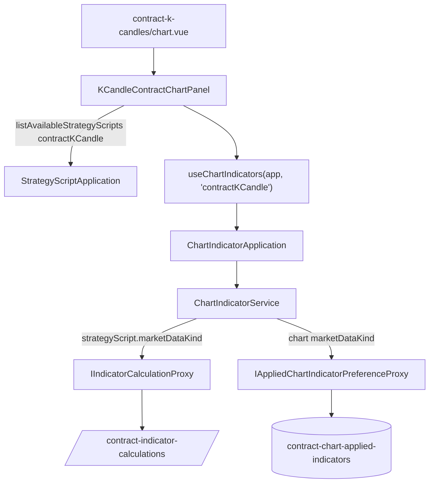

# 合約 K 線圖表套用指標 — Architecture Design

**Status:** Confirmed
**Source PRD:** `.sdd/2026-10-18-contract-chart-indicators/PRD.md`
**Tech context:** Nuxt 3 · TypeScript · Clean/Onion（`.vue` → Application → Domain ◀ Infrastructure Proxy）

---

## 1. Design Goal & Guiding Principle

- **In one sentence:** 讓合約 K 線圖表重用現貨圖表那一整套指標機制（`useChartIndicators` → `ChartIndicatorApplication` → `ChartIndicatorService` → `IIndicatorCalculationProxy`），只多兩件事：計算走合約指標計算、「擺著哪幾支」依圖表的行情種類分開記。
- **Guiding principle:** **行情種類跟著策略腳本走，記憶跟著圖表走。**
  - 一支可套用的策略腳本自己帶著 `marketDataKind`，`ChartIndicatorService` 用它決定計算送去哪一種指標計算——呼叫端（composable、panel）永遠不必傳「這次算合約」。
  - 圖表只說一次「我是哪一種行情」（建 composable 時），清單、還原、記住都由那一個值決定。

---

## 2. Change Scope

| Area | Action | What / Why |
| :--- | :--- | :--- |
| `ChartApplicableStrategyScriptDto` | **Modify** | 多一欄 `marketDataKind`；兩個來源（自己的、市集加入的）的 `toChartApplicable()` 一併帶上 |
| `ChartIndicatorService` | **Modify** | 計算請求帶上策略腳本的 `marketDataKind`；還原／記住收圖表的 `marketDataKind` |
| `ChartIndicatorApplication` | **Modify** | 還原／記住多收 `marketDataKind`（純轉交） |
| `IAppliedChartIndicatorPreferenceProxy` + 實作 | **Modify** | 讀寫收 `marketDataKind`；K 線沿用既有儲存鍵（升級不遺失），合約用新鍵 |
| `useChartIndicators` | **Modify** | 多收圖表的 `marketDataKind`，還原與記住時帶上 |
| `KCandleChartPanel` | **Modify** | 建 composable 時說自己是 `kCandle`；清單明說取 `kCandle`（行為不變） |
| `KCandleContractChartPanel` | **Modify** | 接上 composable：清單取 `contractKCandle`、還原、隨顯示區間重算、一根走完重算、換圖清線、卸載停止；工作區傳指標與圖例；`#indicators` 改放 `ChartIndicatorPanel` |
| `ChartIndicatorPanel` | **Modify** | 空清單那一句改成可由使用端覆寫的 `empty` slot，預設仍是現貨那一句 |
| `pages/contract-k-candles/chart.vue` | **Modify** | 多傳 `$chartIndicatorApplication`、`$strategyScriptApplication` |
| 中英文 locale | **Modify** | 刪 `kCandleContractChartPanel.noIndicators`，加合約空清單那一句 |
| `IndicatorCalculationProxy` | **Not touched** | 已經依請求的 `marketDataKind` 分送兩個端點 |
| `StrategyScriptService.listAvailableStrategyScripts` | **Not touched** | 已經依行情種類過濾；現貨圖表的過濾本來就在這裡 |
| 線色記憶、參數值記憶 | **Not touched** | 以策略腳本識別碼為鍵；兩邊的策略腳本不重疊，共用不衝突 |
| `KCandleChartWorkspace` | **Not touched** | 已經接受 `indicators`／`appliedIndicatorRows` 與兩個事件，與哪一邊無關 |

---

## 3. New Classes / Modules

無。這一刀刻意不新增任何類別：所有能力都已存在，缺的是把行情種類傳到對的地方。

---

## 4. Modified Components

| Component | Current role | Change needed |
| :--- | :--- | :--- |
| `ChartApplicableStrategyScriptDto` | 圖表套用一支策略腳本需要的全部 | 加 `marketDataKind: MarketDataKind`（建構子最後一個參數） |
| `StrategyScriptDto.toChartApplicable()` / `PublishedStrategyScriptDto.toChartApplicable()` | 轉成圖表要的形狀 | 帶上各自的 `marketDataKind` |
| `ChartIndicatorService.drawChartIndicator` | 組計算請求、配色 | `IndicatorCalculationRequestDto` 最後一個參數傳 `appliedIndicator.strategyScript.marketDataKind` |
| `ChartIndicatorService.restoreAppliedIndicators` / `rememberAppliedIndicators` | 讀寫「擺著哪幾支」 | 多收 `marketDataKind`，轉給 proxy |
| `IAppliedChartIndicatorPreferenceProxy` | 讀寫整份清單 | `readAppliedChartIndicators(marketDataKind)`、`writeAppliedChartIndicators(marketDataKind, vos)` |
| `AppliedChartIndicatorPreferenceProxy` | localStorage 一把鍵 | 一張 `Record<MarketDataKind, string>` 鍵表：`kCandle` → `go-trading:chart-applied-indicators`（原鍵），`contractKCandle` → `go-trading:contract-chart-applied-indicators` |
| `useChartIndicators(chartIndicatorApplication, marketDataKind)` | 圖表指標的畫面狀態 | 還原、記住帶上 `marketDataKind` |
| `KCandleContractChartPanel.vue` | 合約圖表，指標留空 | 照 `KCandleChartPanel` 的接法接上（見 §2） |
| `ChartIndicatorPanel.vue` | 指標對話框 | 空清單文字包進 `<slot name="empty">`，預設內容不變 |

---

## 5. Component Relationships

---

## 6. Extensibility & Handoff Notes

- **Most likely next requirement:** 第三種行情（或另一種圖表）也要套指標；或「擺著哪幾支」要改成依交易標的記。
- **Where it lands:** `MarketDataKind` 就是那條縫——新的行情種類只要在 `AppliedChartIndicatorPreferenceProxy` 的鍵表與 `IndicatorCalculationProxy` 的端點表各補一列；`Record<MarketDataKind, …>` 會讓 TypeScript 在漏補時直接編譯失敗。依標的記的話改的只有 preference proxy 的鍵與介面參數。
- **How to add it:** 新圖表建 `useChartIndicators(app, '<kind>')`、清單取同一種，其餘不動。
- **Patterns applied & why:** 資料攜帶自己的路由資訊（策略腳本帶行情種類），取代呼叫端分支。
- **Do not hardcode:** 不要在 panel 或 composable 裡判斷「合約就走合約計算」——那由策略腳本自己說。
- **Known debt / deferred:** 列清單與還原已收進 `useChartIndicators.loadStrategyScripts()`；兩個 panel 仍各自接三個重算掛點（顯示區間、一根走完、換圖收線），那是各自取圖與跟盤流程的一部分。

---

## 7. Traceability

| PRD Scenario | Fulfilled by |
| :--- | :--- |
| 合約圖表只列吃合約行情的策略腳本 | `KCandleContractChartPanel` 以 `contractKCandle` 呼叫 `listAvailableStrategyScripts` |
| 現貨圖表照舊只列吃 K 線的策略腳本 | `KCandleChartPanel` 以 `kCandle` 呼叫（既有過濾） |
| 從市集加入的合約策略腳本也列出來 | `PublishedStrategyScriptDto.toChartApplicable()` 帶行情種類 ＋ 合約 panel 合併兩段 |
| 一支吃合約行情的策略腳本都沒有 | `ChartIndicatorPanel` 的 `empty` slot ＋ 合約 panel 填入合約那一句 |
| 只回答是或否的合約策略腳本挑不了 | `drawableOnChart`（既有 `holdsNumbers()`）＋ `ChartIndicatorPanel` 既有停用 |
| 交易服務答不出有哪些策略腳本 | 合約 panel `onMounted` 的 catch：清單清空、圖照畫 |
| 每一根各得一個值的畫成曲線 | `ChartIndicatorService` 帶 `contractKCandle` → 合約指標計算；`ChartIndicatorDomain.toSeriesDtos()` |
| 只得出單一個值的畫成水平線 | `ChartIndicatorDomain.toLevelDtos()`（既有） |
| 換彙總刻度時指標跟著重算 | 合約 panel `showViewport` 呼叫 `chartIndicators.recalculateForRange` |
| 一根走完時指標跟著重算 | 合約 panel `followTheMarket` 在 `hasClosedAKCandle` 時呼叫 `recalculateAfterKCandleClosed`（背景重算） |
| 不在追蹤名單上的合約標的不會自己重算 | 沒有即時更新就沒有 `hasClosedAKCandle`（既有跟盤） |
| 從來沒存過合約 K 線的代號 | `IndicatorCalculationProxy` 既有「最少可算根數」翻譯 |
| 策略腳本本身有錯 | `IndicatorCalculationProxy` 既有 422 翻譯 ＋ composable 逐筆記失敗 |
| 重新打開兩張圖各自回到上次的樣子 | `AppliedChartIndicatorPreferenceProxy` 依 `marketDataKind` 分鍵 |
| 在合約這一邊移除不影響現貨那一邊 | 同上：寫入只動合約那一把鍵 |
| 升級前記住的那幾支仍屬現貨 | `kCandle` 沿用原鍵 `go-trading:chart-applied-indicators` |
| 記著的那一支已被刪掉 | `RememberedAppliedIndicatorsDomain` 既有對照（清單只含同一種，別種的也一併丟掉） |
