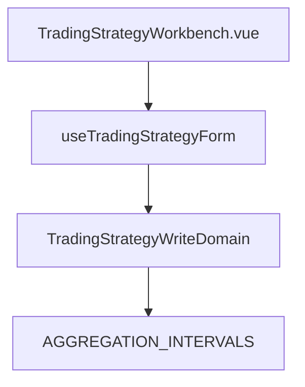

# 交易策略編輯畫面接受多種粗細 — Architecture Design

**Status:** Confirmed
**Source PRD:** `.sdd/2026-10-18-multi-interval-trading-strategy/PRD.md`
**Tech context:** Nuxt 3 · TypeScript · Clean / Onion（.vue 元件 → composable/Application → Domain）

---

## 1. Design Goal & Guiding Principle

- **In one sentence:** 從 `TradingStrategyWriteDomain` 拿掉刻度一致的擋下，改由同一個 Domain Model 算出「重演步調說明」，composable 轉交、工作台照 `marketDataKindNotice` 的樣子顯示。
- **Guiding principle:** 「哪個刻度是步調、哪幾路較粗」是業務判斷，只住在 Domain Model；元件只決定要不要畫那個提示框。

---

## 2. Change Scope

| Area | Action | What / Why |
| :--- | :--- | :--- |
| `TradingStrategyWriteDomain` | **Modify** | 刪 `mixedCoarsenessRejection`；新增 `replayPaceNotice`（刻度只有一種時為 null） |
| `use-trading-strategy-form` | **Modify** | 新增 `replayPaceNotice` computed |
| `TradingStrategyWorkbench.vue` | **Modify** | 在行情說明旁顯示 `replayPaceNotice` |
| `AGGREGATION_INTERVALS`（由細到粗） | **Not touched** | 已是排序來源，直接用它判斷最細與列出順序 |
| 回測、機器人畫面 | **Not touched** | 照舊顯示後端回的單一刻度 |

---

## 3. New Classes / Modules

無新類別；`replayPaceNotice` 是 `TradingStrategyWriteDomain` 的新 getter。

---

## 4. Modified Components

| Component | Current role | Change needed |
| :--- | :--- | :--- |
| `TradingStrategyWriteDomain` | 驗證可否送出，含刻度一致擋下 | 拿掉刻度一致擋下；`replayPaceNotice` 依 `AGGREGATION_INTERVALS` 的順序找出最細刻度與其餘較粗刻度，組出中英兩種說法 |
| `useTradingStrategyForm` | 表單狀態與送出 | 暴露 `replayPaceNotice` |
| `TradingStrategyWorkbench` | 工作台版面 | `AppAlert tone="info"`，`data-testid="trading-strategy-replay-pace-notice"` |

---

## 5. Component Relationships

---

## 6. Extensibility & Handoff Notes

- **Most likely next requirement:** 回測成績單列出每個來源的刻度。
- **Where it lands:** 後端回測結果 DTO 加欄位後，在回測畫面的成績單元件顯示；編輯畫面不必動。
- **Do not hardcode:** 刻度的順序與名稱——一律讀 `AGGREGATION_INTERVALS`。

---

## 7. Traceability

| PRD Scenario | Fulfilled by |
| :--- | :--- |
| US-01 一小時與五分鐘的組合不再被擋 | `TradingStrategyWriteDomain.rejection`（移除刻度一致擋下） |
| US-01 把第二個來源改成一天之後照樣存得下去 | `TradingStrategyWriteDomain.sendable`、`useTradingStrategyForm` |
| US-01 刻度相同時照舊存得下去 | `TradingStrategyWriteDomain.rejection` |
| US-02 三種刻度時說出最細的那一個是步調 | `TradingStrategyWriteDomain.replayPaceNotice`、`TradingStrategyWorkbench` |
| US-02 刻度都相同時不顯示說明 | `TradingStrategyWriteDomain.replayPaceNotice` |
| US-02 英文畫面說英文 | `TradingStrategyWriteDomain.replayPaceNotice`（`LocalizedTextVo`） |
