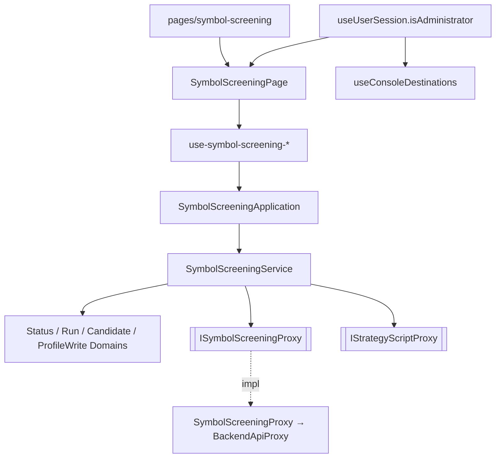

# 管理員標的篩選畫面 — Architecture Design

**Status:** Confirmed（使用者授權以最佳實務自行決定）
**Source PRD:** `.sdd/2026-10-19-admin-symbol-screening/PRD.md`
**Tech context:** Nuxt 3 SPA · Vue 3 `<script setup lang="ts">` · Clean / Onion（.vue = Controller → Application → Domain ← Infrastructure Proxy）· Vitest

---

## 1. Design Goal & Guiding Principle

- **In one sentence:** 在操作台加一頁只給管理員的 `/symbol-screening`，透過一支 `SymbolScreeningProxy` 對接後端的篩選設定與篩選輪次端點，讓管理員管理設定、送出篩選、跟著進度看紀錄與明細、取消篩選。
- **Guiding principle:** 所有「怎麼說、什麼語氣、要不要顯示」的判斷住在 Domain Model（狀態、關卡、數字格式），元件只綁 DTO；後端的 wire 形狀與狀態碼只在 proxy 內被讀懂，翻成具名錯誤。新增一種候選狀態或一個判斷數字時只改 Domain Model 與 DTO，不碰元件的條件式。

---

## 2. Change Scope

| Area | Action | What / Why |
| :--- | :--- | :--- |
| 使用者身分（`UserProxy` wire → `SignedInUser` → `SignedInUserDto`） | **Modify** | 多帶 `isAdmin`，導覽與頁面才知道是不是管理員 |
| `useConsoleDestinations` / `ConsoleLayout` / `ChartWorkspaceMenu` | **Modify** | 管理員才多一格「標的篩選」，窄螢幕放進「更多」 |
| 篩選設定與篩選輪次的對外存取 | **Add** | `ISymbolScreeningProxy` + `SymbolScreeningProxy`（一資源群一 proxy） |
| 篩選的領域模型、service、application、composable、頁面與元件 | **Add** | 見第 3 節 |
| 中英文字串 | **Add** | `symbolScreening.*`、`shell.navigation.symbolScreening` |
| `signed-in.global.ts` 中介層 | **Not touched** | 管理員判斷在頁面內呈現「這是管理員功能」，不做轉址——PRD 要求直接打網址看到那句話 |
| 回測紀錄的 composable / 元件 | **Not touched** | 篩選的狀態集合與明細形狀不同，硬共用會讓兩邊互相牽制；只沿用相同的輪詢作法 |
| 策略腳本 proxy / service | **Not touched** | 只在 `SymbolScreeningService` 透過既有 `IStrategyScriptProxy` 讀清單後自己挑 |

---

## 3. New Classes / Modules

| Name | Kind | Responsibility (purpose) | Collaborators | Satisfies |
| :--- | :--- | :--- | :--- | :--- |
| `ISymbolScreeningProxy` / `SymbolScreeningProxy` | Interface / Proxy | 篩選設定 CRUD、送出、列表、單筆（`waitSeconds`）、取消；把 403→`AdministratorRequiredError`、409 取消→`SymbolScreeningRunAlreadyEndedError`；其餘拒絕沿用 `BackendRequestRejectedError`（原樣訊息） | `BackendApiProxy` | US-01~07 |
| `AdministratorRequiredError`、`SymbolScreeningRunAlreadyEndedError` | Error | 讓畫面分流「這是管理員功能」與「已經結束」 | — | US-01 S3、US-06 S2 |
| `SymbolScreeningProfile`、`SymbolScreeningRun`、`SymbolScreeningRunDetail`、`SymbolScreeningCandidate`（含 findings / segment / contribution entity）、`SymbolScreeningSnapshot` | Entity | 後端資料在 domain 的本體（金額用 `Decimal`、時間用 `Date`），各自 `toDomain()`/`toDto()` | — | US-02、05、07 |
| `SymbolScreeningRunStatusDomain` | Domain Model | 輪次狀態的說法、語氣、是否仍在進行（認不得→失敗） | — | US-05、06 |
| `SymbolScreeningCandidateStatusDomain` | Domain Model | 候選狀態與關卡（基本條件 / 策略移植）的說法與語氣 | — | US-07 S2、S9 |
| `SymbolScreeningRunDomain` | Domain Model | 進度文字、可否取消、失敗原因 → `SymbolScreeningRunDto` | 狀態 Domain | US-04 S1、05、06 |
| `SymbolScreeningCandidateDomain` | Domain Model | 只把有的數字轉成顯示用文字（報酬帶正負號一位小數、日均成交額、空窗天數與縮短天數） | 狀態 Domain | US-07 S3~S7 |
| `SymbolScreeningProfileWriteDomain` | Domain Model | 把表單 DTO 正規化成要送的內容：留白的數字不送、現有組合拆逗號轉大寫 | — | US-02 S1、S6；US-03 S1 |
| `SymbolScreeningService` | Domain Service | 列/存/刪設定、挑出可用策略（自己的、合約 K 線、信號、無逐筆成交參數）、送出、列輪次、讀單筆、取消；entity → DTO | `ISymbolScreeningProxy`、`IStrategyScriptProxy` | US-02 S2/S3、全部 |
| `SymbolScreeningApplication` | Application | 用例入口，只碰 DTO | `SymbolScreeningService` | 全部 |
| `useSymbolScreeningProfiles` / `useSymbolScreeningSubmission` / `useSymbolScreeningRuns` / `useSymbolScreeningRunDetail` | Composable | 畫面狀態：設定清單與存檔；送出篩選（失敗保留輸入）；紀錄清單＋只在有進行中時每 3 秒重讀；明細在進行中時每 3 秒重讀至結束（後端的 `waitSeconds` 只在結束時才回，看不到逐檔進度，因此不用）；關閉或離開畫面即停止 | Application | US-03、05、06、07 S6 |
| `pages/symbol-screening/index.vue` + `SymbolScreeningPage`（template）+ `SymbolScreeningProfilePanel`、`SymbolScreeningProfileForm`、`SymbolScreeningSubmitPanel`、`SymbolScreeningRunList`、`SymbolScreeningRunDetail`（organisms）+ `SymbolScreeningCandidateCard`（molecule） | Controller | 綁 DTO 與事件；非管理員（或後端 403）時只顯示「這是管理員功能」 | Application / composables | US-01~07 |

---

## 4. Modified Components

| Component | Current role | Change needed |
| :--- | :--- | :--- |
| `user-proxy.ts` / `SignedInUser` / `SignedInUserDto` | 已登入者的身分 | 加 `isAdmin`（wire 缺欄位→`false`） |
| `use-user-session.ts` | 目前使用者 | 不改：導覽與頁面直接讀 `currentUser.isAdmin`，免得既有對它的 mock 都要多補一個欄位 |
| `use-console-destinations.ts` | 導覽清單 | 管理員才多一格「標的篩選」（icon `search`）；`ChartWorkspaceMenu` 用同一份清單，因此不必改 |
| `ConsoleLayout.vue` | 窄螢幕「更多」 | `MORE_DESTINATION_PATHS` 加 `/symbol-screening` |
| `plugins/dependencies.ts` | 組裝根 | 組 `SymbolScreeningApplication` 並 provide |
| `locales/*` | 字串 | 新增 `symbolScreening` 區塊 |

---

## 5. Component Relationships

---

## 6. Extensibility & Handoff Notes

- **Most likely next requirement:** 明細多一個判斷數字（例如資金費率成本）或候選多一種狀態；或「把通過的標的一鍵加入合約追蹤名單」。
- **Where it lands:** 數字 → proxy 的 findings 讀法 + `SymbolScreeningCandidateDomain.toDto()` + `SymbolScreeningCandidateCard`；狀態 → `SymbolScreeningCandidateStatusDomain` 的表；新動作 → `SymbolScreeningApplication` 新增一個方法（呼叫既有合約追蹤 service）。
- **How to add it:** 在 Domain Model 的說法表加一列；DTO 欄位為「有才有」(`null` 不顯示)，元件只 `v-if` 該欄位。
- **Patterns applied & why:** 狀態說法表（沿用 `BacktestRunStatusDomain`）讓新增狀態只加一列；具名錯誤讓畫面分流不讀狀態碼。
- **Do not hardcode:** 輪詢間隔用常數 `SYMBOL_SCREENING_POLL_INTERVAL_MILLISECONDS`（3000）；預設值由後端回填，前端不寫死 730/3/6 等。
- **Known debt / deferred:** 列表一次取最新 50 筆、不分頁（管理員自用、量小）；量大時再加分頁。

---

## 7. Traceability

| PRD Scenario | Fulfilled by |
| :--- | :--- |
| US-01 管理員的導覽上有標的篩選 | `SignedInUser.isAdmin` → `useUserSession.currentUser` → `useConsoleDestinations` |
| US-01 一般使用者的導覽上沒有標的篩選 | `useConsoleDestinations`（非管理員不加）、`ConsoleLayout`、`ChartWorkspaceMenu` |
| US-01 一般使用者直接打開標的篩選頁 | `SymbolScreeningPage`（非管理員只渲染拒絕訊息、不載入資料）+ `AdministratorRequiredError` |
| US-01 管理員打開標的篩選頁 | `SymbolScreeningPage` → `useSymbolScreeningProfiles` / `useSymbolScreeningRuns` |
| US-02 只填必要項目建立設定 | `SymbolScreeningProfileWriteDomain`（留白不送）+ `SymbolScreeningProxy.saveProfile` + `SymbolScreeningProfilePanel` 顯示回填值 |
| US-02 策略選單只列得出能拿來篩選的策略 | `SymbolScreeningService.listEligibleStrategyScripts` |
| US-02 沒有任何能用的策略 | `SymbolScreeningProfileForm`（清單空 → 說明、存鍵停用） |
| US-02 名稱與自己另一份設定重複 | `BackendRequestRejectedError` 原樣訊息 + `useSymbolScreeningProfiles`（失敗保留表單） |
| US-02 看盤間隔只有兩種 | `SYMBOL_SCREENING_AGGREGATION_INTERVALS`（vo）+ `SymbolScreeningProfileForm` |
| US-02 現有組合標的用逗號分隔輸入 | `SymbolScreeningProfileWriteDomain`（拆分、去空白、轉大寫） |
| US-03 修改歷史天數 | `SymbolScreeningService.saveProfile`（帶 id → PUT）+ 清單更新 |
| US-03 有篩選正在使用的設定不能刪 | 409 → `BackendRequestRejectedError` 原樣訊息 + 清單不變 |
| US-03 刪除沒在用的設定 | `SymbolScreeningService.deleteProfile` + `useSymbolScreeningProfiles` 移除 |
| US-03 確認時反悔 | `SymbolScreeningProfilePanel` + 既有 `ConfirmDialog`（取消 → 不刪） |
| US-04 送出一串標的 | `SymbolScreeningService.submitRun` + `useSymbolScreeningRuns.prepend` + `SymbolScreeningRunDomain`（0／2、排隊中） |
| US-04 已有一筆在排隊 | 429 → `BackendRequestRejectedError` 原樣 + `SymbolScreeningSubmitPanel` 保留輸入 |
| US-04 標的含不允許的字元 | 400 → 原樣訊息 + 保留輸入 |
| US-04 沒有任何設定 | `SymbolScreeningSubmitPanel`（無設定 → 說明、送出停用） |
| US-04 標的欄位空白 | 照送，後端 400「沒有任何標的」原樣顯示 |
| US-05 進行中的篩選自己更新進度 | `useSymbolScreeningRuns`（有進行中 → 3 秒後重讀）+ `SymbolScreeningRunDomain.progressText` |
| US-05 全部結束就不再更新 | `useSymbolScreeningRuns`（無進行中 → 不排程） |
| US-05 失敗的篩選附原因 | `SymbolScreeningRunDomain.toDto().failureReason` + `SymbolScreeningRunList` |
| US-05 離開畫面就不再更新 | `onScopeDispose` + generation counter |
| US-06 取消排隊中的篩選 | `SymbolScreeningService.cancelRun` + `SymbolScreeningRunDomain.isCancellable` |
| US-06 按取消時其實已經結束 | `SymbolScreeningRunAlreadyEndedError` → 說明 + `useSymbolScreeningRuns` 重讀 |
| US-06 已結束的沒有取消鍵 | `SymbolScreeningRunDomain.isCancellable`（`SymbolScreeningRunStatusDomain.isActive`） |
| US-07 依推薦順序列出 | 後端已排序；`SymbolScreeningService.getRun` 保留順序 + `SymbolScreeningRunDetail` |
| US-07 淘汰的標的說出卡在哪一關與原因 | `SymbolScreeningCandidateStatusDomain`（關卡說法）+ `SymbolScreeningCandidateCard` |
| US-07 通過的標的顯示各段報酬 | `SymbolScreeningCandidateDomain`（帶號百分比）+ `SymbolScreeningCandidateCard` |
| US-07 通過的標的顯示縮短的空窗 | `SymbolScreeningCandidateDomain`（gapReductionDays）|
| US-07 現有組合無法比較 | `SymbolScreeningRunDto.contributionFailureReason` + `SymbolScreeningRunDetail` |
| US-07 進行中的明細依貼上順序並自己更新 | `useSymbolScreeningRunDetail`（進行中每 3 秒重讀至結束） |
| US-07 只顯示有的數字 | `SymbolScreeningCandidateDomain`（缺的欄位為 `null`）+ `v-if` |
| US-07 顯示送出當下的設定 | `SymbolScreeningSnapshot` → `SymbolScreeningRunDetailDto.snapshot` |
| US-07 無法完成的標的說出原因 | `SymbolScreeningCandidateStatusDomain` + `reason` |

---

## 8. Risks & Open Decisions

- **Risks / trade-offs:** 明細與清單各自每 3 秒重讀；關閉明細或換一筆時以 generation counter 丟棄舊回應，避免蓋掉。刪除確認沿用既有 `ConfirmDialog`。
- **Open decisions (for implementation):** 無（導覽圖示定為既有的 `search`）。
