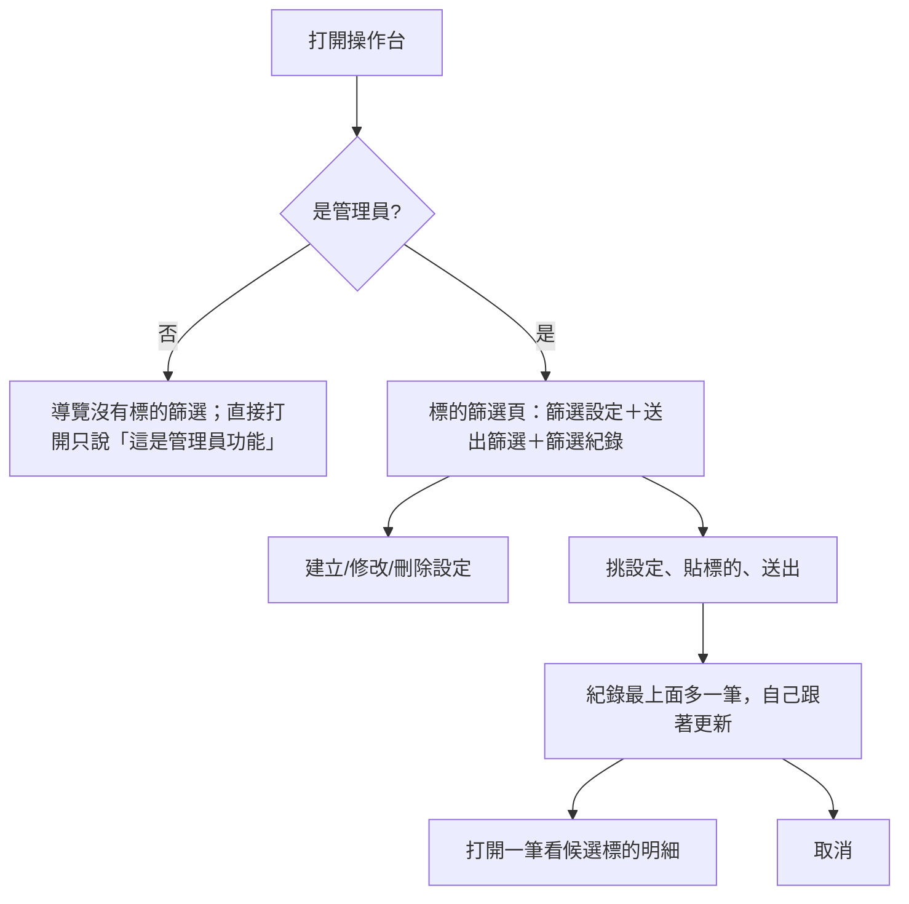

# Product Requirements Document (PRD) — 管理員標的篩選畫面

**Status:** Finalized
**Version:** v1.0
**Owner:** James Hsueh
**Stakeholders:** Engineering

---

## 1. Background & Goal (Why & Goal)

- **Problem Statement:** 系統已經能替管理員在背後篩選一串永續合約標的，但操作台上沒有地方用它：管理員只能靠外掛或手打請求管理篩選設定、送出篩選、反覆查看結果。
- **Expected Outcome:**
  - 管理員在操作台的「標的篩選」一頁就能管理篩選設定、貼上標的送出篩選、看篩選紀錄跟著進度更新、打開一筆看每個候選標的的結論與數字、取消還沒結束的篩選。
  - 一般使用者在操作台上完全看不到這個去處。
- **Out of Scope:** 由畫面設定或取消管理員；結果匯出與比較；圖表化的持倉時間軸；一鍵加入合約追蹤名單或建立機器人；定期自動重跑與通知。

---

## 2. User Personas

- **Primary Role(s):** 管理員（已開通且被營運者設為管理員的使用者）；一般使用者（只需要確定看不到、用不到）。
- **Usage Context:** 研究要不要加標的時，在桌機或手機打開操作台，貼上一串候選，離開做別的事，之後回來看推薦順序。

---

## 3. User Stories & Acceptance Criteria

### US-01 — [priority: P0] 只有管理員看得到、用得到
**As a** 營運者, **I want** 標的篩選只出現在管理員的操作台, **so that** 一般使用者不會看到還在研究階段的功能。

```gherkin
Scenario: 管理員的導覽上有標的篩選
  Given 我是已開通的管理員
  When 我看操作台的導覽
  Then 導覽上有「標的篩選」這一格

Scenario: 一般使用者的導覽上沒有標的篩選
  Given 我是已開通、不是管理員的使用者
  When 我看操作台的導覽
  Then 導覽上沒有「標的篩選」這一格

Scenario: 一般使用者直接打開標的篩選頁
  Given 我是已開通、不是管理員的使用者
  When 我直接打開標的篩選頁
  Then 畫面說「這是管理員功能」
  And 看不到任何篩選設定或篩選紀錄，也沒有任何操作按鈕

Scenario: 管理員打開標的篩選頁
  Given 我是已開通的管理員
  When 我打開標的篩選頁
  Then 看得到自己的篩選設定與篩選紀錄
```

### US-02 — [priority: P0] 建立篩選設定
**As a** 管理員, **I want** 只填名稱、策略與看盤間隔就能建立篩選設定, **so that** 其餘數字用系統的預設值。

```gherkin
Scenario: 只填必要項目建立設定
  Given 我有一支自己的合約信號策略「V3」
  When 我只填名稱「趨勢 V3」、挑「V3」、挑每 4 小時，然後存
  Then 設定清單多一份「趨勢 V3」
  And 它顯示歷史 730 天、3 段、最少 6 筆、最低日均成交額 2,000 萬、1 倍、手續費 0.05%、滑價 0.05%、只做多

Scenario: 策略選單只列得出能拿來篩選的策略
  Given 我有一支現貨策略、一支合約信號策略、一支需要逐筆成交明細的合約策略
  When 我打開策略選單
  Then 只看得到那支合約信號策略

Scenario: 沒有任何能用的策略
  Given 我沒有任何合約信號策略
  When 我打開建立設定
  Then 畫面說明要先去寫一支給合約用、會說出買賣信號的策略
  And 存的按鈕不能按

Scenario: 名稱與自己另一份設定重複
  Given 我已經有一份叫「趨勢 V3」的設定
  When 我再存一份同名的設定
  Then 畫面顯示「已經有同名的篩選設定」
  And 表單內容保留

Scenario: 看盤間隔只有兩種
  When 我打開看盤間隔選單
  Then 只有「每 4 小時」與「每天」兩個選項

Scenario: 現有組合標的用逗號分隔輸入
  When 我在現有組合標的填「btcusdt, ETHUSDT」並存
  Then 這份設定顯示現有組合 BTCUSDT、ETHUSDT
```

### US-03 — [priority: P0] 修改與刪除篩選設定
**As a** 管理員, **I want** 修改或刪除自己的設定, **so that** 我能調整篩法、清掉不用的設定。

```gherkin
Scenario: 修改歷史天數
  Given 設定「趨勢 V3」歷史 730 天
  When 我把它改成 365 天並存
  Then 設定清單上「趨勢 V3」顯示 365 天

Scenario: 有篩選正在使用的設定不能刪
  Given 設定「趨勢 V3」有一筆排隊中的篩選在用
  When 我刪除它並確認
  Then 畫面顯示「有篩選正在使用這份設定，等它結束再刪除」
  And 「趨勢 V3」仍在清單上

Scenario: 刪除沒在用的設定
  Given 用過「趨勢 V3」的篩選都已結束
  When 我刪除它並確認
  Then 清單上沒有「趨勢 V3」

Scenario: 確認時反悔
  When 我按刪除後在確認時取消
  Then 設定沒有被刪除
```

### US-04 — [priority: P0] 送出篩選
**As a** 管理員, **I want** 挑一份設定、貼上一串標的就能送出篩選, **so that** 我可以直接從別處複製候選清單。

```gherkin
Scenario: 送出一串標的
  Given 我有設定「趨勢 V3」
  When 我挑「趨勢 V3」、貼上「linkusdt，ADAUSDT」並送出
  Then 篩選紀錄最上面多一筆排隊中、進度 0／2 的篩選

Scenario: 已有一筆在排隊
  Given 我已有一筆排隊中的篩選
  When 我再送出一筆
  Then 畫面顯示「你已經有一筆篩選在排隊或進行中，等它結束再送」
  And 貼上的內容保留

Scenario: 標的含不允許的字元
  When 我貼上「BTC-USDT」並送出
  Then 畫面顯示「BTC-USDT 只能有英文字母與數字」
  And 貼上的內容保留

Scenario: 沒有任何設定
  Given 我沒有任何篩選設定
  When 我看送出篩選
  Then 畫面說明要先建立一份篩選設定
  And 送出的按鈕不能按

Scenario: 標的欄位空白
  When 我沒貼任何標的就送出
  Then 畫面顯示「沒有任何標的」
```

### US-05 — [priority: P0] 篩選紀錄跟著進度更新
**As a** 管理員, **I want** 篩選紀錄自己跟著更新, **so that** 我不必一直重新整理。

```gherkin
Scenario: 進行中的篩選自己更新進度
  Given 一筆進行中的篩選處理了 1／4
  When 過了幾秒，系統已處理到 2／4
  Then 清單上那一筆顯示 2／4

Scenario: 全部結束就不再更新
  Given 清單上每一筆都已結束
  When 過了幾秒
  Then 清單不再向系統詢問

Scenario: 失敗的篩選附原因
  Given 一筆失敗、原因「超過時間上限」
  When 我看篩選紀錄
  Then 那一筆顯示失敗與「超過時間上限」

Scenario: 離開畫面就不再更新
  Given 有一筆進行中的篩選
  When 我離開這一頁
  Then 不再向系統詢問
```

### US-06 — [priority: P0] 取消篩選
**As a** 管理員, **I want** 取消還沒結束的篩選, **so that** 我能改送一筆不同的。

```gherkin
Scenario: 取消排隊中的篩選
  Given 一筆排隊中的篩選
  When 我按取消
  Then 那一筆顯示已取消
  And 那一筆的取消鍵消失

Scenario: 按取消時其實已經結束
  Given 畫面還顯示進行中，但它剛完成
  When 我按取消
  Then 畫面說明「這筆篩選已經結束，不能取消」
  And 那一筆更新成完成

Scenario: 已結束的沒有取消鍵
  Given 一筆已完成的篩選
  When 我看那一筆
  Then 沒有取消鍵
```

### US-07 — [priority: P0] 一筆篩選的明細
**As a** 管理員, **I want** 打開一筆看每個候選標的的結論與數字, **so that** 我知道該加哪個標的、其他為什麼被淘汰。

```gherkin
Scenario: 依推薦順序列出
  Given 一筆完成的篩選：LINKUSDT 通過、推薦第 1；FOOUSDT 淘汰、推薦第 2
  When 我打開它
  Then 先列 LINKUSDT，再列 FOOUSDT

Scenario: 淘汰的標的說出卡在哪一關與原因
  Given FOOUSDT 淘汰，卡在基本條件，原因「幣安沒有這個 USDT 永續合約」
  When 我打開這一筆
  Then FOOUSDT 顯示「淘汰」、「基本條件」與「幣安沒有這個 USDT 永續合約」

Scenario: 通過的標的顯示各段報酬
  Given LINKUSDT 通過；三段報酬 +20%、+5%、+12%；去掉最好一段後 +17.6%
  When 我打開這一筆
  Then LINKUSDT 顯示三段報酬 +20.0%、+5.0%、+12.0% 與去掉最好一段後 +17.6%

Scenario: 通過的標的顯示縮短的空窗
  Given LINKUSDT 通過；現有組合最長空窗 95 天、加上它之後 60 天
  When 我打開這一筆
  Then LINKUSDT 顯示現有組合最長空窗 95 天、加上後 60 天、縮短 35 天

Scenario: 現有組合無法比較
  Given 這一筆的現有組合無法比較，原因「現有組合標的 BTCUSDT 無法比較：目前沒有在交易」
  When 我打開這一筆
  Then 畫面顯示「現有組合標的 BTCUSDT 無法比較：目前沒有在交易」
  And 通過的標的仍顯示「通過」

Scenario: 進行中的明細依貼上順序並自己更新
  Given 一筆進行中、還沒排好順序的篩選，貼上順序是 XRPUSDT、LINKUSDT
  When 我打開它
  Then 依 XRPUSDT、LINKUSDT 列出
  And 它結束時明細自己換成結束後的內容

Scenario: 只顯示有的數字
  Given XRPUSDT 在基本條件被淘汰，只有歷史天數 120 天
  When 我打開這一筆
  Then XRPUSDT 顯示歷史 120 天
  And 不顯示區段表

Scenario: 顯示送出當下的設定
  Given 我送出後把設定的歷史天數改成 365
  When 我打開那一筆篩選
  Then 它顯示的設定內容是歷史 730 天

Scenario: 無法完成的標的說出原因
  Given XRPUSDT 無法完成，原因「行情取不到」
  When 我打開這一筆
  Then XRPUSDT 顯示「無法完成」與「行情取不到」
```

---

## 4. Business Flow & Logic

- **Flow Diagram:**

- **Core Business Rules:**
  - 是不是管理員由目前登入者決定；導覽與頁面都照它判斷。系統拒絕「這是管理員功能」時也照樣呈現那句話。
  - 留白的數字不送出，交給系統補預設值；畫面以系統回覆的數字為準。
  - 策略選單只列：自己寫的、給合約用的、會說出買賣信號、不需要逐筆成交明細的策略。
  - 系統的拒絕原因一律原樣顯示；送出失敗時使用者輸入保留。
  - 清單與明細只有在有排隊中或進行中的篩選時才定期更新（間隔與回測紀錄相同，3 秒），全部結束或離開畫面就停。
  - 明細在結束前以貼上順序列出、結束後以推薦順序列出（由系統給的順序決定）。
  - 百分比顯示到小數一位，帶正負號；天數為整數；日均成交額以 USDT 顯示千分位。
- **Edge Cases:** 連不上系統時沿用操作台既有的提示；取消時其實已經結束要重讀；明細讀取中再點另一筆時以最後點的為準。

---

## 5. UI/UX Design & Interaction

- **Prototype Link:** N/A（沿用操作台既有版面：面板、列表、對話框、徽章）
- **Key Interactions:**
  - 頁面由上而下：篩選設定面板（清單＋建立／修改對話框）、送出篩選面板、篩選紀錄面板（點開為明細對話框）。
  - 窄螢幕時「標的篩選」放在「更多」裡。
  - 空狀態：沒有設定、沒有紀錄各有一句說明。讀取中、失敗各有提示。

---

## 6. Non-Functional Requirements

- **Performance:** 定期更新每 3 秒最多一次，且只在有未結束的篩選時。
- **Security:** 畫面只是不顯示；真正的把關在系統那一側。
- **Compatibility:** 與操作台相同（桌機與手機寬度）。
- **Analytics / Tracking:** N/A

---

## 7. Dependencies & Risks

- **External Dependencies:** 系統的「管理員標的篩選」功能與目前登入者是否為管理員的回覆。
- **Known Risks:** 管理員身分在本頁打開後被撤銷時，下一次操作會收到「這是管理員功能」，畫面照樣呈現。

---

## 8. Appendix

- BRIEF：`.sdd/2026-10-19-admin-symbol-screening/BRIEF.md`
- 後端：`go-trading/.sdd/2026-10-19-admin-symbol-screening/`
- 相關：回測紀錄頁（`2026-10-10-background-backtest-runs`）。
