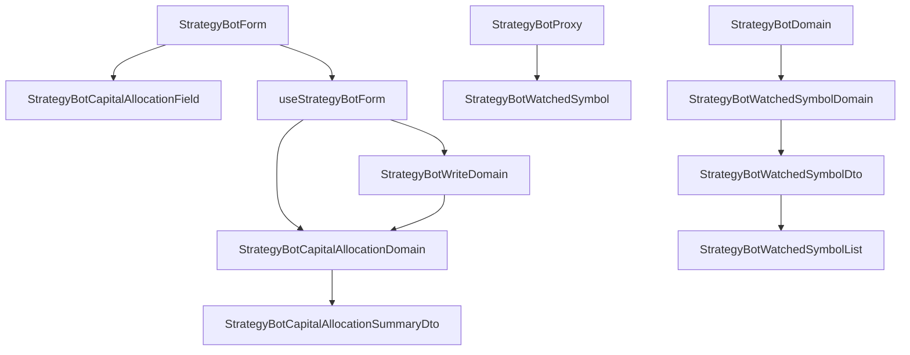

# 多標的機器人的資金分配（操作台） — Architecture Design

**Status:** Confirmed
**Source PRD:** `.sdd/2026-10-20-multi-symbol-capital-allocation/PRD.md`
**Tech context:** Nuxt 4 · Vue 3 `<script setup>` · Clean/Onion（.vue → Application → Domain ← Proxy）· decimal.js · Vitest

---

## 1. Design Goal & Guiding Principle

- **In one sentence:** 每個監聽標的多一個分配比例：proxy 讀回 `watchedSymbols[].allocationPercentage`、送出 `positionPlan.capitalAllocations`；表單上的平均分配、自動重算、合計／未動用、分到多少、押不下提醒與送出前規則**全部集中在一個 `StrategyBotCapitalAllocationDomain`**。
- **Guiding principle:** 資金分配的每一條規則（平均分配怎麼捨去、何時自動重算、檢查順序與措辭、分到多少、押不下）只在 `StrategyBotCapitalAllocationDomain` 說一次——表單即時摘要與送出前擋下問的是同一個物件，兩邊不會講不同的話；元件只攤 DTO。

---

## 2. Change Scope

| Area | Action | What / Why |
| :--- | :--- | :--- |
| `StrategyBotWatchedSymbol` entity | **Modify** | 多 `allocationPercentage: Decimal` |
| `StrategyBotWatchedSymbolDomain` / `StrategyBotWatchedSymbolDto` | **Modify** | 收機器人的總金額（或 `null`），多 `allocationLabel`（分配 60%）與 `allocatedCapitalLabel`（分到 600，沒有部位規劃時 `null`） |
| `StrategyBotDomain` | **Modify** | 把 `positionPlan?.capital` 交給每個監聽標的 |
| `PositionPlanDto` | **Modify** | 多 `capitalAllocations: readonly StrategyBotCapitalAllocationDto[]`（預設 `[]`＝不給） |
| `PositionSizingDomain` | **Modify** | 多 `shortfallLabelWithin(allocatedCapital)`：固定金額押不下分到的資金時說「分到的資金不足，押不下 X」——押多少的語意住在它身上 |
| `StrategyBotWriteDomain` | **Modify** | 部位規劃本身合法後，再問 `StrategyBotCapitalAllocationDomain.rejection` |
| `StrategyBotPageDto` / `MarketDataKindDomain` 描述 | **Modify** | 多 `capitalLabel` 與 `capitalHint`（現貨：總金額；合約：總金額（保證金）＋名目說明） |
| `StrategyBotProxy` | **Modify** | wire 讀 `allocationPercentage`（缺即 100）；`toBody` 送 `capitalAllocations`（空陣列不送） |
| `useStrategyBotForm` | **Modify** | 持有每個標的的分配比例文字；加減標的時問 Domain 重算；`splitEqually`、`allocationSummary` |
| `StrategyBotForm.vue` | **Modify** | 總金額名稱與說明改讀 page；部位規劃區塊內放 `StrategyBotCapitalAllocationField` |
| `StrategyBotWatchedSymbolList.vue` | **Modify** | 每個標的多一行「分配 X% · 分到 Y」 |
| locales（zh-TW / en） | **Modify** | 新字串 |
| `StrategyBotWatchedSymbolListDomain`、執行紀錄、清單小標籤、Telegram | **Not touched** | 標的清單規則不變；清單列不顯示分配（Out of Scope）；訊息由交易服務處理 |
| `StrategyBotApplication` / `StrategyBotService` | **Not touched** | 寫入仍是同一份 write DTO，讀取仍是同一份機器人 |

---

## 3. New Classes / Modules

| Name | Kind | Responsibility (purpose) | Collaborators | Satisfies (PRD scenario) |
| :--- | :--- | :--- | :--- | :--- |
| `StrategyBotCapitalAllocationDto` | DTO | 一個監聽標的的分配比例（標的＋`Decimal`）；寫入時的形狀 | — | US-02, US-03 |
| `StrategyBotCapitalAllocationDomain` | Domain Model | 以「監聽標的清單＋已給的分配」建立：`equallySplit()`（平均分配）、`isEqualSplit`、`reallocatedTo(symbols)`（自動重算或保留）、`rejection`（缺 → 範圍 → 小數 → 合計，措辭同交易服務）、`toSummaryDto(capital, positionSizing)` | `PositionSizingDomain` | US-02, US-03, US-04 |
| `StrategyBotCapitalAllocationSummaryDto` | DTO | 合計、未動用、是否超過 100、每一列 | — | US-03, US-04 |
| `StrategyBotCapitalAllocationRowDto` | DTO | 一列：標的、分到的資金（或 `null`）、押不下的提醒（或 `null`） | — | US-04 |
| `StrategyBotCapitalAllocationField.vue` | Molecule | 每個監聽標的一列分配比例輸入、分到多少、提醒；合計／未動用；「平均分配」鍵 | `AppInput`、`AppButton`、`AppAlert`/文字 | US-02, US-03, US-04 |

表單狀態以「標的 → 輸入文字」持有（輸入框給的是字，打到一半的 `33.` 不能被收成數字）；composable 把它轉成 `StrategyBotCapitalAllocationDto[]`：空白的那一格**不產生**一筆（＝那個標的沒有分配比例，正是交易服務「缺了哪一個」的語意），打不出數字的字收成 `NaN`（＝範圍不合法）。

---

## 4. Modified Components

| Component | Current role | Change needed |
| :--- | :--- | :--- |
| `StrategyBotProxy.toStrategyBot` | 讀每個監聽標的 | `allocationPercentage` 收成 `Decimal`，舊後端不回時讀作 100 |
| `StrategyBotProxy.toBody` | 送部位規劃 | `capitalAllocations` 非空時放進 `positionPlan`，比例以字串送 |
| `StrategyBotWriteDomain.rejection` | 部位規劃本身的規則 | 之後接 `StrategyBotCapitalAllocationDomain(symbols, capitalAllocations).rejection` |
| `useStrategyBotForm.addSymbol/removeSymbol/reset` | 改監聽標的 | 同步重算分配文字；`reset` 由 `editing.watchedSymbols[].allocationPercentage` 填回，新機器人為平均分配 |
| `StrategyBotWatchedSymbolDomain.toDto` | 一個標的的狀態 | 多分配與分到的說法 |

---

## 5. Component Relationships

---

## 6. Extensibility & Handoff Notes

- **Most likely next requirement:** 依信號強弱或波動度建議分配、或「把未動用的平均補給大家」之類的分配策略。
- **Where it lands:** `StrategyBotCapitalAllocationDomain` 多一個產生分配的方法（與 `equallySplit()` 並列），表單多一顆鍵呼叫它；檢查、摘要、送出都不必動。
- **Patterns applied & why:** 規則集中在一個深模組（建構子吃清單與分配，對外只有幾個問題）；即時摘要與送出前擋下共用同一個物件，避免兩份措辭。自動重算以「目前是否仍等於平均分配」判斷而非記旗標，建立與修改同一條規則、沒有額外狀態要同步。
- **Do not hardcode:** 上限 100 與小數兩位集中在 `STRATEGY_BOT_LIMITS`（`allocationPercentageMaximum`、`allocationPercentageDecimalPlaces`）。
- **Known debt / deferred:** 交易服務另外會擋「指到不在清單上」與「重複」，表單結構上產生不出這兩種，不在操作台重寫。

---

## 7. Traceability

| PRD Scenario | Fulfilled by |
| :--- | :--- |
| 現貨機器人的總金額 / 合約機器人的總金額是保證金 | `MarketDataKindDomain.toStrategyBotPageDto`（`capitalLabel`、`capitalHint`）+ `StrategyBotForm` |
| 只有一個標的 / 加入第二個標的時自動平均 / 三個標的的平均分配捨去零頭 / 七個標的 | `StrategyBotCapitalAllocationDomain.equallySplit`、`reallocatedTo` + `useStrategyBotForm.addSymbol`/`reset` + `toSummaryDto` |
| 改過之後加入標的不再自動重算 | `StrategyBotCapitalAllocationDomain.isEqualSplit`/`reallocatedTo` + `rejection`（缺一格） |
| 改過之後拿掉標的 | `reallocatedTo` + `useStrategyBotForm.removeSymbol` + `toSummaryDto`（未動用） |
| 一鍵回到平均分配 | `useStrategyBotForm.splitEqually` → `equallySplit` + `StrategyBotCapitalAllocationField` |
| 打開既有機器人看到它的分配 / 既有機器人原本就是平均分配 | `StrategyBotProxy.toStrategyBot` + `StrategyBotWatchedSymbolDto.allocationPercentage` + `useStrategyBotForm.reset` + `reallocatedTo` |
| 合計正好 100 / 合計少於 100 / 合計超過 100 | `StrategyBotCapitalAllocationDomain.toSummaryDto` + `rejection` + `StrategyBotWriteDomain.rejection` |
| 分配比例為零 / 超過 100 / 超過兩位小數 | `StrategyBotCapitalAllocationDomain.rejection` |
| 送出每個標的的分配 / 部位規劃收著不送分配 | `useStrategyBotForm.buildPositionPlan` + `StrategyBotProxy.toBody` |
| 交易服務仍拒絕 | 既有 `useStrategyBotWorkbench.save` 失敗訊息（`BackendRequestRejectedError` 原句） |
| 分到的資金不取整 / 總金額空白 / 押不下 / 正好押得下 / 全押永遠押得下 | `StrategyBotCapitalAllocationDomain.toSummaryDto`（`StrategyBotCapitalAllocationRowDto`）+ `PositionSizingDomain.shortfallLabelWithin` + `StrategyBotCapitalAllocationField` |
| 有部位規劃的機器人 / 沒有部位規劃的機器人（詳細區） | `StrategyBotWatchedSymbolDomain.toDto`（`allocationLabel`、`allocatedCapitalLabel`） + `StrategyBotWatchedSymbolList` |

---

## 8. Risks & Open Decisions

- **Risks / trade-offs:** 規則是交易服務的副本；不同步時以交易服務拒絕原句為準。`33.330` 之類尾端零的小數位以 decimal.js 的有效小數位判斷（2 位），與「最多兩位」一致。
- **Open decisions (for implementation):** 無。
