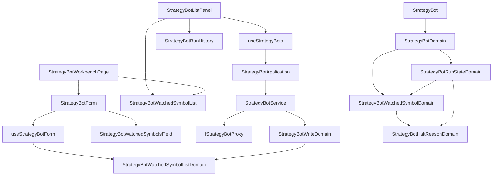

# 一台機器人盯多個交易標的（操作台） — Architecture Design

**Status:** Confirmed
**Source PRD:** `.sdd/2026-10-20-multi-symbol-strategy-bot/PRD.md`
**Tech context:** Nuxt 4 · Vue 3 `<script setup>` · Clean/Onion（.vue → Application → Domain ← Proxy）· Vitest

---

## 1. Design Goal & Guiding Principle

- **In one sentence:** 把機器人身上的「一個標的＋一份狀態」換成一串 `StrategyBotWatchedSymbol`，讓表單送出 `symbols`、清單／詳細區逐標的呈現狀態、執行紀錄帶標的並可由交易服務篩選，並把兩種「移除被拒」翻成具名錯誤。
- **Guiding principle:** 每個監聽標的的一眼狀態、語氣、停擺原因、持倉說法**只在 `StrategyBotWatchedSymbolDomain` 算一次**，監聽標的清單的規則（1–10、去重、正規化、加入／移除）**只在 `StrategyBotWatchedSymbolListDomain`**；元件只把 DTO 攤開。未來的「個別標的覆寫設定」或「同時持倉上限」都是在這兩個 Domain Model 上長，不碰元件。

---

## 2. Change Scope

| Area | Action | What / Why |
| :--- | :--- | :--- |
| `StrategyBot` entity / `StrategyBotDto` | **Modify** | `symbol`、`lastSentSignal`、`conflicting`、`autoOrderPosition`（及 DTO 的 `symbol`、`symbolLabel`、`autoOrderPositionLabel`）換成 `watchedSymbols` |
| `StrategyBotRunStateDomain` / `StrategyBotRunStateDto` | **Modify** | 拿掉 `lastSentSignalLabel`；`isConflicting` 改為任一監聽標的；新增 `haltedWatchedSymbolsLabel`（部分標的停擺） |
| `StrategyBotWriteDto` / `StrategyBotWriteDomain` | **Modify** | `symbol` → `symbols`；驗證與正規化交給監聽標的清單 Domain |
| `StrategyBotRunRecord` / Domain / DTO | **Modify** | 多 `symbol` |
| `IStrategyBotProxy` / `StrategyBotProxy` | **Modify** | wire 讀 `watchedSymbols`、送 `symbols`、`listRunRecords` 收查詢 DTO 帶 `?symbol=`；409 兩種新 reason 翻成具名錯誤（原本會被誤判為撞名） |
| `StrategyBotService` / `StrategyBotApplication` | **Modify** | `listRunRecords(query)` |
| `useStrategyBotForm` / `StrategyBotForm.vue` | **Modify** | 單一標的欄改為監聽標的欄（挑＋加入＋小標籤移除） |
| `useStrategyBots` / `StrategyBotListPanel.vue` | **Modify** | 每列監聽標的小標籤；詳細區監聽標的清單；執行紀錄標的篩選 |
| `StrategyBotRunHistory.vue` | **Modify** | 每列標的、標的選單 |
| `StrategyBotStatusBadge.vue` | **Modify** | 部分標的停擺的警示標籤 |
| `StrategyBotAutoOrderSwitch.vue` | **Modify** | 拿掉單一持倉那一行（改到每個監聽標的上） |
| `StrategyBotWorkbenchPage.vue` | **Modify** | 編輯時顯示監聽標的清單（含持倉） |
| locales（zh-TW / en） | **Modify** | 新字串、副標改說法 |
| 交易日誌預填／交易來源 | **Not touched** | 那一輪的標的由交易服務帶出，形狀未變 |
| `SymbolField` / `ContractSymbolField` | **Not touched** | 直接拿來當「要加入的那一個」的挑選器 |

---

## 3. New Classes / Modules

| Name | Kind | Responsibility (purpose) | Collaborators | Satisfies (PRD scenario) |
| :--- | :--- | :--- | :--- | :--- |
| `StrategyBotWatchedSymbol` | Entity | 一個監聽標的的原樣（標的、上次信號、規則打架、停擺原因、機器人持倉） | `StrategyBotWatchedSymbolDomain` | US-03 全部 |
| `StrategyBotWatchedSymbolDomain` | Domain Model | 算出一個監聽標的的一眼狀態與語氣、上次訊號說法、停擺原因說法、持倉說法、標的唸法 | `StrategyBotHaltReasonDomain`、`AutoOrderPositionDomain`、`MarketDataKindDomain` | US-03 |
| `StrategyBotWatchedSymbolDto` | DTO | 交給畫面的一個監聽標的 | — | US-03 |
| `StrategyBotHaltReasonDomain` | Domain Model | 認得的停擺原因 → 說法；認不得當作沒有。整台與單一標的共用 | `STRATEGY_BOT_HALT_REASON_LABELS` | 部分／整台停擺 |
| `StrategyBotWatchedSymbolListDomain` | Domain Model | 監聽標的清單的規則：正規化、拒絕原因（無／超過 10／重複）、加入（去重、滿了不加）、移除、滿了沒 | `STRATEGY_BOT_LIMITS` | US-01 全部 |
| `StrategyBotRunRecordQueryDto` | DTO | 讀執行紀錄的查詢：哪一台＋（可選）哪一個標的 | — | US-04 |
| `StrategyBotWatchedSymbolNotRemovableError` | 哨兵錯誤 | 兩種移除被拒（持倉／自動下單）各自一句中英說法 | `StrategyBotProxy` | US-02 |
| `StrategyBotWatchedSymbolRemovalRefusalReasonVo` | VO（union） | 那兩種原因 | — | US-02 |
| `StrategyBotWatchedSymbolsField.vue` | Molecule | 挑一個（現貨或合約清單）→ 加入；已加入的小標籤與移除鍵 | `SymbolField`、`ContractSymbolField`、`AppButton`、`AppBadge` | US-01 |
| `StrategyBotWatchedSymbolList.vue` | Molecule | 詳細區的監聽標的清單（標的、上次訊號、規則打架、停擺原因、持倉） | `AppBadge` | US-03 |

---

## 4. Modified Components

| Component | Current role | Change needed |
| :--- | :--- | :--- |
| `StrategyBotProxy.toStrategyBot` | 讀單一標的與狀態 | 讀 `watchedSymbols[]` 成 entity；`autoOrderPosition` 只在有回時建 VO |
| `StrategyBotProxy.strategyBotFailureOf` | 409 依 reason／訊息分流 | 先認 `watchedSymbolHoldsPosition` / `watchedSymbolAutoOrderOutstanding` |
| `StrategyBotProxy.listRunRecords` | `GET /runs` | 收 `StrategyBotRunRecordQueryDto`，有標的時帶 `query.symbol`；讀每輪 `symbol` |
| `useStrategyBotForm` | `symbol` ref | `symbols` ref、`canAddSymbol`、`addSymbol`、`removeSymbol`，規則全交給 `StrategyBotWatchedSymbolListDomain` |
| `useStrategyBots` | 展開時讀紀錄 | 記 `runRecordsSymbol`；`selectRunRecordsSymbol(symbol)` 重讀；換台／立即運算回到全部；過期回應丟掉 |
| `StrategyBotRunHistory` | 時間軸 | 每列標的；`symbolOptions` 多於一個時出現標的選單，emit `selectSymbol` |

---

## 5. Component Relationships

---

## 6. Extensibility & Handoff Notes

- **Most likely next requirement:** 個別監聽標的覆寫設定（部位資金、槓桿），或同時持倉上限。
- **Where it lands:** 覆寫設定 → `StrategyBotWatchedSymbol`／`StrategyBotWatchedSymbolDomain` 多欄位與說法，`StrategyBotWatchedSymbolList.vue` 多一欄；持倉上限 → `StrategyBotWatchedSymbolListDomain` 或機器人層級 DTO 多一個數字。
- **How to add it:** 在 Domain Model 加 getter、DTO 加欄位、元件照攤；不需要在元件裡判斷狀態。
- **Patterns applied & why:** 一眼狀態集中在 Domain Model（規則不是樣式）；清單規則一個 Domain Model 同時服務「加入時」與「送出前」，兩邊不會講不同的話。
- **Do not hardcode:** 上限 10 在 `STRATEGY_BOT_LIMITS.watchedSymbolCount`。
- **Known debt / deferred:** 交易服務移除被拒時不另給標的名稱；若日後回傳，在錯誤上多帶標的即可。

---

## 7. Traceability

| PRD Scenario | Fulfilled by |
| :--- | :--- |
| 加入第二個標的 | `StrategyBotWatchedSymbolListDomain.adding` + `useStrategyBotForm.addSymbol` + `StrategyBotWatchedSymbolsField` + `StrategyBotProxy.toBody` |
| 只有一個標的也存得下去 | `StrategyBotWatchedSymbolListDomain.rejection` |
| 已滿 10 個不能再加 | `StrategyBotWatchedSymbolListDomain.isFull` / `adding` + `StrategyBotWatchedSymbolsField`（滿了的說明） |
| 一個都沒挑 | `StrategyBotWatchedSymbolListDomain.rejection` → `StrategyBotWriteDomain.rejection` |
| 同一個標的不重複加入 | `StrategyBotWatchedSymbolListDomain.adding`（正規化後比對）；送出前 `rejection` 也擋重複 |
| 拿掉一個標的 | `StrategyBotWatchedSymbolListDomain.removing` + `useStrategyBotForm.removeSymbol` |
| 打開既有機器人看到它的監聽標的 | `useStrategyBotForm.reset`（`editing.watchedSymbols`） |
| 移除還有機器人持倉的標的 | `StrategyBotProxy.strategyBotFailureOf` → `StrategyBotWatchedSymbolNotRemovableError` → `useStrategyBotWorkbench.save` 失敗訊息 |
| 移除還有沒做完的自動下單的標的 | 同上（另一種 reason） |
| 移除空手的標的 | `useStrategyBotWorkbench.save`（既有成功路徑） |
| 上次送出買入 / 還沒送出過 | `StrategyBotWatchedSymbolDomain.stateLabel` + 清單小標籤 |
| 一個標的規則打架 | `StrategyBotWatchedSymbolDomain.stateTone` + `StrategyBotRunStateDomain.isConflicting` |
| 只有部分標的停擺 | `StrategyBotRunStateDomain.haltedWatchedSymbolsLabel` + `StrategyBotStatusBadge` + `StrategyBotWatchedSymbolList` |
| 整台停擺 | `StrategyBotRunStateDomain`（整台停擺時 `haltedWatchedSymbolsLabel` 為空） |
| 合約機器人每個標的的機器人持倉 / 現貨機器人沒有 | `StrategyBotWatchedSymbolDomain.autoOrderPositionLabel` + `StrategyBotWatchedSymbolList` |
| 自動下單開關旁不再只講一份持倉 | `StrategyBotAutoOrderSwitch`（拿掉持倉）+ `StrategyBotWorkbenchPage` |
| 每一輪標出標的 | `StrategyBotRunRecordDto.symbol` + `StrategyBotRunHistory` |
| 只看某一個標的 / 回到全部標的 | `useStrategyBots.selectRunRecordsSymbol` + `StrategyBotRunRecordQueryDto` + `StrategyBotProxy.listRunRecords` |
| 只盯一個標的時不給挑 | `StrategyBotRunHistory`（選項少於兩個不畫選單） |

---

## 8. Risks & Open Decisions

- **Risks / trade-offs:** 移除被拒的說明不指出標的（交易服務回覆沒有結構化欄位）；以編輯頁上方監聽標的清單的持倉補足。正規化轉大寫與交易服務一致。
- **Open decisions (for implementation):** 無。
