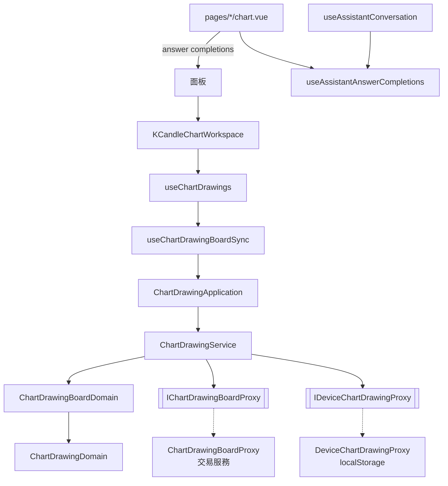

# 看盤繪圖存到帳號，並看得到助手畫的線 — Architecture Design

**Status:** Confirmed
**Source PRD:** `.sdd/2026-10-21-chart-drawings-saved-to-account/PRD.md`
**Tech context:** Nuxt · Vue 3 `<script setup>` · Clean/Onion（`.vue` → Application → Domain ← Proxy）· decimal.js · SCSS token · Vitest

---

## 1. Design Goal & Guiding Principle

- **In one sentence:** 把看盤工作區的繪圖板從「瀏覽器裡的一份」換成「帳號那一份＋這裡還沒存進去的改動」——讀、存、接上別處改動、搬舊繪圖、移除助手畫的，畫圖本身與上一步／下一步的規則一行不改。
- **Guiding principle:**
  1. **同步的規則在 domain，時機在 composable。** 「存回之後編號怎麼換」「別處改過要怎麼接上」「什麼算還沒存進去」全部是 `ChartDrawingBoardDomain` 的行為（不可變板子交回新板子）；「多久存一次、同時只存一次、什麼時候重讀」是畫面時機，住在新的 `useChartDrawingBoardSync`。
  2. **板子記著帳號那一份。** `ChartDrawingBoardDto` 多帶一份 `savedBoard`（帳號那一份，含版本），因此「還沒存進去的改動」＝目前的繪圖與它的差，「接上別處的改動」是三方合併（帳號舊的、帳號新的、這裡的），不需要任何一層另外記狀態。
  3. **介面以能力命名、一資源一 proxy。** 帳號的繪圖板一個 proxy（`IChartDrawingBoardProxy`），瀏覽器裡的舊繪圖一個 proxy（`IDeviceChartDrawingProxy`，只剩讀與忘掉）。

---

## 2. Change Scope

| Area | Action | What / Why |
| :--- | :--- | :--- |
| `IChartDrawingPreferenceProxy` / `ChartDrawingPreferenceProxy` | **Rename + shrink** → `IDeviceChartDrawingProxy` / `DeviceChartDrawingProxy` | 瀏覽器那一份不再是真相，只剩「讀舊繪圖」與「搬完忘掉」；寫入拿掉 |
| `IChartDrawingBoardProxy` / `ChartDrawingBoardProxy` | **Add** | 帳號的繪圖板：讀、整份存回（帶版本，衝突時拋出帶著現在那一份的哨兵錯誤）、移除助手畫的全部 |
| `ChartDrawing` entity / `ChartDrawingDto` | **Modify** | 多一個 `source`（`manual`／`assistant`）；DTO 多 `drawnByAssistant` |
| `ChartDrawingBoardDomain` / `ChartDrawingBoardDto` | **Modify** | 多 `savedBoard`；新繪圖拿暫時負號編號；新增 `acknowledged`（存回後換編號與來源）、`incorporated`（接上帳號較新的一份）、`hasUnsavedChanges` |
| `ChartDrawingService` / `ChartDrawingApplication` | **Modify** | 各動作不再寫留存（純計算）；新增 `openBoard`、`loadSavedBoard`（含搬舊繪圖）、`saveBoard`、`settleSave`（存回結果套到目前的板子：存進去就換編號、別處改過就接上）、`incorporateSavedBoard`、`removeAssistantDrawings` |
| `useChartDrawings` | **Modify** | 板子改由 `useChartDrawingBoardSync` 持有；每個動作之後排一次存回；存回換編號時選取跟著換 |
| `useChartDrawingBoardSync` | **Add** | 讀、延遲合併存回、同時只做一件事、衝突接上與重試上限、重讀時機（焦點、可見、外部訊號）、說明與提示 |
| `useAssistantAnswerCompletions` + `useAssistantConversation` | **Add / Modify** | 共用計數：一則回答由「在寫」變「寫完」時加一；行情圖表頁把它交給工作區當重讀訊號 |
| `KCandleChartWorkspace` / 兩個面板 / 兩個圖表頁 | **Modify** | 新 prop `drawingBoardRefreshSignal`；浮動提示區多三則說明（讀不到、存不進去、搬不成）；物件樹接上移除助手畫的全部 |
| `ChartDrawingObjectTree` / `ChartDrawingFloatingToolbar` | **Modify** | 「助手畫的」標籤；物件樹「移除助手畫的全部」與就地確認 |
| `ChartDrawingColorVo` | **Modify** | 多 `name`（交易服務的十二色名稱），proxy 據以對應 token；兩者一一對應，`_tokens.scss` 已有十二個 `drawing-*`，不需改 |
| locales | **Modify** | `marketData.chartDrawing.*` 新增中英字串 |
| `ChartDrawingLayer`、繪圖種類目錄、畫法與命中表 | **Not touched** | 畫圖手感與種類不變 |
| `assistantConversationId` / `assistantTurnId` | **Not modeled** | PRD 明定不做「跳到那一次問答」；proxy 讀得到但不收進 entity，等那一刀再加一欄 |

---

## 3. New Classes / Modules

| Name | Kind | Responsibility (purpose) | Collaborators | Satisfies |
| :--- | :--- | :--- | :--- | :--- |
| `IChartDrawingBoardProxy` | 介面 | `fetchBoard(marketSide, symbol)`、`saveBoard(board)`、`removeAssistantDrawings(marketSide, symbol)` | — | US-01、02、03、05 |
| `ChartDrawingBoardProxy` | Proxy | 打 `/users/me/chart-drawings/{market}/{symbol}`；wire ↔ entity（價格字串 ↔ Decimal、色名 ↔ token、`id ≤ 0` 送出時省略）；409 → `ChartDrawingBoardChangedError(currentBoard)` | `BackendApiProxy` | US-02、03、07 |
| `IDeviceChartDrawingProxy` / `DeviceChartDrawingProxy` | 介面 / Proxy | 讀這台瀏覽器某一邊某一檔的舊繪圖；搬完後忘掉那一筆（其他檔不動） | `localStorage` | US-06 |
| `ChartDrawingBoard` | Entity | 帳號那一份：市場、交易標的、版本、繪圖 | `ChartDrawing` | 全部 |
| `SavedChartDrawingBoardDto` | DTO | 帳號那一份交給 application 的形狀（`toEntity()`） | — | 全部 |
| `ChartDrawingSourceValue` | VO（字面量） | `manual`／`assistant` | — | US-05 |
| `ChartDrawingBoardChangedError` | 哨兵錯誤 | 存回時帳號那一份已經變了；帶著現在那一份 | — | US-03 |
| `ChartDrawingBoardLoadDto` | DTO | 讀回來的那一份、這一次搬進帳號幾個舊繪圖、搬的時候失敗的原因（或 null） | — | US-01、06 |
| `ChartDrawingSaveDto` | DTO | 存回的結果：`saved`（存進去的那一份）或 `superseded`（帳號現在那一份） | — | US-02、03 |
| `useChartDrawingBoardSync` | Composable | 持有板子 ref；`replaceBoard(next)` 後延遲 800ms 存回；一條序列化佇列（讀、存、重讀、移除一次一件）；衝突→接上→再存，連續 3 次停；`loadFailure`／`saveFailure`／`migrationFailure` 三則說明＋各自重試；視窗 `focus`、`visibilitychange` 與外部訊號重讀；換檔時把舊板子還沒存的先送出 | `ChartDrawingApplication` | US-01～06 |
| `useAssistantAnswerCompletions` | Composable | 全站共用的「答完幾則」計數 | `useState` | US-04 |

### `ChartDrawingBoardDomain` 新行為

| Method | 規則 |
| :--- | :--- |
| `added(drawing)` | 新繪圖拿 `min(0, 目前最小編號) − 1` 的暫時編號 |
| `hasUnsavedChanges()` | 目前的繪圖與 `savedBoard` 逐一比（編號、種類、錨點、樣式、鎖定、顯示），順序或數量不同也算 |
| `acknowledged(sent, saved)` | 送出的第 i 個對到存回的第 i 個：目前、上一步、下一步裡同編號的繪圖換成帳號的編號與來源；`savedBoard = saved`；記下 `renumberedDrawingIds`。數量對不上時整份改用帳號那一份 |
| `incorporated(saved)` | `saved.revision ≤ savedBoard.revision` → 不動。沒有還沒存的改動 → 改用帳號那一份。否則三方合併：這裡的每一個——暫時編號或不在舊的那份裡 → 留；帳號新的那份沒有 → 丟；和舊的那份一樣 → 用帳號新的；否則用這裡的（來源取帳號的）；再補上帳號新的那份裡、舊的那份與這裡都沒有的。兩種情況都清空上一步／下一步 |
| `assistantDrawingCount()` | 來源是助手的有幾個 |

---

## 4. Modified Components

| Component | Current role | Change needed |
| :--- | :--- | :--- |
| `ChartDrawingService` | 讀留存建板子、每步寫回留存 | 動作改純計算（不寫留存）；`loadSavedBoard`：讀帳號 → 版本 0 且空、瀏覽器有舊繪圖 → 以版本 0 存回 → 成功忘掉舊紀錄、失敗回報原因並交回帳號那一份；`saveBoard`：送出，`ChartDrawingBoardChangedError` → `superseded` |
| `ChartDrawingDomain` | 單一繪圖的行為 | `sameAs(other)`；`withSavedIdentityOf(saved)`（換編號與來源）；`toDto` 帶 `drawnByAssistant` |
| `useChartDrawings` | 畫面狀態＋直接呼叫同步的 application | 板子來自 sync；動作經 `sync.replaceBoard`；`watch(board)` 依 `renumberedDrawingIds` 換選取；選取的繪圖不在了就取消選取 |
| `KCandleChartWorkspace` | 工作區 | prop `drawingBoardRefreshSignal`；三則說明（`AppAlert` + 重試）；toast 收 sync 的提示；物件樹 `removeAssistantDrawings` |
| `ChartDrawingObjectTree` | 物件樹 | prop `assistantDrawingCount`；「助手畫的」`AppBadge`；就地確認；emit `removeAssistantDrawings` |
| `ChartDrawingFloatingToolbar` | 浮動工具列 | `drawing.drawnByAssistant` 時多一個「助手畫的」標籤 |
| `KCandleChartPanel` / `KCandleContractChartPanel` | 面板 | 透傳 `drawingBoardRefreshSignal` |
| `pages/k-candles/chart.vue`、`pages/contract-k-candles/chart.vue` | 頁面 | 從 `useAssistantAnswerCompletions()` 取計數交給面板 |
| `useAssistantConversation.refreshCurrentConversation` | 讀回對話 | 讀回前在寫、讀回後不在寫（同一段對話）→ 計數加一 |
| `plugins/dependencies.ts` | 組裝根 | `ChartDrawingService(new ChartDrawingBoardProxy(...), new DeviceChartDrawingProxy())` |

---

## 5. Component Relationships



存回的時序（composable）：

```
動作 → board = application.addDrawing(...) → replaceBoard → 800ms 計時
計時到 → 佇列：sent = board；result = await saveBoard(sent)
  board = settleSave(board(最新), sent, result)
  saved      → 清掉說明
  superseded → 提示；連續 < 3 次 → 再存
  錯誤        → saveFailure = 原因（下一步或重試會再試）
  結果回來時板子已換成別檔 → 丟掉結果
```

---

## 6. Extensibility & Handoff Notes

- **Most likely next requirement:** 即時推播（別處一改就出現）；其次是「跳到畫這條線的那一次問答」。
- **Where it lands:**
  - 推播：新的觸發來源只要呼叫 `useChartDrawingBoardSync.refresh()`（或把推來的那一份交給 `incorporateSavedBoard`），合併規則不必改。
  - 跳到問答：entity 加 `assistantConversationId`，proxy 多讀一欄，物件樹那一列多一個連結。
- **How to add it:** add-only——觸發點進 composable，規則留在 `ChartDrawingBoardDomain`。
- **Patterns applied & why:** 不可變板子＋三方合併（帳號舊的、帳號新的、這裡的）對應「帳號那一份會在別處變」這條變動軸；單一佇列消除讀與存的競爭。
- **Do not hardcode:** 存回延遲（`CHART_DRAWING_SAVE_DELAY_MILLISECONDS`）、衝突上限（`CHART_DRAWING_CONFLICT_RETRY_LIMIT`）放 composable 頂端常數。
- **Known debt / deferred:**
  - 上一步帶回一個帳號裡已刪的助手繪圖，帳號會發新編號並當成手畫的——接受（PRD 已記）。
  - 換檔時舊檔還沒存的改動照樣送出，但結果與錯誤不再呈現（使用者已離開那一檔）。
  - 頁面關閉當下還在等的那一次存回可能送不出去（約 0.8 秒的窗口）；不為它加 `sendBeacon`。

---

## 7. Traceability

| PRD Scenario | Fulfilled by |
| :--- | :--- |
| US-01 另一台電腦看到帳號裡的繪圖 | `ChartDrawingBoardProxy.fetchBoard`、`ChartDrawingService.loadSavedBoard`、`useChartDrawingBoardSync` 讀 |
| US-01 帳號從沒存過、瀏覽器也沒有 | `loadSavedBoard`（不搬、不提示） |
| US-01 讀回來之前先畫的不會被蓋掉 | `ChartDrawingBoardDomain.incorporated`（暫時編號留著）＋存回 |
| US-01 讀不到／重試成功 | `useChartDrawingBoardSync.loadFailure`＋`retryLoad`、工作區 `AppAlert` |
| US-02 畫一條線就存回 | `useChartDrawings` → `replaceBoard` → `saveBoard` → `acknowledged`（帳號編號） |
| US-02 拖動途中不存 | `ChartDrawingLayer` 只在放手時 `change`（既有）＋ composable 延遲存回 |
| US-02 很快連做幾步合併 | `useChartDrawingBoardSync` 800ms 計時重設 |
| US-02 上一步也存回 | `undo` 也走 `replaceBoard` |
| US-02 存不進去／超過上限／重試／再做一步也會再試 | `saveFailure`、`retrySave`、`replaceBoard` 再排存回；`BackendRequestRejectedError` 帶交易服務的原因 |
| US-03 助手剛畫了線、這裡又畫 | `ChartDrawingBoardChangedError` → `superseded` → `incorporated` → 再存；提示 |
| US-03 別處刪掉的／兩邊都改同一條 | `incorporated` 三方合併規則 |
| US-03 接上之後上一步從頭 | `incorporated` 清空 undo／redo |
| US-03 連續三次接不上 | `CHART_DRAWING_CONFLICT_RETRY_LIMIT`、`saveFailure` |
| US-04 助手答完 | `useAssistantConversation` 計數 → `useAssistantAnswerCompletions` → 頁面 → 面板 → 工作區 `drawingBoardRefreshSignal` → `refresh` |
| US-04 切回視窗 | `useChartDrawingBoardSync` `focus`／`visibilitychange` → `refresh` → `incorporated` |
| US-04 帳號沒變什麼都不動 | `incorporated`（版本不比這裡新 → 原板子） |
| US-04 沒有重讀時機 | 不做推播（無程式） |
| US-05 物件樹／浮動工具列標出 | `ChartDrawingDto.drawnByAssistant`、`ChartDrawingObjectTree`、`ChartDrawingFloatingToolbar` |
| US-05 移動後仍是助手畫的 | `acknowledged` 取帳號回來的來源（帳號保留既有編號的來源） |
| US-05 移除全部／沒有時不出現／取消／失敗 | `ChartDrawingObjectTree`（`assistantDrawingCount`、就地確認）、`useChartDrawingBoardSync.removeAssistantDrawings` → `refresh`；失敗提示 |
| US-05 不能上一步 | 移除後 `refresh` → `incorporated` 清空 undo／redo |
| US-06 搬進帳號／已有不搬／現貨合約分開／搬失敗／曾經存過不搬 | `ChartDrawingService.loadSavedBoard`（版本 0 且空才搬、成功才 `forgetChartDrawings`）、`DeviceChartDrawingProxy`（鍵含市場）、`migrationFailure` 說明 |
| US-07 色名對應／改色／認不得／固定配色 | `ChartDrawingColorVo.name`、`ChartDrawingBoardProxy` 對應、`ChartDrawingDomain` 建構子退回預設色、`ChartDrawingLayer` 固定配色（既有） |

---

## 8. Risks & Open Decisions

- **Risks:** composable 的佇列與計時是最容易出錯的地方——以 fake timers 的 composable 測試覆蓋：合併存回、衝突重試上限、換檔、存回中重讀。
- **Open decisions (for implementation):** 說明在浮動提示區排在面板既有說明之後；三則說明各用 `AppAlert` 的 `warning` 語氣。

---

## 9. Implementation Notes（與原設計的差異）

- **`ChartDrawingBoardNotices` 分子**：三則說明（讀不到、存不進去、舊繪圖沒搬成）收成一個分子放在工作區的浮動提示區，排在面板既有說明之後；工作區只接重試事件。
- **`/improve-codebase` 之後**：`acknowledgeSave` 換成 `settleSave(board, sentBoard, result)`——存回結果要換編號還是接上別處的改動，由 service 依結果決定；composable 只負責提示、清掉說明與再存。
- **提示走 `announcement`**：sync composable 交出一個「剛發生的事」的說法，工作區照既有的短暫提示顯示，不另開提示元件。
