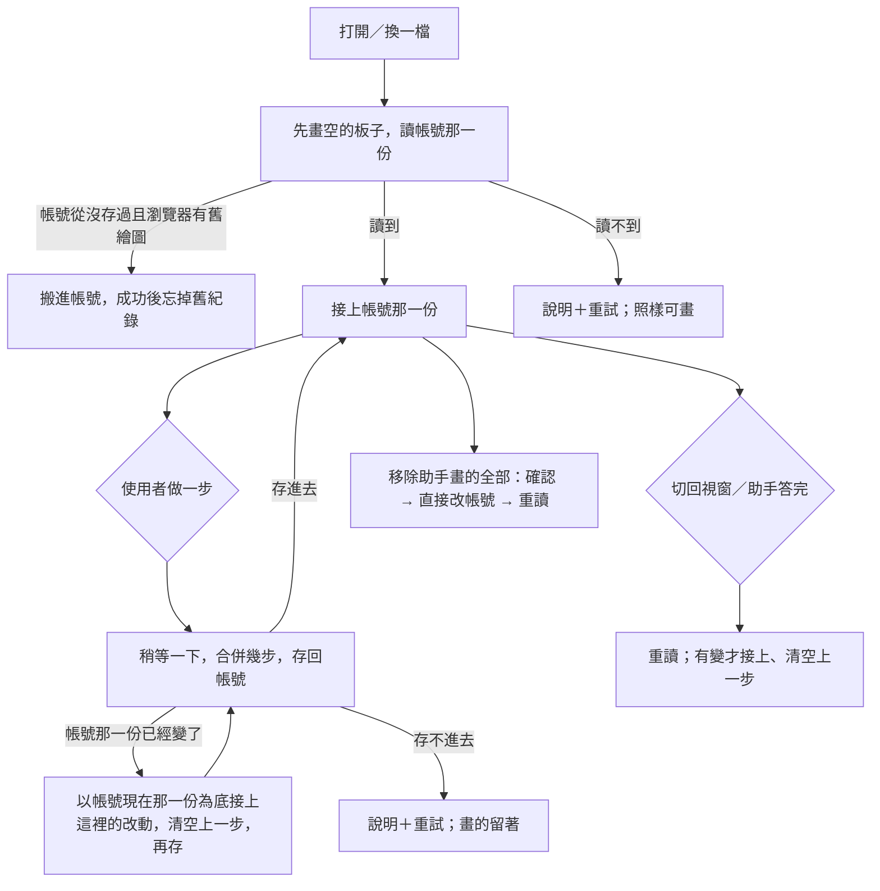

# Product Requirements Document (PRD)

**Status:** Finalized
**Version:** v1.0
**Owner:** James Hsueh
**Stakeholders:** 使用者本人（看盤、研究策略腳本、用站內助手畫線）

---

## 1. Background & Goal (Why & Goal)

- **Problem Statement:** 看盤工作區的繪圖只記在這個瀏覽器裡：換一台電腦就不見，站內助手也看不到、畫不了。
  交易服務已經把**繪圖板**放進帳號，並讓站內助手與外掛能在帳號那一份上畫「助手畫的」繪圖——
  但看盤工作區還在讀寫瀏覽器裡那一份，助手畫的線使用者看不到。
- **Expected Outcome:**
  1. 看盤工作區打開一檔時，畫出來的是**帳號裡**那一邊那一檔的繪圖板；每做完一步就存回帳號。
     換一台電腦打開同一檔，看到同一批繪圖。
  2. 助手畫的繪圖畫在圖上，物件樹與浮動工具列標明「助手畫的」，物件樹可一次「移除助手畫的全部」。
  3. 站內助手答完一則、或使用者切回這個視窗時重讀，助手剛畫的線不必重新整理就出現。
  4. 帳號那一份在別處被改過時，**絕不默默蓋掉別處的改動**，而是把這裡的改動接上去。
  5. 這台瀏覽器裡以前的舊繪圖，在帳號那一份從沒存過時自動搬進帳號。
  6. 畫圖的手感與既有規則（八種繪圖、選取、鎖定、隱藏、上一步／下一步、快捷鍵）一條都不改；存不存得進去不影響畫不畫得出來。
- **Out of Scope:**
  - 文字標註等新的繪圖種類。
  - 即時推播（圖開著時別處一改就出現）。
  - 跨使用者分享繪圖板。
  - 上一步／下一步跨裝置或跨重新整理留存。
  - 指名移除某幾個助手畫的繪圖；從繪圖跳到畫它的那一次問答。

---

## 2. User Personas

- **Primary Role(s):** 看盤的人——專案作者本人，單人使用；同時是站內助手的使用者。
- **Usage Context:** 桌機寬螢幕看盤，旁邊開著助手抽屜問「幫我把這段的支撐壓力畫出來」；
  有時在另一台電腦或手機打開同一檔接著看。也可能同時開著兩個分頁看同一檔。

---

## 3. User Stories & Acceptance Criteria

### US-01 — 打開一檔就帶出帳號裡的繪圖板 [priority: P0]
**As a** 看盤的人, **I want** 打開一檔看到的是帳號裡的繪圖, **so that** 換一台電腦也看得到我畫的線。

```gherkin
Scenario: 另一台電腦看到帳號裡的繪圖
  Given 帳號裡現貨 BTCUSDT 有一條 60000 的水平線
  When 在另一台電腦打開現貨 BTCUSDT 的行情圖表
  Then 圖上有那條 60000 的水平線

Scenario: 帳號裡從沒存過、瀏覽器也沒有舊繪圖
  Given 帳號裡現貨 BTCUSDT 從沒存過繪圖
  And 這台瀏覽器沒有現貨 BTCUSDT 的舊繪圖
  When 打開現貨 BTCUSDT
  Then 圖上沒有繪圖
  And 不出現任何關於繪圖的提示

Scenario: 讀回來之前先畫的不會被蓋掉
  Given 帳號裡現貨 BTCUSDT 有一條 60000 的水平線
  And 帳號那一份還沒讀回來
  When 先畫了一條趨勢線，之後帳號那一份讀回來
  Then 圖上同時有那條趨勢線與 60000 的水平線
  And 兩條都存在帳號裡

Scenario: 讀不到帳號裡的繪圖
  Given 連不上交易服務
  When 打開現貨 BTCUSDT
  Then 圖上說「讀不到存在帳號裡的繪圖」與原因，並給「重試」
  And 照樣可以畫繪圖

Scenario: 讀不到之後重試成功
  Given 剛才讀不到帳號裡的繪圖、現在連得上
  When 按「重試」
  Then 帳號裡的繪圖出現，說明消失
```

### US-02 — 每一步存回帳號 [priority: P0]
**As a** 看盤的人, **I want** 畫完、改完就存進帳號, **so that** 不用記得按儲存，關掉也不會丟。

```gherkin
Scenario: 畫一條線就存回帳號
  Given 帳號裡現貨 BTCUSDT 是空的
  When 畫一條趨勢線
  Then 帳號裡現貨 BTCUSDT 有那條趨勢線
  And 那條趨勢線的編號是帳號發的

Scenario: 拖動途中不存，放手才存一次
  Given 選取一條線
  When 拖著它移動一段時間後放手
  Then 帳號只收到一次存回，存的是放手時的位置

Scenario: 很快連做幾步合併成一次存回
  Given 選取一條線寬 1 的趨勢線
  When 很快地連按三次線寬
  Then 帳號只收到一次存回，記著線寬 4

Scenario: 上一步也存回帳號
  Given 剛畫了一條線，帳號裡也有它
  When 按上一步
  Then 線從圖上消失，帳號裡也沒有它

Scenario: 存不進去時畫的東西留著並說明
  Given 連不上交易服務
  When 畫一條線
  Then 那條線留在圖上、可以繼續畫
  And 圖上說「繪圖沒能存到帳號」與原因，並給「重試」

Scenario: 超過一份繪圖板的上限
  Given 帳號裡這一份已經有 200 個繪圖
  When 再畫一個
  Then 新畫的那一個留在圖上
  And 圖上說「繪圖沒能存到帳號」並說出交易服務給的原因（一份最多 200 個）

Scenario: 重試之後存進去
  Given 上一次存不進去、現在連得上
  When 按「重試」
  Then 存進帳號，那則說明消失

Scenario: 存不進去之後再做一步也會再試
  Given 上一次存不進去、現在連得上
  When 再畫一條線
  Then 兩條線都存進帳號，那則說明消失
```

### US-03 — 帳號那一份在別處被改過時，不蓋掉別處的改動 [priority: P0]
**As a** 看盤的人, **I want** 這裡存回時把別處的改動留著, **so that** 助手剛畫的線不會被我這邊默默蓋掉。

```gherkin
Scenario: 助手剛畫了線、這裡又畫了一個
  Given 圖開著時助手在帳號裡畫了一條支撐線，這裡還沒重讀
  When 在這裡畫一個矩形
  Then 圖上與帳號裡都同時有支撐線與矩形
  And 提示「繪圖在別處改過，已接上最新的一份」

Scenario: 別處刪掉的這裡也不再有
  Given 另一個視窗刪了 A 線，這裡還沒重讀
  When 在這裡移動 B 線
  Then 圖上與帳號裡都沒有 A 線
  And B 線在新的位置

Scenario: 兩邊都改了同一條，以這裡為準
  Given 另一個視窗把 A 線移到 61000，這裡還沒重讀
  When 在這裡把 A 線移到 62000
  Then 帳號裡 A 線在 62000

Scenario: 接上別處的改動之後上一步從頭開始
  Given 剛接上別處的改動
  When 看上一步
  Then 上一步按不了

Scenario: 別處一直在改，接不上
  Given 別處一直在改，連續三次都沒接上
  When 存回
  Then 停下來，圖上說「繪圖沒能存到帳號」並給「重試」
  And 圖上的繪圖照樣都在
```

### US-04 — 回到視窗、助手答完時重讀 [priority: P0]
**As a** 看盤的人, **I want** 助手答完或我切回來時自動重讀, **so that** 助手畫的線不必重新整理就出現。

```gherkin
Scenario: 助手答完，畫的線出現
  Given 打開著現貨 BTCUSDT，問站內助手「幫我畫出支撐壓力」
  And 助手在帳號裡畫了兩條線
  When 助手答完那一則
  Then 不必重新整理，圖上出現那兩條線

Scenario: 切回這個視窗，出現別處加的線
  Given 在另一個視窗加了一條線
  When 切回這個視窗
  Then 圖上出現那一條線
  And 上一步按不了

Scenario: 切回來時帳號那一份沒變
  Given 帳號那一份沒有變，這裡有上一步可按、選取著一條線
  When 切回這個視窗
  Then 圖上什麼都不變
  And 上一步仍可按、那條線仍選取著

Scenario: 沒有重讀的時機就暫時看不到
  Given 圖開著、沒切走、沒問助手
  When 另一台電腦加了一條線
  Then 這裡暫時看不到那條線，直到下一次重讀
```

### US-05 — 看得出助手畫的、可一次移除 [priority: P0]
**As a** 看盤的人, **I want** 分得出哪些是助手畫的、並能一次清掉, **so that** 助手畫得不好時我能乾淨地重來。

```gherkin
Scenario: 物件樹標出助手畫的
  Given 有一條助手畫的水平線與一條手畫的趨勢線
  When 打開物件樹
  Then 水平線那一列標「助手畫的」
  And 趨勢線那一列沒有

Scenario: 選取助手畫的繪圖時浮動工具列也標出
  Given 有一條助手畫的水平線
  When 選取它
  Then 浮動工具列上標「助手畫的」

Scenario: 移動助手畫的繪圖，仍是助手畫的
  Given 有一條助手畫的水平線
  When 把它拖到別的價格
  Then 它停在新的價格，仍標「助手畫的」

Scenario: 移除助手畫的全部
  Given 有兩條助手畫的、一條手畫的
  When 在物件樹按「移除助手畫的全部」並確認
  Then 圖上只剩手畫的那一條
  And 提示「已移除 2 個助手畫的繪圖」

Scenario: 沒有助手畫的繪圖
  Given 只有手畫的繪圖
  When 打開物件樹
  Then 沒有「移除助手畫的全部」

Scenario: 移除助手畫的全部不能上一步
  Given 剛移除助手畫的全部
  When 看上一步
  Then 上一步按不了
  And 被移除的助手繪圖不會因為上一步回來

Scenario: 確認時取消
  Given 有一條助手畫的繪圖
  When 按「移除助手畫的全部」，確認時按取消
  Then 那條助手畫的繪圖還在

Scenario: 移除失敗
  Given 連不上交易服務、有一條助手畫的繪圖
  When 按「移除助手畫的全部」並確認
  Then 說明「沒能移除助手畫的繪圖」與原因
  And 那條助手畫的繪圖還在
```

### US-06 — 舊繪圖搬進帳號 [priority: P1]
**As a** 看盤的人, **I want** 以前畫在這台瀏覽器的線自動搬進帳號, **so that** 換到帳號存之後舊的線不會消失。

```gherkin
Scenario: 帳號從沒存過，搬進去
  Given 帳號裡現貨 BTCUSDT 從沒存過
  And 這台瀏覽器有現貨 BTCUSDT 的 3 個舊繪圖
  When 打開現貨 BTCUSDT
  Then 圖上與帳號裡都有那 3 個繪圖，都是手畫的
  And 提示「已把這台裝置上的 3 個繪圖存到帳號」
  And 這台瀏覽器不再記著現貨 BTCUSDT 的舊繪圖

Scenario: 帳號裡已經有東西就不搬
  Given 帳號裡現貨 BTCUSDT 有 1 個繪圖
  And 這台瀏覽器有現貨 BTCUSDT 的 3 個舊繪圖
  When 打開現貨 BTCUSDT
  Then 圖上只有帳號那 1 個
  And 這台瀏覽器的 3 個舊繪圖照樣記著

Scenario: 現貨與合約分開
  Given 這台瀏覽器只有合約 BTCUSDT 的舊繪圖
  And 帳號裡現貨 BTCUSDT 從沒存過
  When 打開現貨 BTCUSDT
  Then 圖上沒有繪圖、不搬任何東西

Scenario: 搬的時候連不上
  Given 帳號裡現貨 BTCUSDT 從沒存過、這台瀏覽器有舊繪圖
  And 搬的那一次連不上交易服務
  When 打開現貨 BTCUSDT
  Then 圖上說「沒能把這台裝置上的舊繪圖存到帳號」，下次打開再試
  And 這台瀏覽器的舊繪圖照樣記著

Scenario: 帳號曾經存過、現在是空的就不搬
  Given 帳號裡現貨 BTCUSDT 曾經存過、後來清空
  And 這台瀏覽器有現貨 BTCUSDT 的舊繪圖
  When 打開現貨 BTCUSDT
  Then 圖上沒有繪圖、不搬任何東西
```

### US-07 — 線色與交易服務的十二色一一對應 [priority: P0]
**As a** 看盤的人, **I want** 在哪裡畫的顏色都一樣, **so that** 助手說它畫了藍線，我看到的就是藍線。

```gherkin
Scenario: 帳號裡記著的顏色畫成調色盤上那一色
  Given 帳號裡一條線記著青綠
  When 打開
  Then 那條線畫成調色盤上的青綠

Scenario: 改色後帳號記著新的顏色
  Given 選取一條藍色的趨勢線
  When 在浮動工具列改成靛
  Then 帳號裡那條線記著靛

Scenario: 認不得的顏色
  Given 帳號裡一個矩形記著調色盤上沒有的顏色
  When 打開
  Then 那個矩形畫成矩形的預設顏色紫

Scenario: 固定配色的繪圖
  Given 帳號裡一個斐波那契回撤
  When 打開
  Then 它照斐波那契回撤固定的配色畫
```

---

## 4. Business Flow & Logic



- **Core Business Rules:**
  - **帳號是繪圖的家**：圖上的繪圖以帳號那一份為準；這裡做的每一步是「還沒存進去的改動」，存進去之後才算數。
  - **存回**：每一步做完稍等一下（約 0.8 秒）再存，期間又做的步合併；同一時間只存一次，存的時候又做了步，存完再存一次。
    存回時說出「根據帳號的第幾版改的」。
  - **新繪圖的編號**由帳號發；存回之前這裡先用暫時的記號，存回後換成帳號發的編號，選取與上一步跟著換。
  - **接上別處的改動**（存回時發現帳號那一份已經變了，或重讀時帳號那一份比這裡新）：以繪圖為單位——
    這裡新畫的留著；這裡改過的以這裡為準；這裡沒動過的以帳號為準；別處新增的留著；別處刪掉的這裡也刪掉；這裡刪掉的不再出現。
    接上之後上一步與下一步清空。帳號那一份比這裡舊或一樣時不動。
  - 連續三次存回都碰到帳號那一份又變了，停下來說明並給重試。
  - **重讀時機**：切回這個分頁或視窗、站內助手答完一則、移除助手畫的全部之後、按讀不到的「重試」。
  - **助手畫的**：來源由帳號記，這裡不能改；被使用者移動、改樣式仍是助手畫的。上一步把一個已經在帳號裡被刪掉的繪圖帶回來時，帳號會把它當成新的手畫繪圖。
  - **移除助手畫的全部**：只在有助手畫的繪圖時出現；先確認；直接改帳號、不算一步；之後重讀。
  - **舊繪圖搬家**：只在帳號那一份「從沒存過」時搬那一邊那一檔的舊繪圖，當成手畫的；成功才忘掉舊紀錄。
  - **線色**：十二色名稱與調色盤一一對應；認不得的顏色畫成那種繪圖的預設色。
- **Edge Cases:**
  - 存回或讀的途中換了交易標的：換之前還沒存的那幾步照樣送出；回來的結果不套到新的那一檔上。
  - 存回途中又讀：讀等存完再做，避免把自己剛存的當成別處的改動。
  - 被登出：沿用既有的登出規則（回登入畫面）。
  - 帳號那一份讀回來時與這裡完全一樣：什麼都不提示。

---

## 5. UI/UX Design & Interaction

- **Prototype Link:** 沿用看盤工作區既有設計；本刀只加說明、標記與一個動作。
- **Key Interactions:**
  - 「讀不到」「存不進去」「沒能搬舊繪圖」三則說明放在圖的上緣中間那一區浮動提示（與既有圖的狀態說明同一區、排在它們之後），各自帶「重試」（搬舊繪圖那一則沒有重試，下次打開自動再試）。
  - 「已接上最新的一份」「已移除 N 個助手畫的繪圖」「已把這台裝置上的 N 個繪圖存到帳號」用既有的短暫提示。
  - 物件樹：助手畫的那一列在名稱旁標一個小標籤「助手畫的」；標題下方一列「移除助手畫的全部（N）」，只在 N > 0 時出現。
  - 確認：按下「移除助手畫的全部」後，同一處換成「確定移除 N 個助手畫的繪圖？」與「移除」「取消」兩顆按鈕。
  - 浮動工具列：選取助手畫的繪圖時，最左邊多一個小標籤「助手畫的」。
  - 讀的時候不擋圖、不出現轉圈圈。
- 中英文字串都要有。

---

## 6. Non-Functional Requirements

- **Performance:** 拖動與畫線的手感不受存回影響（存回不在拖動途中發生）；一次動作最多觸發一次存回。重讀一檔只讀那一檔。
- **Security:** 存回與讀都以目前登入的身分進行；不能讀寫別人的繪圖板（由交易服務把關）。
- **Compatibility:** 與看盤工作區相同（桌機與手機寬 390）。
- **Analytics / Tracking:** N/A。

---

## 7. Dependencies & Risks

- **External Dependencies:** 交易服務的繪圖板（讀、整份存回、移除助手畫的）；站內助手。
- **Known Risks:**
  - 上一步把已在帳號刪掉的助手繪圖帶回來會變成手畫的——已接受，並以「別處改過就清空上一步」降低機率。
  - 沒有即時推播，兩個視窗同時改時靠存回時接上；接不上時停下來說明。

---

## 8. Appendix

- Brief：`.sdd/2026-10-21-chart-drawings-saved-to-account/BRIEF.md`
- 看盤工作區：`.sdd/2026-10-16-supercharts-chart-workspace/`
- 交易服務：`go-trading/.sdd/2026-10-20-chart-drawing-storage-and-assistant-drawing/`
