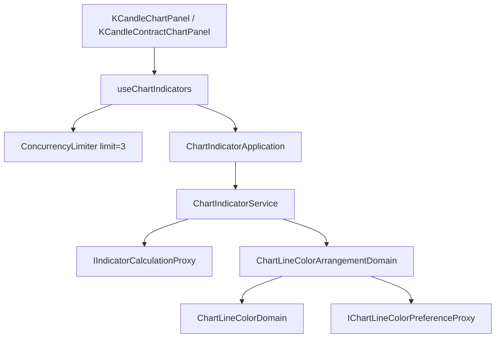

# 多支指標一起算 — Architecture Design

**Status:** Confirmed
**Source PRD:** `.sdd/2026-10-21-concurrent-chart-indicator-calculation/PRD.md`
**Tech context:** Nuxt 3 · Vue 3 · TypeScript · Clean/Onion（`.vue` → Application → Domain ← Infrastructure）

---

## 1. Design Goal & Guiding Principle

- **In one sentence:** `useChartIndicators` 的每一次指標計算都經過一個每張圖一份、上限三支的併發閘門；結果仍以既有「每支各自的請求序號」判斷是否過期；每一支畫上時由領域依**清單順序**重新配一次全部線色。
- **Guiding principle:** 三件事各自只有一個家——**上限**住在一個純技術的併發閘門（不認識指標）、**過期判斷**沿用既有請求序號（不另立第二套）、**配色順序**住在領域（畫面只交出清單順序）。之後要改上限、改排程策略或改配色規則，各自只動一處。

---

## 2. Change Scope

| Area | Action | What / Why |
| :--- | :--- | :--- |
| `app/utilities/concurrency-limiter.ts` | **Add** | `ConcurrencyLimiter`：同時最多 N 個非同步工作，其餘排隊（FIFO），一個結束就交棒給下一個。純技術、無領域資料，符合 `utilities/` 門檻 |
| `app/domain/models/domains/chart-line-color-arrangement-domain.ts` | **Add** | `ChartLineColorArrangementDomain`：依清單順序替所有已算好的指標重新配色 |
| `ChartIndicatorService` / `ChartIndicatorApplication` | **Modify** | 新增 `arrangeChartLineColors(chartIndicatorDtos)`，回傳依清單順序配好色的那一份 |
| `app/composables/use-chart-indicators.ts` | **Modify** | `calculateOne` 經過閘門；`recalculateEveryApplied` 與還原改為一起送出（`Promise.all`）；畫上時依清單順序排好再請領域配色；`calculatingIds` 結束時只拿掉自己那一份 |
| `IIndicatorCalculationProxy` 與其實作 | **Not touched** | 系統端點、等待進度條的前景／背景兩條路完全不變 |
| `ChartIndicatorDomain` 的單支配色 | **Not touched** | 計算當下照舊配一次（快照），畫上時由排列那一步定案；是否收斂成單一路徑交給 improve-codebase 判斷 |
| 取消已送出的請求 | **Not touched** | PRD 範圍外；proxy 不支援中途取消 |

---

## 3. New Classes / Modules

| Name | Kind | Responsibility (purpose) | Collaborators | Satisfies (PRD scenario) |
| :--- | :--- | :--- | :--- | :--- |
| `ConcurrencyLimiter` | Utility class | 讓同一時間最多 `limit` 個工作在跑；`run(task)` 拿到名額才執行 task，結束（成功或失敗）時把名額交給排隊中的下一個 | — | 三支同時送去算；第四支起排隊；單獨加一支也受上限管 |
| `ChartLineColorArrangementDomain` | Domain Model | 拿清單順序的一串已算好的指標，逐支逐條以 `ChartLineColorDomain` 配色：「被用掉」只算清單上排在前面的、「同一條線已經在圖上」也只看前面的 | `IChartLineColorPreferenceProxy`、`ChartLineColorDomain`、`DrawnChartLinesVo` | 顏色只看清單順序三則 |

`ConcurrencyLimiter.run<T>(task: () => Promise<T>): Promise<T>` 是唯一公開方法——呼叫端不必 acquire/release。

---

## 4. Modified Components

| Component | Current role | Change needed |
| :--- | :--- | :--- |
| `useChartIndicators.calculateOne` | 取序號、標為正在算、送出、比對序號後採用 | 取序號與標為正在算照舊**同步**做；送出改包在 `calculationLimiter.run` 裡；拿到名額時若已不是最新要求或畫面已收掉就**不送**；採用時把結果放進清單順序、請 Application 重新配色；`finally` 只拿掉 `calculatingIds` 裡**一個**自己的 id |
| `useChartIndicators.recalculateEveryApplied` | `for … await` 逐支 | `await Promise.all(appliedIndicators.map(calculateOne))`，上限由閘門負責 |
| `useChartIndicators.loadStrategyScripts`（還原） | `for … await` 逐支 | 同上，一起交給閘門 |
| `ChartIndicatorService` | 計算、換色、列色 | 新增 `arrangeChartLineColors` |
| `ChartIndicatorApplication` | 薄轉送 | 新增 `arrangeChartLineColors` 轉送 |

上限常數 `CONCURRENT_INDICATOR_CALCULATION_LIMIT = 3` 只宣告在 `use-chart-indicators.ts` 一處；閘門每個 composable 實例一份（現貨、合約兩張圖各自計）。

---

## 5. Component Relationships

---

## 6. Extensibility & Handoff Notes

- **Most likely next requirement:** 調整上限（系統變快／變慢），或讓兩張圖共用一個上限。
- **Where it lands:** `CONCURRENT_INDICATOR_CALCULATION_LIMIT` 常數；共用上限時把 `ConcurrencyLimiter` 實例改由組裝根提供即可，`calculateOne` 不變。
- **How to add it:** 改常數；或新增一個 provide 的 limiter 實例並傳入 composable。
- **Patterns applied & why:** 計數號誌（semaphore）——上限是「同時幾個」而不是「一批幾個」，一個結束立刻補上，比分批 `Promise.all` 更快。
- **Do not hardcode:** 上限數字不得在其他地方重複出現。
- **Known debt / deferred:** 已送出但被取代的請求仍佔名額直到回來（無法取消）；若之後 proxy 支援中止，可在取代時中止以釋放名額。

---

## 7. Traceability

| PRD Scenario | Fulfilled by |
| :--- | :--- |
| 三支同時送去算 | `recalculateEveryApplied`（`Promise.all`）+ `ConcurrencyLimiter` |
| 第四支起排隊 | `ConcurrencyLimiter` |
| 只掛一支時與現在一樣 | `calculateOne` |
| 排隊中的也顯示正在算 | `calculateOne` 在進閘門前就加入 `calculatingIds` |
| 單獨加一支也受上限管 | `addToChart` → `calculateOne` → `ConcurrencyLimiter` |
| 先算好的先畫上 | `calculateOne` 各自採用，不等 `Promise.all` |
| 一支失敗不影響其他支 | `calculateOne` 各自 `try/catch` |
| 換標的後舊標的晚回來 | 既有請求序號 `isLatestRequest` |
| 被取代的排隊那一次不送出 | 拿到名額時檢查 `isLatestRequest` |
| 移除之後才回來的不畫回去 | 既有 `removeAppliedIndicator` 推進序號 |
| 後面那支先算好，顏色仍照清單順序 | 清單順序排列 + `ChartLineColorArrangementDomain` |
| 挑過的顏色照舊 | `ChartLineColorArrangementDomain` → `ChartLineColorDomain` 規則二 |
| 同一支擺兩筆，第二筆先算好 | `ChartLineColorArrangementDomain`（「已經在圖上」只看前面的） |
| 一根走完時同時重算且不亮進度條 | `recalculateEveryApplied(true)` 走 `recalculateChartIndicator` |
| 使用者的操作照舊亮進度條 | `calculateChartIndicator` 路徑不變 |

---

## 8. Risks & Open Decisions

- **Risks / trade-offs:** 第一次打開畫面時，後面那支若先回來會先用暫時的顏色，前面那支回來後重新配色（最終與依序相同）。可接受：只在線第一次出現時、且只在沒挑過顏色時發生。
- **Open decisions (for implementation):** 無。
