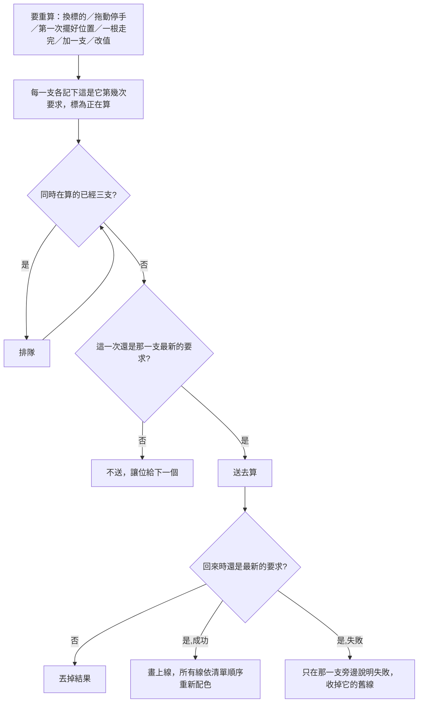

# Product Requirements Document (PRD) — 多支指標一起算

**Status:** Finalized
**Version:** v1.0
**Owner:** James Hsueh
**Stakeholders:** 看行情的人（唯一使用者）

---

## 1. Background & Goal (Why & Goal)

- **Problem Statement:** 圖表上掛著好幾支已套用的指標時，每一次重算都是一支算完才送下一支。系統算一支約一到兩秒，掛三支就要等三倍時間才全部畫好。換交易標的、拖動停手、第一次擺好位置、一根 K 線走完的跟盤重算，都走同一條路。
- **Expected Outcome:**
  - 掛三支時，一次重算等的時間約等於最慢那一支，而不是三支相加。
  - 同時在算的指標每張圖最多三支（系統那一側全體同時最多處理六支，現貨與合約兩張圖同時開著也不會超過）。
  - 每一支算好就先畫上。
  - 換標的、拖動之後，圖上永遠是最新那一段的線；線的顏色分配與依序算完時一模一樣。
- **Out of Scope:**
  - 取消已經送出、但已經不需要的那一次計算（讓它跑完，結果不採用）。
  - 系統那一側單次計算的速度。
  - 讓使用者自己調同時算幾支。

---

## 2. User Personas

- **Primary Role(s):** 看行情的人。
- **Usage Context:** 在現貨或合約 K 線圖表上掛著兩支以上已套用的指標，換標的、拖動、或放著跟盤。

---

## 3. User Stories & Acceptance Criteria

### US-01 — 好幾支同時算，但有上限 [priority: P0]
**As a** 看行情的人，**I want** 掛著的幾支指標同時去算，**so that** 換標的之後不必等每一支排隊算完。

```gherkin
Scenario: 三支同時送去算
  Given 圖上掛著三支已套用的指標
  When 換一個交易標的
  Then 三支同時送去計算，不等前一支算完

Scenario: 第四支起排隊
  Given 圖上掛著四支已套用的指標
  When 換一個交易標的
  Then 先送出三支
  And 第四支在前面任一支算好之後才送出

Scenario: 只掛一支時與現在一樣
  Given 圖上掛著一支已套用的指標
  When 拖動圖表後停手
  Then 送出那一支的計算一次

Scenario: 排隊中的也顯示正在算
  Given 圖上掛著四支，第四支在排隊
  Then 清單上四支都顯示「正在算」

Scenario: 單獨加一支也受上限管
  Given 三支正在算
  When 再加一支沒有旋鈕的策略腳本
  Then 新加的那一支等前面任一支算好之後才送出
```

### US-02 — 算好一支畫一支 [priority: P0]
**As a** 看行情的人，**I want** 每一支算好就先畫上，**so that** 快的那幾支不必等慢的。

```gherkin
Scenario: 先算好的先畫上
  Given 三支同時在算
  When 第二支先算好
  Then 第二支的線立刻畫在圖上
  And 另外兩支仍顯示「正在算」

Scenario: 一支失敗不影響其他支
  Given 三支同時在算
  When 第一支失敗、另外兩支成功
  Then 第一支旁邊說明失敗，圖上沒有它的線
  And 另外兩支的線照常畫上
```

### US-03 — 舊的結果不蓋掉新的 [priority: P0]
**As a** 看行情的人，**I want** 圖上永遠是我最後要看的那一段，**so that** 不會把另一檔的值看成這一檔的。

```gherkin
Scenario: 換標的後舊標的晚回來
  Given 比特幣的那一次計算還沒回來
  When 換成以太幣，以太幣先回來、比特幣後回來
  Then 圖上畫的是以太幣算出來的線

Scenario: 被取代的排隊那一次不送出
  Given 四支在算、第四支在排隊
  When 使用者拖動圖表後停手，觸發新的一次重算
  Then 第四支排隊中的舊那一次不送出
  And 第四支只為新的那一段算一次

Scenario: 移除之後才回來的不畫回去
  Given 某一支正在算
  When 使用者把它移除，它的結果才回來
  Then 圖上沒有它的線
```

### US-04 — 顏色只看清單順序 [priority: P0]
**As a** 看行情的人，**I want** 沒挑過顏色的線每次都拿到同樣的顏色，**so that** 打開畫面時不必重新認哪條線是哪一支。

```gherkin
Scenario: 後面那支先算好，顏色仍照清單順序
  Given 上次擺著「均線」「布林」兩支，都沒挑過顏色
  When 打開畫面，布林先算好、均線後算好
  Then 均線拿線色清單的第一個顏色
  And 布林拿的不是第一個顏色——與兩支依序算完時相同

Scenario: 挑過的顏色照舊
  Given 均線的線挑過某個顏色
  When 打開畫面，布林先算好、均線後算好
  Then 均線用的是挑過的那個顏色

Scenario: 同一支擺兩筆，第二筆先算好
  Given 同一支策略腳本在清單上擺了兩筆，它的線挑過某個顏色
  When 打開畫面，第二筆先算好
  Then 清單上的第一筆用挑過的那個顏色
  And 第二筆用的是另一個沒被用掉的顏色
```

### US-05 — 跟盤重算照舊不打擾 [priority: P1]
**As a** 看行情的人，**I want** 一根走完時的自動重算也同時算、且照舊不亮進度條，**so that** 跟盤時畫面不會一直閃。

```gherkin
Scenario: 一根走完時同時重算且不亮進度條
  Given 看得到最新那一根，圖上掛著三支
  When 一根走完
  Then 三支同時重算
  And 頂端等待進度條不亮

Scenario: 使用者的操作照舊亮進度條
  Given 圖上掛著三支
  When 使用者換一個交易標的
  Then 頂端等待進度條照舊會亮
```

---

## 4. Business Flow & Logic



- **Core Business Rules:**
  - 同時在算的指標每張圖最多三支；這個上限只有一處決定。
  - 任何會讓一支指標去算的事件都經過同一個上限（重算整批、還原、加一支、改一支的值）。
  - 結果只在它仍是那一支最新的要求時才採用；排隊中已被取代的不送出。
  - 沒挑過顏色的線依**清單順序**取第一個沒被前面用掉的顏色；挑過的優先；同一支策略腳本的第二筆以後不沿用記住的顏色——判斷的「前面」一律指清單上排在它前面的。
  - 「正在算」涵蓋排隊與送出中；算完（成功、失敗、被取代）才結束。同一支的新一次要求還在等時，舊的那一次結束不讓它停止顯示「正在算」。
- **Edge Cases:**
  - 系統沒回應：那一支就地說明連不上，其他支照常。
  - 畫面收掉：排隊的那幾支不再送出。
  - 舊的那一次還在系統那一側跑：讓它跑完，結果不採用，但它仍佔著一個名額直到回來。

---

## 5. UI/UX Design & Interaction

- 無新畫面、無新文字。清單上「正在算」、失敗說明、線色選單照舊。
- 第一次打開畫面時，若後面那支先回來，它的線可能先用某個顏色畫上，等前面那支回來後依清單順序重新配色（最終顏色與依序算完時相同）。

---

## 6. Non-Functional Requirements

- **Performance:** 掛 N 支時，一次重算的等待約為 ⌈N/3⌉ 支的計算時間，而不是 N 支。
- **Security:** 無新增。
- **Compatibility:** 現貨與合約 K 線圖表皆適用，各自計上限。
- **Analytics / Tracking:** 無。

---

## 7. Dependencies & Risks

- **External Dependencies:** 無系統那一側的改動；系統的算式隔間全體同時最多六支。
- **Known Risks:** 被取代但已送出的那一次仍佔名額，在使用者快速連續操作時，新的那幾支可能要等舊的回來才送出——仍比依序算快，且不會超過系統上限。

---

## 8. Appendix

- `.sdd/2026-09-03-chart-indicator-overlay/`（套用指標、線色）
- `.sdd/2026-09-04-remembered-chart-indicators/`（還原順序決定顏色分配）
- `.sdd/2026-09-04-indicator-follows-the-live-edge/`（一根走完時重算、不亮進度條）
- `.sdd/2026-10-17-smooth-chart-navigation/`（停手才重算）
- `.sdd/2026-10-18-contract-chart-indicators/`（合約圖指標）
