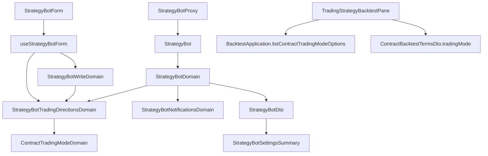

# 交易方向搬到機器人與回測、每種結論的通知（操作台） — Architecture Design

**Status:** Confirmed
**Source PRD:** `.sdd/2026-11-11-bot-trading-direction/PRD.md`
**Tech context:** Nuxt 4 · Vue 3 `<script setup>` · Clean/Onion（.vue → Application → Domain ← Proxy）· Vitest

---

## 1. Design Goal & Guiding Principle

- **In one sentence:** 交易模式整條從交易策略的寫入／讀取／表單／清單拔掉；合約交易策略的回測沿用既有 `ContractBacktestTermsDto.tradingMode` 送出挑好的那一種；機器人多 `tradingDirections`（合約）與 `notifications`（全部），由 proxy 讀寫、Domain 算出說明與標籤、表單以勾選呈現。
- **Guiding principle:** **方向 → 交易模式的對照只住在 `StrategyBotTradingDirectionsDomain`**（它把方向清單轉成 `ContractTradingModeDomain`，名字與說明全部借既有那張表），**通知的預設與說法只住在 `StrategyBotNotificationsDomain`**。表單說明、詳細區、清單標記都問這兩個物件——下一個方向或通知種類只改一處。

---

## 2. Change Scope

| Area | Action | What / Why |
| :--- | :--- | :--- |
| `TradingStrategy` entity / `TradingStrategyDto` / `TradingStrategyWriteDto` / `TradingStrategyDomain` / `TradingStrategyWriteDomain` | **Modify** | 移除 `tradingMode` / `tradingModeLabel`；交易服務不再回、也不收 |
| `TradingStrategyProxy` | **Modify** | wire 不再讀 `tradingMode`；body 不再送 |
| `useTradingStrategyForm` / `TradingStrategyWorkbench.vue` / `pages/trading-strategies/[id].vue` | **Modify** | 拿掉交易模式那一格、說明與 `contractTradingModeOptions` |
| `TradingStrategyApplication.listContractTradingModeOptions` / `TradingStrategyService.listContractTradingModeOptions` | **Remove** | 再沒有呼叫端 |
| `TradingStrategyListPanel.vue` | **Modify** | 不再標交易模式 |
| `TradingStrategyBacktestPane.vue` | **Modify** | 拿掉 `tradingModeLabel` prop 與唯讀註記；改用 `backtestApplication.listContractTradingModeOptions()`，`v-model:trading-mode` 交給 `BacktestConditionFields`，`ContractBacktestTermsDto` 帶挑好的那一種 |
| `BacktestProxy` | **Modify**（註解） | `contractTermsBody` 已在 `tradingMode` 非 null 時送出；只更新「交易策略不送」的註解 |
| `StrategyBot` entity / `StrategyBotDto` / `StrategyBotDomain` | **Modify** | 多 `tradingDirections`、`notifications`；DTO 多 `tradingDirectionsLabel`（合約）與 `notificationsLabel` |
| `StrategyBotWriteDto` / `StrategyBotWriteDomain` | **Modify** | 多 `tradingDirections: readonly TradingDirection[] \| null`（null＝這一種不收）與 `notifications`；`rejection` 加「至少要選一個交易方向」 |
| `StrategyBotPageDto` / `MarketDataKindDomain` 描述 | **Modify** | 多 `takesTradingDirections`（合約 true） |
| `StrategyBotProxy` | **Modify** | wire 讀 `tradingDirections`、`notifications`（缺即預設）；body 送 `tradingDirections`（非 null 時）與 `notifications`；409 `tradingDirectionAutoOrderOn` 翻成新錯誤 |
| `StrategyBotWatchedSymbolNotRemovableError` 訊息 | **Modify** | 同一組原因也擋改方向，說法改成涵蓋兩種 |
| `useStrategyBotForm` / `StrategyBotForm.vue` | **Modify** | 交易方向與通知的勾選狀態、說明、reset、寫入 |
| `StrategyBotListPanel.vue` | **Modify** | 列上標方向；詳細區（旁邊與手機上）放 `StrategyBotSettingsSummary` |
| locales（zh-TW / en） | **Modify** | 新字串；刪掉不再用的交易模式字串 |
| 標的篩選、直接回測腳本、`ContractTradingModeDomain` 本體、回測成績單 | **Not touched** | 它們本來就自己說交易模式；成績單照舊顯示那一次的交易模式 |
| 執行紀錄 / Telegram | **Not touched** | 交易服務處理（API 不變） |

---

## 3. New Classes / Modules

| Name | Kind | Responsibility (purpose) | Collaborators | Satisfies (PRD scenario) |
| :--- | :--- | :--- | :--- | :--- |
| `TradingDirection` (`'long' \| 'short'`) + `TRADING_DIRECTIONS` | VO（字面量 union） | 交易方向的拼法，與交易服務同值 | — | US-03 |
| `StrategyBotTradingDirectionsDomain` | Domain Model | 以宣告的方向清單建立（正規化、去重、照固定順序）；`isEmpty`、`rejection`（至少一個）、`toContractTradingMode()`（只做多／只做空／多空反手）、`label()`（「做多＋做空（多空反手）」）、`description()`（買入、賣出各代表什麼） | `ContractTradingModeDomain` | US-03, US-05 |
| `StrategyBotNotificationsDto` | DTO | 三個開關（buy / sell / hold） | — | US-04 |
| `StrategyBotNotificationsDomain` | Domain Model | 從 DTO 建立；`label()`（「買入、賣出」／「全部關閉」） | — | US-04, US-05 |
| `StrategyBotTradingDirectionLockedError` | 哨兵錯誤 | 409 `tradingDirectionAutoOrderOn`：說出先到詳細頁關掉自動下單 | `LocalizedError` | US-03 |
| `AppCheckbox.vue` | Atom | 一個勾選（`v-model` 布林、slot 文字）；專案第一個勾選元件，一個 UI 概念一個元件 | — | US-03, US-04 |
| `StrategyBotSettingsSummary.vue` | Molecule | 詳細區那一組 `<dl>`：交易方向（有才畫）、通知 | `StrategyBotDto` | US-05 |

預設（兩個方向、買入開／賣出開／持有關）只寫在 Domain 一處：`STRATEGY_BOT_DEFAULT_TRADING_DIRECTIONS` 與 `StrategyBotNotificationsDto` 的預設值由 Domain 檔匯出，proxy 與表單都引用它。

---

## 4. Modified Components

| Component | Current role | Change needed |
| :--- | :--- | :--- |
| `StrategyBotProxy.toStrategyBot` | 讀機器人 | 合約：`tradingDirections` 缺或空即兩者；現貨一律空清單；`notifications` 每一格缺即預設 |
| `StrategyBotProxy.toBody` | 組 body | `tradingDirections` 非 null 時送陣列；`notifications` 一律送 `{buy,sell,hold}` |
| `StrategyBotProxy.strategyBotFailureOf` | 409 分流 | 在 watched-symbol 原因之前認 `tradingDirectionAutoOrderOn` |
| `StrategyBotDomain.toDto` | 算畫面形狀 | 用兩個新 Domain 算出 `tradingDirectionsLabel`（合約才有）、`notificationsLabel` |
| `useStrategyBotForm` | 表單狀態 | `tradesLong` / `tradesShort` / `notifyBuy` / `notifySell` / `notifyHold` refs；`tradingDirectionsDescription` computed 問 Domain；`buildWriteDto` 帶方向（`page.takesTradingDirections` 才帶）與通知 |
| `TradingStrategyBacktestPane` | 重演交易策略 | 交易模式改成挑的 |

---

## 5. Component Relationships

---

## 6. Extensibility & Handoff Notes

- **Most likely next requirement:** 逐種結論決定自動下單，或第四種通知（例如衝突）。
- **Where it lands:** 通知是 `StrategyBotNotificationsDto` 多一格＋`StrategyBotNotificationsDomain.label()` 多一個名字＋表單多一個 `AppCheckbox`＋proxy 多一個鍵。
- **Patterns applied & why:** 方向轉交易模式借 `ContractTradingModeDomain` 的名字與說明——機器人說明與回測選單因此說同一句話。
- **Do not hardcode:** 預設方向與預設通知只在 Domain 檔。
- **Known debt / deferred:** 交易方向被擋下的「還有持倉」說法不點名標的（交易服務原句只有中文）。

---

## 7. Traceability

| PRD Scenario | Fulfilled by |
| :--- | :--- |
| US-01 拼合約交易策略時沒有交易模式 | `TradingStrategyWorkbench.vue`（移除那一格與說明） |
| US-01 存合約交易策略不帶交易模式 | `TradingStrategyWriteDto`/`TradingStrategyProxy` body |
| US-01 清單不再標交易模式 | `TradingStrategyListPanel.vue`、`TradingStrategyDto` |
| US-02 挑只做空回測 | `TradingStrategyBacktestPane` → `ContractBacktestTermsDto.tradingMode` → `BacktestProxy.contractTermsBody`；說明來自 `ContractTradingModeOptionDto.description` |
| US-02 沒動交易模式 | 同上（預設第一個選項多空反手） |
| US-02 現貨交易策略沒有交易模式 | `BacktestConditionFields`（`replaysOnContractAccount` 才畫）＋ `backtestRun.run` 不帶 terms |
| US-03 新拼一台合約機器人 | `useStrategyBotForm.reset`（預設兩者）＋`StrategyBotTradingDirectionsDomain.description` |
| US-03 只勾做多 | `StrategyBotTradingDirectionsDomain.description` |
| US-03 只勾做空 | 同上 |
| US-03 兩個都不勾 | `StrategyBotWriteDomain.rejection` → `StrategyBotTradingDirectionsDomain.rejection` |
| US-03 現貨機器人沒有交易方向 | `StrategyBotPageDto.takesTradingDirections`、write DTO `null`、proxy 不送 |
| US-03 打開既有的合約機器人 | `useStrategyBotForm.reset` 讀 `StrategyBotDto.tradingDirections` |
| US-03 送出時帶著勾選的方向 | `StrategyBotProxy.toBody` |
| US-03 自動下單開著時改方向 | `StrategyBotProxy` → `StrategyBotTradingDirectionLockedError`；workbench 留頁 |
| US-03 監聽標的還有機器人持倉時改方向 | `StrategyBotWatchedSymbolNotRemovableError`（新說法） |
| US-03 監聽標的還有沒做完的自動下單時改方向 | 同上 |
| US-04 新拼一台機器人的預設通知 | `useStrategyBotForm.reset` ＋ 通知預設 |
| US-04 勾持有通知送出 | `StrategyBotProxy.toBody` |
| US-04 三個都不勾 | `StrategyBotWriteDomain`（不擋） |
| US-04 打開既有的機器人 | `useStrategyBotForm.reset` 讀 `StrategyBotDto.notifications` |
| US-05 合約機器人的詳細區 | `StrategyBotDomain.toDto` → `StrategyBotSettingsSummary` |
| US-05 現貨機器人通知全關 | `StrategyBotNotificationsDomain.label` ＋ summary 不畫方向 |
| US-05 清單那一列標出方向 | `StrategyBotListPanel.vue` 讀 `tradingDirectionsLabel`（簡稱，例如「只做空」） |
