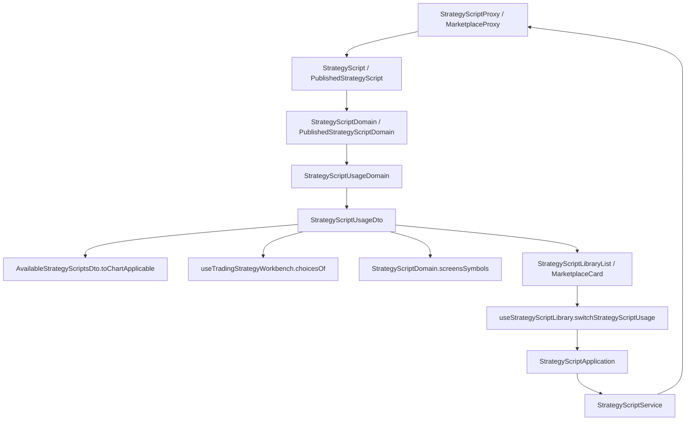

# 策略腳本的用途（操作台） — Architecture Design

**Status:** Confirmed
**Source PRD:** `.sdd/2026-11-11-strategy-script-usage/PRD.md`
**Tech context:** Nuxt 4 · Vue 3 `<script setup>` · Clean/Onion（.vue → Application → Domain ← Proxy）· Vitest

---

## 1. Design Goal & Guiding Principle

- **In one sentence:** proxy 把 `usage` 讀進兩種腳本 entity（自己的、市集／副本），`StrategyScriptUsageDomain` 把它正規化並交出一份 `StrategyScriptUsageDto`（值、標籤、切換目標、切換鍵上的字、`appliesToChart`、`feedsCalculation`）掛在 `StrategyScriptDto` 與 `PublishedStrategyScriptDto` 上；每個挑腳本的地方只問那兩個布林；新增送 `usage`、切換走新的 `PUT /strategy-scripts/:id/usage`。
- **Guiding principle:** **用途的每一條規則只住在 `StrategyScriptUsageDomain`**（預設、認不得的讀法、標籤、切到哪裡）。消費端只讀 `usage.appliesToChart` / `usage.feedsCalculation`——第三種用途是 VO 多一個值、Domain 多一列描述，消費端一行不改。

---

## 2. Change Scope

| Area | Action | What / Why |
| :--- | :--- | :--- |
| `StrategyScript` / `PublishedStrategyScript` entity | **Modify** | 多 `usage: string`（原樣） |
| `StrategyScriptDomain` / `PublishedStrategyScriptDomain` | **Modify** | `toDto` 帶 `usage: StrategyScriptUsageDto`；`screensSymbols` 加 `feedsCalculation` |
| `StrategyScriptDto` / `PublishedStrategyScriptDto` | **Modify** | 多 `usage` |
| `AvailableStrategyScriptsDto.toChartApplicable` | **Modify** | 只留 `usage.appliesToChart` 的（只有圖表用它） |
| `StrategyScriptProxy` | **Modify** | wire 讀 `usage`；create body 送 `usage`（write DTO 有值時），update 不送；新增 `switchStrategyScriptUsage(id, usage)`；409 `strategyScriptUsageInUse` 照後端原句往上 |
| `StrategyScriptMarketplaceProxy` | **Modify** | wire 讀 `usage` |
| `IStrategyScriptProxy` | **Modify** | 多 `switchStrategyScriptUsage` |
| `StrategyScriptWriteDto` / `StrategyScriptWriteDomain` | **Modify** | 多 `usage: StrategyScriptUsage \| null`（null＝不送：改寫／改名） |
| `StrategyScriptService` / `StrategyScriptApplication` | **Modify** | 多 `switchStrategyScriptUsage(id, usage)` 回 `void`（之後重讀清單） |
| `useStrategyScriptLibrary` | **Modify** | `createStrategyScript(name, description, usage)`；`switchStrategyScriptUsage(id, usage)`：成功說一句、重讀；失敗顯示錯誤 |
| `StrategyScriptNameDialog.vue` | **Modify** | `asksUsage` 時多一組單選（選項由 Application 給） |
| `StrategyScriptLibraryList.vue` / `StrategyScriptLibraryDialog.vue` / `IndicatorCalculationPanel.vue` | **Modify** | 每列用途標記＋切換鍵；事件往上接到 library composable |
| `MarketplaceStrategyScriptCard.vue` | **Modify** | 多一格用途 |
| `SignalSourceChoicesDomain`（原 `useTradingStrategyWorkbench.choicesOf`） + `TradingStrategySignalSourceCard` | **Modify** | 選項只收 `feedsCalculation`；圖表用另給一句挑不得的原因；新 shortage `noCalculationStrategyScripts` |
| `ChartIndicatorPanel.vue` 空清單文字 | **Modify** | 改說「沒有圖表用的策略腳本」與下一步（現貨與合約兩份） |
| `RememberedAppliedIndicatorsDomain` | **Not touched** | 它只從可挑清單還原；清單已濾掉計算用 |
| 策略腳本頁的挑選清單（`StrategyScriptPicker`）、試算 | **Not touched** | 作者試算兩種用途都行 |
| 回測被拒絕的呈現 | **Not touched** | 交易服務原句走既有 `requestRejected` |

---

## 3. New Classes / Modules

| Name | Kind | Responsibility (purpose) | Collaborators | Satisfies (PRD scenario) |
| :--- | :--- | :--- | :--- | :--- |
| `StrategyScriptUsage` (`'chart' \| 'calculation'`) + `STRATEGY_SCRIPT_USAGES` | VO | 用途的拼法，與交易服務同值 | — | US-01 |
| `StrategyScriptUsageDomain` | Domain Model | 解讀宣告（空白／認不得 → 計算用）；`toDto()`；`toOptionDto()`（新增對話框的單選） | — | US-01–US-05 |
| `StrategyScriptUsageDto` | DTO | `value`、`label`、`switchTarget`、`switchLabel`（「改成圖表用」）、`appliesToChart`、`feedsCalculation` | — | US-02–US-05 |
| `StrategyScriptUsageOptionDto` | DTO | 單選上的一個選項：值、名字、說明 | — | US-01 |

`StrategyScriptApplication.listUsageOptions()` 交出兩個選項；預設選項是 `StrategyScriptUsageDomain('')` 的值，不另寫一次。

---

## 4. Modified Components

| Component | Current role | Change needed |
| :--- | :--- | :--- |
| `StrategyScriptProxy.writeStrategyScript` | 建立與改寫共用 body | `usage` 只在 `writeDomain.usage !== null` 時放進 body；建立呼叫端給值、改寫給 null |
| `StrategyScriptProxy.strategyScriptFailureOf` | 409 當撞名 | 409 帶 `reason === 'strategyScriptUsageInUse'` 時原樣交出 `BackendRequestRejectedError`（它的 `localizedMessage` 就是後端點名那一句），不當成撞名 |
| `SignalSourceChoicesDomain`（原 `useTradingStrategyWorkbench.choicesOf`） | 挑訊號來源 | 可挑：`signal` 且 `feedsCalculation`；挑不得：非信號 → 舊說法，圖表用 → 新說法；shortage 依挑不得的原因分三種 |

---

## 5. Component Relationships

---

## 6. Extensibility & Handoff Notes

- **Most likely next requirement:** 第三種用途（例如篩選用），或某處只收圖表用。
- **Where it lands:** VO 加一個值、`StrategyScriptUsageDomain` 的描述表加一列（標籤、說明、`appliesToChart`／`feedsCalculation`）；切換目標若不再是二選一，`switchTarget` 改成選單——消費端不動。
- **Do not hardcode:** 預設用途只在 `StrategyScriptUsageDomain`。
- **Known debt / deferred:** 無。實作後 improve-codebase 已把訊號來源的可挑判斷從 composable（`SignalSourceChoicesDomain`）搬進 `SignalSourceChoicesDomain` / `SignalSourceCandidateDomain`，經 `StrategyScriptApplication.listSignalSourceChoices` 交給工作台。

---

## 7. Traceability

| PRD Scenario | Fulfilled by |
| :--- | :--- |
| US-01 另存成圖表用 | `StrategyScriptNameDialog`（單選）→ `useStrategyScriptLibrary.createStrategyScript` → `StrategyScriptWriteDto.usage` → proxy create body |
| US-01 沒動用途 | 對話框預選 `StrategyScriptUsageDomain('')` 的值（計算用） |
| US-01 改名時不問用途 | 對話框 `asksUsage=false`；rename/save 送 `usage=null`，proxy 不放 |
| US-02 自己的腳本改成圖表用 | `StrategyScriptLibraryList` 切換鍵 → `switchStrategyScriptUsage` → proxy PUT → 重讀；成功訊息 |
| US-02 市集副本改成圖表用 | 同上（副本列也有切換鍵） |
| US-02 圖表用改回計算用 | 同上（`switchTarget`） |
| US-02 被交易策略用著 | proxy 409 → `BackendRequestRejectedError` → library `errorMessage` 顯示原句；清單不變 |
| US-03 圖表用、畫得成線 | `AvailableStrategyScriptsDto.toChartApplicable`（`appliesToChart`） |
| US-03 計算用、畫得成線 | 同上（濾掉） |
| US-03 圖表用、畫不成線 | `ChartIndicatorPanel` 既有 `drawableOnChart` 停用 |
| US-03 一支圖表用的都沒有 | `ChartIndicatorPanel` 空清單文字（現貨與合約） |
| US-03 上次擺著的指標現在是計算用 | 可挑清單已濾掉 → `RememberedAppliedIndicatorsDomain` 找不到它 |
| US-04 計算用、吐訊號 | `SignalSourceChoicesDomain`（`feedsCalculation` 且 signal） |
| US-04 圖表用、吐訊號 | `SignalSourceChoicesDomain` 挑不得原因 `chartUsageStrategyScript` |
| US-04 吐訊號的全是圖表用 | `SignalSourceChoicesDomain` shortage `noCalculationStrategyScripts` → `TradingStrategySignalSourceCard` |
| US-04 計算用但吐數字 | `SignalSourceChoicesDomain` 既有規則 |
| US-04 篩選不列圖表用 | `StrategyScriptDomain.screensSymbols` |
| US-05 市集卡標圖表用 | `PublishedStrategyScriptDomain` → `MarketplaceStrategyScriptCard` |
| US-05 市集卡標計算用 | 同上 |
| US-05 副本留著加入當下的用途 | proxy 讀副本自己的 `usage`（交易服務存副本自己的值） |
| US-05 交易服務沒說用途 | `StrategyScriptUsageDomain`（空白 → 計算用） |
